# 🗺️ Wiki de acesso aos dados

> ℹ️ Esta página reúne **como acessar os dados publicados pelo projeto Áreas Protegidas SC** sobre as Unidades de Conservação de Santa Catarina e seus entornos: os serviços de mapa, o QGIS, o Excel, o Power BI, o SQL e o Python, com o dicionário de dados e 15 consultas prontas. Os números de cobertura são um **retrato de 02/11/2026** e crescem com as cargas semanais.
{.is-info}

> ⚠️ **ATENÇÃO:** os serviços de mapa e o download em CSV são **abertos e sem senha**. O acesso ao banco exige um login, e o administrador entrega o usuário, a senha e o endereço do servidor por canal privado. Nunca publique esses dados em relatórios, repositórios ou mensagens de grupo.
{.is-warning}

---

## Comece por aqui

Este guia foi escrito para servir tanto a quem **nunca abriu um programa de mapas** quanto a quem já usa SQL. Você não precisa ler tudo. Escolha abaixo o cartão que mais combina com você e siga os passos na ordem. Cada passo tem imagens da tela, com números que mostram onde clicar.

<div class="cards">
<div class="card c-green">
<span class="card-emoji">🌱</span>
<strong>Nunca usei mapas no computador</strong>
<span class="time">cerca de 40 minutos</span>
<ol>
<li><a href="#conceitos-básicos-leia-antes-de-começar">Conceitos básicos</a></li>
<li><a href="#31-instalar-o-qgis-no-windows">Instalar o QGIS</a></li>
<li><a href="#33-conhecendo-a-tela-do-qgis">Conhecer a tela</a></li>
<li><a href="#35-seu-primeiro-mapa-o-mapa-base">Seu primeiro mapa</a></li>
<li><a href="#36-ver-as-ucs-no-mapa-wms">Ver as UCs no mapa</a></li>
</ol>
</div>
<div class="card c-orange">
<span class="card-emoji">📊</span>
<strong>Só quero uma planilha</strong>
<span class="time">cerca de 15 minutos</span>
<ol>
<li><a href="#uc-zona-de-amortecimento-e-buffer-de-abrangência">UC e entorno</a></li>
<li><a href="#43-antes-de-importar-separador-decimal">Configurar o Excel</a></li>
<li><a href="#42-uma-url-pronta-para-cada-base">Escolher a URL pronta</a></li>
<li><a href="#44-importando-no-excel">Importar no Excel</a></li>
</ol>
</div>
<div class="card">
<span class="card-emoji">🧭</span>
<strong>Já uso QGIS ou ArcGIS</strong>
<span class="time">cerca de 10 minutos</span>
<ol>
<li><a href="#2-os-serviços-de-mapa-wms-wmts-wfs-e-wcs">Os serviços de mapa</a></li>
<li><a href="#37-baixar-as-feições-com-os-atributos-wfs">Conectar o WFS</a></li>
<li><a href="#8-dicionário-de-dados">Dicionário de dados</a></li>
<li><a href="#313-receitas-de-análise-no-qgis">Receitas de análise</a></li>
</ol>
</div>
<div class="card c-purple">
<span class="card-emoji">🧑‍💻</span>
<strong>Sei SQL, Power BI ou Python</strong>
<span class="time">cerca de 10 minutos</span>
<ol>
<li><a href="#6-dbeaver-e-outros-clientes-sql">Conectar ao banco</a></li>
<li><a href="#8-dicionário-de-dados">Dicionário de dados</a></li>
<li><a href="#9-consultas-prontas">15 consultas prontas</a></li>
<li><a href="#10-acesso-por-python">Python</a></li>
</ol>
</div>
</div>

> 💡 **Dica para quem está começando:** faça **um passo de cada vez** e só passe para o próximo quando a tela estiver igual à imagem do guia. Se algo sair diferente, procure o sintoma no capítulo [7. Problemas comuns](#7-problemas-comuns). Clique em qualquer imagem para vê-la em tela cheia, e use **Esc** ou o **✕** para voltar.
{.is-success}

### Como ler as caixas coloridas

As caixas coloridas seguem sempre o mesmo código, para você saber de longe o que cada uma traz:

<div class="legend">
<span class="l-concept">📘 Conceito: explica uma ideia nova</span>
<span class="l-info">ℹ️ Informação: contexto útil</span>
<span class="l-ok">💡 Dica: atalho ou boa prática</span>
<span class="l-warn">⚠️ Atenção: erro comum a evitar</span>
<span class="l-check">✅ Confira: como saber se deu certo</span>
</div>

---

## Sumário

- [Comece por aqui](#comece-por-aqui)
- [Visão geral](#visão-geral)
- [Mapa do acesso](#mapa-do-acesso)
- [Conceitos básicos (leia antes de começar)](#conceitos-básicos-leia-antes-de-começar)
- [1. Apresentação](#1-apresentação)
- [2. Os serviços de mapa (WMS, WMTS, WFS e WCS)](#2-os-serviços-de-mapa-wms-wmts-wfs-e-wcs)
- [3. QGIS](#3-qgis)
- [4. Excel](#4-excel)
- [5. Power BI Desktop](#5-power-bi-desktop)
- [6. DBeaver e outros clientes SQL](#6-dbeaver-e-outros-clientes-sql)
- [7. Problemas comuns](#7-problemas-comuns)
- [8. Dicionário de dados](#8-dicionário-de-dados)
- [9. Consultas prontas](#9-consultas-prontas)
- [10. Acesso por Python](#10-acesso-por-python)
- [11. Oficinas: modo eventos](#11-oficinas-modo-eventos)
- [12. Cobertura e limitações dos dados](#12-cobertura-e-limitações-dos-dados)
- [13. Créditos e citação das fontes](#13-créditos-e-citação-das-fontes)
- [14. Siglas](#14-siglas)
- [Para aprender mais](#para-aprender-mais)
- [Referências](#referências)

---

## Visão geral

| | |
|---|---|
| **O que é** | Os dados de monitoramento ambiental das 186 Unidades de Conservação (UCs) de Santa Catarina e de seus entornos, já recortados e prontos para análise: desmatamento (PRODES e MapBiomas Alerta), focos de calor (NASA FIRMS) e uso e cobertura da terra (MapBiomas). |
| **Quem usa** | Pesquisadores e estudantes do projeto de extensão, participantes de oficinas e qualquer pessoa que queira analisar as UCs de Santa Catarina. |
| **Como acessar** | Pelo endereço [areasprotegidas-sc.com](https://areasprotegidas-sc.com): serviços de mapa e CSV sem senha, e banco de dados com login de leitura. |
| **Como os dados chegam** | Um pipeline em Apache Airflow baixa as fontes oficiais, recorta cada tema nas UCs e nos entornos e publica o resultado no banco PostGIS e no GeoServer. Alertas e focos são atualizados toda segunda-feira. |

| Ferramenta | Acesso | Senha | Para quê |
|---|---|:---:|---|
| [QGIS, ArcGIS e outros GIS](#3-qgis) | WMS, WMTS, WFS, WCS | não | Ver mapas, baixar feições e o raster MapBiomas |
| [Excel](#4-excel) | WFS em CSV | não | Tabelas atualizáveis e gráficos dinâmicos |
| [Power BI](#5-power-bi-desktop) | banco ou WFS em CSV | banco: sim | Painéis com várias bases relacionadas |
| [DBeaver e clientes SQL](#6-dbeaver-e-outros-clientes-sql) | banco PostgreSQL | sim | Consultas livres e espaciais em SQL |
| [Python](#10-acesso-por-python) | WFS ou banco | banco: sim | Análises reprodutíveis com pandas e geopandas |

---

## Mapa do acesso

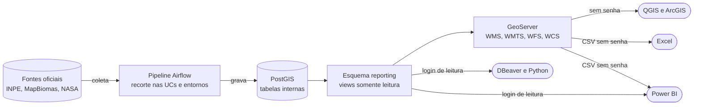

> ℹ️ Ninguém de fora acessa as tabelas internas. Tudo o que é publicado passa pelo **esquema reporting**, e o GeoServer lê essa mesma camada. Por isso um mapa no QGIS, uma planilha no Excel e uma consulta SQL mostram sempre os mesmos números.
{.is-info}

---

## Conceitos básicos (leia antes de começar)

Esta seção explica, sem código, as poucas ideias que aparecem em todo o guia. Se você nunca trabalhou com mapas no computador, leia com calma: são cerca de 10 minutos e evitam a sensação de "não sei o que fazer com tanta informação". Quem já conhece pode pular para o [capítulo 1](#1-apresentação).

### Dado geoespacial

> 📘 **Conceito:** um **dado geoespacial** é uma informação que tem **onde** além de **o quê**. Uma planilha comum diz "foco de calor, 12/08/2024, intensidade 15 MW". Um dado geoespacial diz isso **e** a posição exata do foco na Terra (longitude e latitude). É a posição que permite desenhar o dado num mapa e cruzá-lo com outros dados, por exemplo "este foco caiu dentro do Parque Estadual da Serra do Tabuleiro?".
{.is-concept}

Todos os dados deste projeto são geoespaciais: cada UC tem o seu desenho (limite), cada foco de calor tem um ponto e cada pixel do MapBiomas tem uma posição.

### Vetor e raster: as duas formas de guardar um mapa

<div class="concept-fig">
<svg viewBox="0 0 860 300" role="img" aria-label="Comparação entre dado vetorial (ponto, linha e polígono) e dado raster (grade de pixels)">
  <rect x="10" y="10" width="410" height="280" rx="12" fill="none" stroke="currentColor" stroke-opacity=".25"/>
  <text x="215" y="40" text-anchor="middle" font-size="18" font-weight="700">VETOR: desenhos com atributos</text>
  <polygon points="40,110 120,80 190,105 200,180 130,215 55,190" fill="#2e7d32" fill-opacity=".35" stroke="#1b5e20" stroke-width="3"/>
  <text x="120" y="240" text-anchor="middle" font-size="14">Polígono: uma UC</text>
  <polyline points="230,200 260,150 300,165 330,110 380,95" fill="none" stroke="#1976d2" stroke-width="4"/>
  <text x="310" y="240" text-anchor="middle" font-size="14">Linha: um rio</text>
  <circle cx="150" cy="140" r="7" fill="#e53935" stroke="#7f0000" stroke-width="2"/>
  <circle cx="345" cy="185" r="7" fill="#e53935" stroke="#7f0000" stroke-width="2"/>
  <text x="215" y="272" text-anchor="middle" font-size="14">● Ponto: um foco de calor</text>
  <rect x="440" y="10" width="410" height="280" rx="12" fill="none" stroke="currentColor" stroke-opacity=".25"/>
  <text x="645" y="40" text-anchor="middle" font-size="18" font-weight="700">RASTER: uma grade de pixels</text>
  <g transform="translate(505,60)">
    <rect x="0" y="0" width="28" height="28" fill="#1f8d49"/><rect x="28" y="0" width="28" height="28" fill="#1f8d49"/><rect x="56" y="0" width="28" height="28" fill="#edde8e"/><rect x="84" y="0" width="28" height="28" fill="#edde8e"/><rect x="112" y="0" width="28" height="28" fill="#ffefc3"/><rect x="140" y="0" width="28" height="28" fill="#ffefc3"/><rect x="168" y="0" width="28" height="28" fill="#d4271e"/>
    <rect x="0" y="28" width="28" height="28" fill="#1f8d49"/><rect x="28" y="28" width="28" height="28" fill="#1f8d49"/><rect x="56" y="28" width="28" height="28" fill="#1f8d49"/><rect x="84" y="28" width="28" height="28" fill="#edde8e"/><rect x="112" y="28" width="28" height="28" fill="#edde8e"/><rect x="140" y="28" width="28" height="28" fill="#ffefc3"/><rect x="168" y="28" width="28" height="28" fill="#d4271e"/>
    <rect x="0" y="56" width="28" height="28" fill="#1f8d49"/><rect x="28" y="56" width="28" height="28" fill="#1f8d49"/><rect x="56" y="56" width="28" height="28" fill="#1f8d49"/><rect x="84" y="56" width="28" height="28" fill="#1f8d49"/><rect x="112" y="56" width="28" height="28" fill="#7a5900"/><rect x="140" y="56" width="28" height="28" fill="#7a5900"/><rect x="168" y="56" width="28" height="28" fill="#ffefc3"/>
    <rect x="0" y="84" width="28" height="28" fill="#2532e4"/><rect x="28" y="84" width="28" height="28" fill="#1f8d49"/><rect x="56" y="84" width="28" height="28" fill="#1f8d49"/><rect x="84" y="84" width="28" height="28" fill="#1f8d49"/><rect x="112" y="84" width="28" height="28" fill="#7a5900"/><rect x="140" y="84" width="28" height="28" fill="#edde8e"/><rect x="168" y="84" width="28" height="28" fill="#edde8e"/>
    <rect x="0" y="112" width="28" height="28" fill="#2532e4"/><rect x="28" y="112" width="28" height="28" fill="#2532e4"/><rect x="56" y="112" width="28" height="28" fill="#1f8d49"/><rect x="84" y="112" width="28" height="28" fill="#edde8e"/><rect x="112" y="112" width="28" height="28" fill="#edde8e"/><rect x="140" y="112" width="28" height="28" fill="#edde8e"/><rect x="168" y="112" width="28" height="28" fill="#ffefc3"/>
    <rect x="28" y="28" width="28" height="28" fill="none" stroke="#ff6f00" stroke-width="4"/>
    <g stroke="#ffffff" stroke-opacity=".5"><path d="M0 28H196M0 56H196M0 84H196M0 112H196M28 0V140M56 0V140M84 0V140M112 0V140M140 0V140M168 0V140" fill="none"/></g>
  </g>
  <text x="645" y="232" text-anchor="middle" font-size="14">Cada quadradinho (pixel) guarda um número:</text>
  <text x="645" y="252" text-anchor="middle" font-size="14">o código da classe. 3 = Formação Florestal.</text>
  <text x="645" y="274" text-anchor="middle" font-size="14">No MapBiomas, cada pixel tem 30 m × 30 m.</text>
</svg>
</div>

*Figura A. À esquerda, dados vetoriais (as UCs, os polígonos do PRODES e dos alertas e os pontos dos focos). À direita, um dado raster (o mapa de uso e cobertura do MapBiomas).*

> 📘 **Conceito:** no **vetor**, cada objeto é um desenho (ponto, linha ou polígono) acompanhado de uma linha de planilha com as informações dele. No **raster**, o mapa é uma imagem quadriculada, como uma foto, e cada pixel guarda um número. Uma analogia: o vetor é um **desenho a lápis com etiquetas**, o raster é um **mosaico de azulejos coloridos**.
{.is-concept}

| **Neste projeto** | **Tipo** | **Exemplo** |
|----|----|----|
| UCs, ZAs, Buffers, PRODES, MapBiomas Alerta | vetor (polígono) | o limite do Parque Nacional de São Joaquim |
| FIRMS | vetor (ponto) | um foco de calor detectado pelo satélite |
| MapBiomas Uso e Cobertura (mapa anual) | raster | o mapa de Santa Catarina em 2025, pixel a pixel |
| MapBiomas Uso e Cobertura (mapbiomas_clip) | tabela, sem desenho | a área de floresta de cada UC em cada ano, já calculada |

Para se aprofundar: [Introdução ao SIG, dados vetoriais](https://docs.qgis.org/latest/pt_BR/docs/gentle_gis_introduction/vector_data.html) e [dados raster](https://docs.qgis.org/latest/pt_BR/docs/gentle_gis_introduction/raster_data.html), da documentação oficial do QGIS em português.

### Camada, feição e atributo

> 📘 **Conceito:** um mapa no computador é montado como **folhas transparentes empilhadas**. Cada folha é uma **camada** (por exemplo, "UCs" ou "focos de calor"). Cada objeto de uma camada é uma **feição** (uma UC, um foco). As informações de cada feição são os **atributos**, organizados numa **tabela de atributos** que funciona como uma planilha: cada linha é uma feição, cada coluna é um atributo (nome, área, data...).
{.is-concept}

A ordem das camadas importa: a camada que está **em cima** na lista é desenhada **por cima** no mapa. Por isso o mapa base (o "fundo", com ruas e cidades) fica sempre por último na lista. Veja mais em [Dados de atributos vetoriais](https://docs.qgis.org/latest/pt_BR/docs/gentle_gis_introduction/vector_attribute_data.html).

### Sistema de referência de coordenadas (SRC)

> 📘 **Conceito:** a Terra é redonda e a tela é plana. O **sistema de referência de coordenadas** (SRC, ou CRS em inglês) é a "regra de tradução" entre os dois. Cada sistema tem um código **EPSG**. Não é preciso decorar nada: o QGIS converte entre eles sozinho, desde que cada camada saiba em que sistema está, e as deste projeto já sabem.
{.is-concept}

| **Código** | **Nome** | **Onde aparece neste guia** |
|----|----|----|
| [EPSG:4674](https://epsg.io/4674) | SIRGAS 2000 (graus de longitude e latitude) | sistema oficial do Brasil, usado em **todos os dados** publicados |
| EPSG:3857 | Pseudo-Mercator | mapas da web, como o OpenStreetMap. O QGIS usa este quando você começa pelo mapa base |
| [EPSG:31982](https://epsg.io/31982) | SIRGAS 2000 / UTM zona 22S (metros) | quando você precisa **medir** distâncias ou áreas em metros em Santa Catarina |

> ⚠️ **Atenção:** nunca calcule área ou distância numa camada em graus (EPSG:4674). Um "grau" não tem tamanho fixo em metros. Para medir, reprojete para EPSG:31982 ou use as colunas de área que já vêm calculadas no projeto. Leia mais em [Sistemas de referência de coordenadas](https://docs.qgis.org/latest/pt_BR/docs/gentle_gis_introduction/coordinate_reference_systems.html).
{.is-warning}

### Mapa base

> 📘 **Conceito:** o **mapa base** é o fundo de referência (ruas, cidades, rios, relevo) sobre o qual você coloca os seus dados, como o mapa de papel embaixo das folhas transparentes. O mais usado é o **OpenStreetMap**, gratuito e já incluído no QGIS. Ele serve só para orientação: não é um dado de análise.
{.is-concept}

### UC, Zona de Amortecimento e Buffer de Abrangência

<div class="concept-fig">
<svg viewBox="0 0 860 330" role="img" aria-label="Uma UC com o seu entorno e três focos de calor: um dentro da UC, um no entorno e um fora">
  <text x="215" y="30" text-anchor="middle" font-size="17" font-weight="700">UC sem ZA oficial: entorno = Buffer de 3.000 m</text>
  <path d="M95 175 C 90 95, 170 60, 230 80 C 300 100, 345 140, 330 205 C 315 265, 220 285, 160 265 C 110 250, 98 225, 95 175 Z" fill="#1976d2" fill-opacity=".08" stroke="#1565c0" stroke-width="3" stroke-dasharray="10 7" transform="translate(-30,-25) scale(1.15)"/>
  <path d="M125 175 C 120 115, 180 95, 230 110 C 280 125, 305 150, 295 200 C 285 240, 220 250, 175 238 C 140 228, 127 210, 125 175 Z" fill="#2e7d32" fill-opacity=".35" stroke="#1b5e20" stroke-width="3"/>
  <text x="212" y="182" text-anchor="middle" font-size="16" font-weight="700">UC</text>
  <circle cx="240" cy="205" r="8" fill="#e53935" stroke="#7f0000" stroke-width="2"/>
  <circle cx="345" cy="120" r="8" fill="#e53935" stroke="#7f0000" stroke-width="2"/>
  <circle cx="405" cy="255" r="8" fill="#9e9e9e" stroke="#424242" stroke-width="2"/>
  <text x="140" y="305" font-size="13">● dentro da UC → tipo_cruzamento = UC</text>
  <text x="300" y="98" font-size="13">● no anel → BUFFER_ABRANGENCIA</text>
  <text x="330" y="285" font-size="13">● fora do entorno → não entra</text>
  <line x1="440" y1="20" x2="440" y2="320" stroke="currentColor" stroke-opacity=".2"/>
  <text x="650" y="30" text-anchor="middle" font-size="17" font-weight="700">UC com ZA oficial: entorno = ZA</text>
  <path d="M520 170 C 515 90, 600 55, 680 70 C 770 90, 815 150, 790 220 C 770 280, 660 300, 590 280 C 540 265, 522 230, 520 170 Z" fill="#ef6c00" fill-opacity=".15" stroke="#e65100" stroke-width="3"/>
  <path d="M585 175 C 580 125, 630 105, 680 118 C 730 130, 750 160, 740 200 C 730 235, 670 245, 630 235 C 600 227, 588 208, 585 175 Z" fill="#2e7d32" fill-opacity=".35" stroke="#1b5e20" stroke-width="3"/>
  <text x="665" y="182" text-anchor="middle" font-size="16" font-weight="700">UC</text>
  <text x="760" y="110" font-size="15" font-weight="700" fill="#e65100" style="fill:#e65100">ZA</text>
  <circle cx="560" cy="230" r="8" fill="#e53935" stroke="#7f0000" stroke-width="2"/>
  <text x="520" y="315" font-size="13">● no anel laranja → tipo_cruzamento = ZA</text>
</svg>
</div>

*Figura B. Cada UC é analisada em duas partes que não se sobrepõem: a própria UC e o anel do entorno. O entorno é a ZA oficial, quando existe, ou o Buffer de Abrangência de 3.000 m.*

> 📘 **Conceito:** a **Unidade de Conservação (UC)** é a área protegida criada por lei, como um parque ou uma APA ([Lei nº 9.985/2000, SNUC](https://www.planalto.gov.br/ccivil_03/leis/l9985.htm)). A **Zona de Amortecimento (ZA)** é a faixa ao redor da UC com regras de uso definidas oficialmente. Só 12 das 186 UCs têm ZA cadastrada. Para as demais, o projeto desenha um **Buffer de Abrangência**: uma faixa de 3.000 m ao redor da UC, que serve só para análise e **não tem valor jurídico**.
{.is-concept}

A coluna **tipo_cruzamento** (ou **aoi_type**, no MapBiomas) diz em qual parte cada registro caiu: `UC`, `ZA` ou `BUFFER_ABRANGENCIA`. Ela aparece em quase todas as tabelas e é o filtro mais usado do guia.

> ⚠️ **Atenção:** algumas UCs se sobrepõem (um parque dentro de uma APA, por exemplo). Por isso, um mesmo foco pode aparecer em duas UCs. Somar UCs diferentes pode contar o mesmo foco duas vezes. A soma **por UC** está sempre correta.
{.is-warning}

### Serviço de mapa e URL

> 📘 **Conceito:** um **serviço de mapa** é um endereço na internet (uma **URL**) que entrega dados quando recebe um pedido. Pense numa **janela de pedidos de uma lanchonete**: você não entra na cozinha (o banco de dados), só faz o pedido pela janela e recebe o prato pronto. A URL é o pedido escrito: ela diz **qual camada**, **em qual formato** e **com qual filtro** você quer os dados.
{.is-concept}

O servidor que atende esses pedidos se chama **GeoServer**. Os pedidos seguem padrões internacionais (WMS, WFS, WCS e WMTS), por isso funcionam no QGIS, no ArcGIS, no Excel, no Power BI e no Python. O [capítulo 2](#2-os-serviços-de-mapa-wms-wmts-wfs-e-wcs) explica cada um, e você pode testar um agora mesmo: [clique aqui para pedir ao servidor um mapa das UCs](https://areasprotegidas-sc.com/geoserver/protected_areas_sc/wms?service=WMS&version=1.1.1&request=GetMap&layers=buffer_abrangencia,za_oficial,uc&styles=&bbox=-54.0,-29.45,-48.2,-25.9&width=980&height=600&srs=EPSG:4674&format=image/png&bgcolor=0xFFFFFF). O navegador abre uma imagem como a da Figura C.

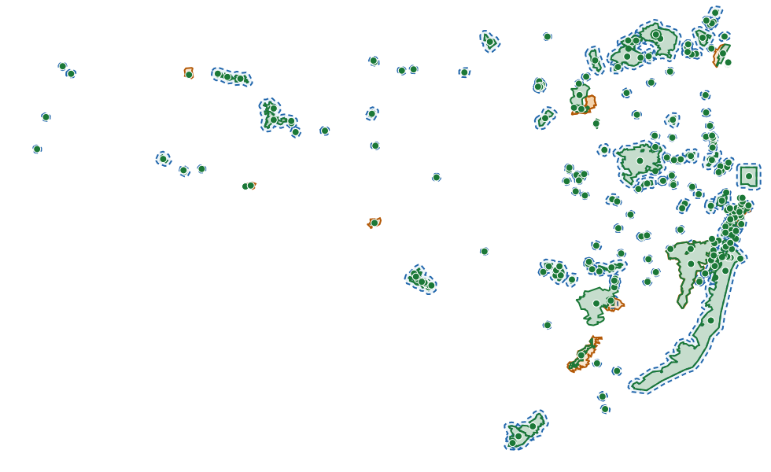

*Figura C. Resposta real do serviço WMS a um pedido feito pelo navegador: UCs (verde), ZAs oficiais (laranja) e Buffers de Abrangência (azul tracejado).*

### Tabela, CSV, banco de dados e SQL

> 📘 **Conceito:** um **CSV** é uma planilha em texto puro, com as colunas separadas por vírgula, que qualquer programa abre. Um **banco de dados** é um "arquivo de planilhas" profissional, que guarda muitas tabelas relacionadas e responde perguntas rápido. **SQL** é a língua usada para fazer essas perguntas, por exemplo "quantos focos houve em cada UC em 2024?". Uma **view** é uma tabela pronta para leitura, montada a partir das tabelas internas. Você só enxerga as views do esquema **reporting**, e elas não podem ser alteradas.
{.is-concept}

Você **não precisa** saber SQL para usar este guia: o QGIS e o Excel acessam os dados pelos serviços de mapa, sem senha e sem código.

### Glossário rápido do que aparece na tela

| **Termo** | **O que significa na prática** |
|----|----|
| Projeto (.qgz) | o arquivo do QGIS que guarda as camadas abertas, as cores e o enquadramento. Não guarda os dados em si |
| Camada | uma "folha" do mapa: UCs, focos, mapa base |
| Feição | um objeto da camada: uma UC, um foco |
| Atributo | uma informação da feição: nome, área, data |
| Tabela de atributos | a planilha com todas as feições de uma camada |
| Simbologia | as cores, espessuras e símbolos usados para desenhar a camada |
| Extensão | o retângulo da área visível no mapa |
| Zoom e panorâmica | aproximar ou afastar o mapa, e arrastá-lo para os lados |
| Filtro | uma condição que esconde as feições que não interessam, por exemplo só o ano de 2024 |
| Reprojetar | converter a camada de um sistema de coordenadas para outro |
| Exportar ("Salvar como") | gravar uma cópia da camada no seu computador, num formato de arquivo |

---

## 1. Apresentação

> 💡 **Primeira vez aqui?** Comece pelo cartão certo em [Comece por aqui](#comece-por-aqui) e leia os [Conceitos básicos](#conceitos-básicos-leia-antes-de-começar). Este capítulo é um resumo para quem já conhece as ferramentas.
{.is-success}

Este guia mostra como os operadores do projeto Áreas Protegidas SC acessam os dados que o sistema publica sobre as Unidades de Conservação (UCs) de Santa Catarina e seus entornos: desmatamento (PRODES e MapBiomas Alerta), focos de calor (NASA FIRMS) e uso e cobertura da terra (MapBiomas).

Ele cobre quatro formas de acesso, da mais simples para a mais técnica:

- **Softwares de GIS** (QGIS, ArcGIS e similares), pelos serviços de mapa WMS, WMTS, WFS e WCS, sem senha;
- **Excel**, baixando tabelas do serviço WFS em formato CSV, também sem senha;
- **Power BI**, conectado ao banco de dados com login;
- **DBeaver** (ou outro cliente SQL), conectado ao banco com login, para consultas livres em SQL.

O [capítulo 8](#8-dicionário-de-dados) traz o dicionário de dados: o que cada tabela contém, de onde vem cada dado, como ele foi gerado e para que serve. O [capítulo 9](#9-consultas-prontas) reúne 15 consultas prontas para análises de geoprocessamento e sensoriamento remoto. Os capítulos 10 a 13 tratam do acesso por Python, das oficinas com o modo eventos, da cobertura e das limitações de cada base e de como citar as fontes.

### 1.1 Como o acesso está organizado

Ninguém de fora acessa as tabelas de produção do sistema. Tudo o que é publicado passa por uma camada de leitura, o esquema reporting, formado por views (tabelas virtuais) que mostram só os produtos prontos, sem dados internos de operação. O GeoServer, servidor de mapas do projeto, lê essa camada e a oferece como serviços web. Quem precisa de SQL conecta direto nessa mesma camada, sempre em modo somente leitura.

O [mapa do acesso](#mapa-do-acesso), no início desta página, mostra esses caminhos.

### 1.2 Qual credencial usar

**Tabela 1.** Ferramenta, forma de acesso e credencial.

| **Ferramenta** | **Acesso** | **Credencial** |
|----|----|----|
| QGIS, ArcGIS e outros softwares de GIS | WMS, WMTS, WFS, WCS | nenhuma |
| Excel | WFS em CSV (Dados &gt; Da Web) | nenhuma |
| Power BI | conector PostgreSQL | login de banco |
| DBeaver ou outro cliente SQL | PostgreSQL | login de banco |

Existem dois logins de banco para pessoas:

**Tabela 2.** Logins de banco para pessoas.

| **Login** | **Para quem** | **Como obter** | **Validade** |
|----|----|----|----|
| login do laboratório | grupo fixo do laboratório (projeto de extensão) | usuário, senha e endereço do servidor repassados pelo administrador, por canal privado | permanente; a senha muda quando alguém sai do grupo |
| ws\_&lt;instituição&gt;\_&lt;data&gt; | participantes de uma oficina | o administrador lê no painel, aba Modo eventos, botão Mostrar dados de acesso | só enquanto o modo eventos estiver ativo |

Os dois têm as mesmas permissões: leem apenas as views de reporting, não conseguem gravar nada e têm limite de tempo por consulta (220 segundos no login do laboratório, 120 no login do evento) e de conexões simultâneas (12 no login do laboratório).

> ⚠️ **Atenção:** A conta do painel (administrador ou operador) **não** dá acesso ao banco. E os serviços de mapa (WMS, WFS, WCS) **não pedem senha**: se você preencher usuário e senha neles, o servidor responde com erro 401.
{.is-warning}


## 2. Os serviços de mapa (WMS, WMTS, WFS e WCS)

> 📘 **Conceito:** os quatro serviços são quatro "janelas de pedido" diferentes no mesmo servidor. Cada uma devolve o dado num formato: imagem pronta (WMS e WMTS), feições com atributos (WFS) ou o raster original (WCS). Se ainda não leu, veja [Serviço de mapa e URL](#serviço-de-mapa-e-url) nos conceitos básicos.
{.is-concept}

Os serviços seguem padrões abertos do Open Geospatial Consortium ([OGC](https://www.ogc.org/standards/)), o que permite usá-los em qualquer software de GIS. A diferença entre eles está no que cada um devolve:

**Tabela 3.** Diferença entre os serviços OGC.

| **Serviço** | **O que devolve** | **Analogia** | **Use quando** |
|----|----|----|----|
| WMS (Web Map Service) | uma imagem pronta do mapa, já colorida | uma fotografia do mapa | quiser ver e sobrepor camadas, montar um layout |
| WMTS (Web Map Tile Service) | o mesmo mapa em ladrilhos pré-gerados | um álbum de fotos já impressas | precisar de navegação rápida (oficinas, muitas pessoas) |
| WFS (Web Feature Service) | as feições vetoriais com todos os atributos (também em CSV ou JSON) | a planilha com o desenho de cada polígono ou ponto | for analisar, filtrar, calcular, exportar |
| WCS (Web Coverage Service) | o raster com o valor original de cada pixel | o arquivo de imagem de satélite classificado | for fazer análise raster (MapBiomas) |

Todos partem do mesmo endereço base, mas cada um tem o seu final. A base sozinha não funciona.

> 💡 **Qual escolher?** Para **ver** um mapa, use WMS (ou WMTS, mais rápido). Para **analisar**, filtrar, contar ou levar ao Excel, use WFS. Para trabalhar com os **pixels** do MapBiomas, use WCS. Na dúvida, comece pelo WMS no QGIS ([seção 3.6](#36-ver-as-ucs-no-mapa-wms)).
{.is-success}

**Tabela 4.** Endereços dos serviços.

| **Serviço** | **URL** |
|----|----|
| WMS | https://areasprotegidas-sc.com/geoserver/protected_areas_sc/wms |
| WMTS | https://areasprotegidas-sc.com/geoserver/protected_areas_sc/gwc/service/wmts |
| WFS | https://areasprotegidas-sc.com/geoserver/protected_areas_sc/wfs |
| WCS | https://areasprotegidas-sc.com/geoserver/protected_areas_sc/wcs |
| Todos (endereço único, útil em scripts) | https://areasprotegidas-sc.com/geoserver/protected_areas_sc/ows |

### 2.1 Camadas publicadas

**Tabela 5.** Camadas e serviços disponíveis.

| **Camada** | **WMS** | **WFS** | **WCS** | **Conteúdo** |
|----|----|----|----|----|
| uc | sim | sim |  | Unidades de Conservação |
| za_oficial | sim | sim |  | Zonas de Amortecimento oficiais |
| buffer_abrangencia | sim | sim |  | Buffers de Abrangência de 3.000 m |
| prodes_clip | sim | sim |  | Desmatamento PRODES recortado |
| mapbiomas_alerta_clip | sim | sim |  | Alertas MapBiomas recortados |
| firms_clip | sim | sim |  | Focos de calor |
| mapbiomas_raster_asset | sim | sim |  | Catálogo dos rasters MapBiomas |
| mapbiomas_clip |  | sim |  | Área por classe MapBiomas (tabela, sem geometria) |
| mapbiomas_legend_class |  | sim |  | Legenda MapBiomas (tabela, sem geometria) |
| mapbiomas_uso_cobertura\_&lt;ano&gt; | sim |  | sim | Mapa MapBiomas de cada ano, de 1985 a 2025 |

No WFS, os nomes levam o prefixo protected_areas_sc: (por exemplo, protected_areas_sc:uc). No WCS, o prefixo é protected_areas_sc\_\_.

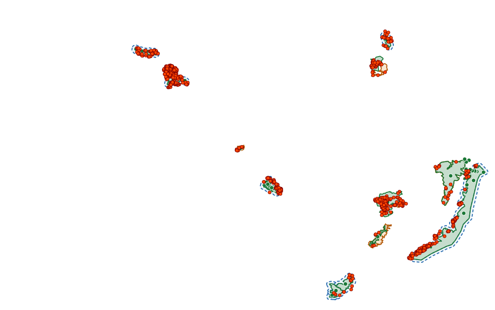

*Figura 1. Resposta real do WMS: UCs, Zonas de Amortecimento (laranja), Buffers de Abrangência (azul tracejado) e focos de calor.*

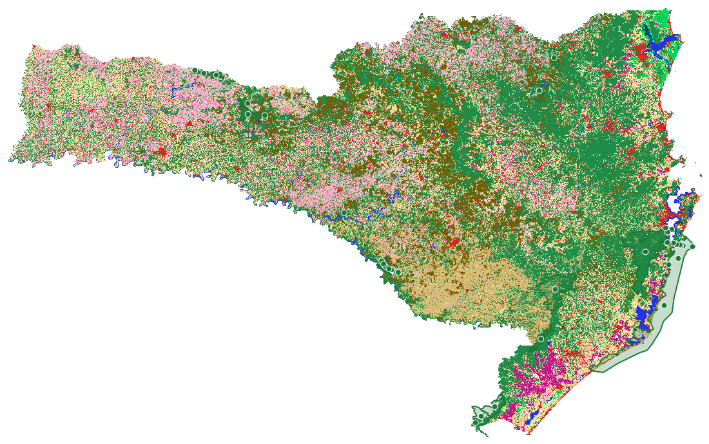

*Figura 2. Resposta real do WMS: MapBiomas 2025 em Santa Catarina com as UCs sobrepostas.*

### 2.2 Baixar arquivos direto pelo navegador

O WFS também entrega arquivos prontos. Cole a URL no navegador e o download começa. Troque uc pelo nome da camada desejada:

**Tabela 6.** Formatos de download do WFS.

| **Formato** | **Parâmetro** | **Exemplo** |
|----|----|----|
| CSV (planilha) | outputFormat=csv | https://areasprotegidas-sc.com/geoserver/protected_areas_sc/wfs?service=WFS&version=2.0.0&request=GetFeature&typeNames=protected_areas_sc:uc&outputFormat=csv |
| GeoJSON (geometria e atributos) | outputFormat=application/json | https://areasprotegidas-sc.com/geoserver/protected_areas_sc/wfs?service=WFS&version=2.0.0&request=GetFeature&typeNames=protected_areas_sc:uc&outputFormat=application/json |
| Shapefile compactado (.zip) | outputFormat=SHAPE-ZIP | https://areasprotegidas-sc.com/geoserver/protected_areas_sc/wfs?service=WFS&version=2.0.0&request=GetFeature&typeNames=protected_areas_sc:uc&outputFormat=SHAPE-ZIP |

> ⚠️ **Atenção:** O Shapefile corta nomes de coluna em 10 caracteres e separa as feições por tipo de geometria (polígonos e pontos em arquivos diferentes). Para guardar os dados com nomes completos, prefira GeoJSON ou, no QGIS, exporte a camada WFS para GeoPackage.
>
> Todas as geometrias vêm em SIRGAS 2000 (EPSG:4674), com 8 casas decimais.
{.is-warning}


### 2.3 Descobrir as colunas e baixar em partes

Para listar as colunas e os tipos de uma camada, sem baixar dados:

```text
https://areasprotegidas-sc.com/geoserver/protected_areas_sc/wfs?service=WFS&version=2.0.0&request=DescribeFeatureType&typeNames=protected_areas_sc:firms_clip&outputFormat=application/json
```

Para saber quantos registros uma consulta devolve, sem baixá-los, use resultType=hits (a resposta traz numberMatched):

```text
https://areasprotegidas-sc.com/geoserver/protected_areas_sc/wfs?service=WFS&version=2.0.0&request=GetFeature&typeNames=protected_areas_sc:prodes_clip&resultType=hits
```

Para baixar em partes (por exemplo, de 1.000 em 1.000), combine count e startIndex: a primeira parte usa startIndex=0, a segunda startIndex=1000, e assim por diante. O serviço aceita até 1.000.000 de registros por requisição, mais do que todas as bases têm hoje; a divisão só é útil em conexões lentas.

Para se aprofundar nos parâmetros, veja a documentação do GeoServer sobre [WMS](https://docs.geoserver.org/stable/en/user/services/wms/index.html) e [WFS](https://docs.geoserver.org/stable/en/user/services/wfs/index.html) (em inglês).

## 3. QGIS

> 📘 **Conceito:** o **QGIS** é um programa **gratuito e de código aberto** para ver, analisar e montar mapas. É o equivalente livre do ArcGIS, funciona em Windows, macOS e Linux e está em português. Com ele você abre as camadas do projeto, cruza com os seus próprios dados, filtra, mede, calcula estatísticas e monta mapas para relatório.
{.is-concept}

Este capítulo começa do zero: instalar, conhecer a tela, fazer o primeiro mapa e só depois analisar. As telas foram capturadas no QGIS 3.28 em português. Nas versões mais novas, a aparência muda um pouco, mas os menus e os passos são os mesmos. Os números laranja nas imagens seguem a ordem dos passos do texto.

### 3.1 Instalar o QGIS no Windows

1. Abra o site oficial [qgis.org/download](https://qgis.org/download/). Baixe o QGIS **só** desse endereço.
2. A primeira tela pede uma doação, que é opcional. Para baixar sem doar, clique em **Skip it and go to download** (passo 1 da Figura 1).

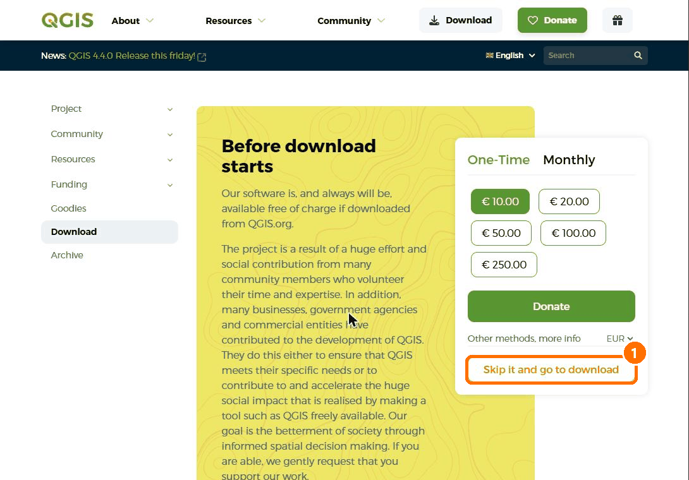

*Figura 1. Página de download do QGIS: o botão laranja "Skip it and go to download" leva aos instaladores.*

3. Confira se o sistema escolhido é **Windows** (passo 1 da Figura 2).
4. Clique em **Download LTR** (passo 2). LTR quer dizer *Long Term Release*, a versão de longo prazo, mais estável e indicada para quem está começando.

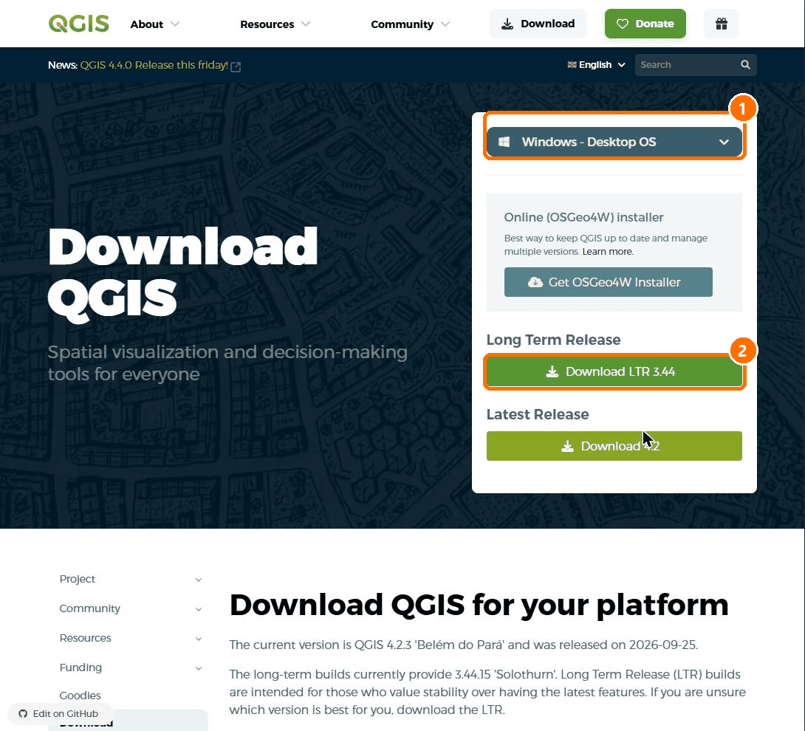

*Figura 2. Escolha do sistema operacional (1) e da versão de longo prazo, LTR (2).*

5. Quando o download terminar, abra o arquivo baixado (algo como `QGIS-OSGeo4W-3.44.x.msi`) na pasta **Downloads**.
6. No instalador, clique em **Next**, marque **I accept the terms in the License Agreement**, clique em **Next** de novo, mantenha a pasta sugerida e clique em **Install**. Se o Windows perguntar se o programa pode fazer alterações, responda **Sim**.
7. A instalação leva alguns minutos. Ao final, clique em **Finish**.

> ✅ **Confira:** no menu Iniciar do Windows aparece uma pasta **QGIS 3.44** com o atalho **QGIS Desktop 3.44**. É ele que você vai usar. Os outros atalhos da pasta (OSGeo4W Shell, Qt Designer e semelhantes) são ferramentas avançadas e podem ser ignorados.
{.is-check}

> 💡 **Dica:** no macOS e no Linux, escolha o seu sistema na mesma página (passo 1 da Figura 2) e siga as instruções que aparecem. Em computadores do laboratório sem permissão de administrador, peça à equipe de TI para instalar a versão LTR.
{.is-success}

### 3.2 Abrir o QGIS e criar um projeto

1. Abra o **QGIS Desktop** pelo menu Iniciar. A primeira abertura demora um pouco mais.
2. Aparece a tela de boas-vindas (Figura 3), com notícias e projetos recentes. Dê dois cliques em **Novo Projeto Vazio**, à direita, ou use o atalho <kbd>Ctrl</kbd>+<kbd>N</kbd>.

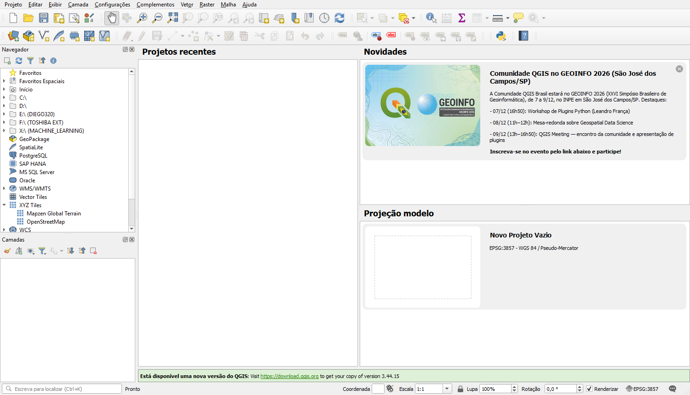

*Figura 3. Tela de boas-vindas do QGIS. "Novo Projeto Vazio" fica à direita, abaixo de "Projeção modelo".*

> 📘 **Conceito:** um **projeto** do QGIS é como uma pasta de trabalho: guarda quais camadas estão abertas, as cores de cada uma e a área do mapa que você estava olhando. Salve com <kbd>Ctrl</kbd>+<kbd>S</kbd> (o arquivo termina em **.qgz**). Os dados do projeto Áreas Protegidas SC continuam no servidor: ao reabrir o projeto, o QGIS busca a versão mais recente.
{.is-concept}

### 3.3 Conhecendo a tela do QGIS

Com um mapa aberto, a tela tem seis áreas. Vale a pena olhar a Figura 4 com calma antes de seguir: ela é o "mapa" que você vai usar em todos os passos seguintes.

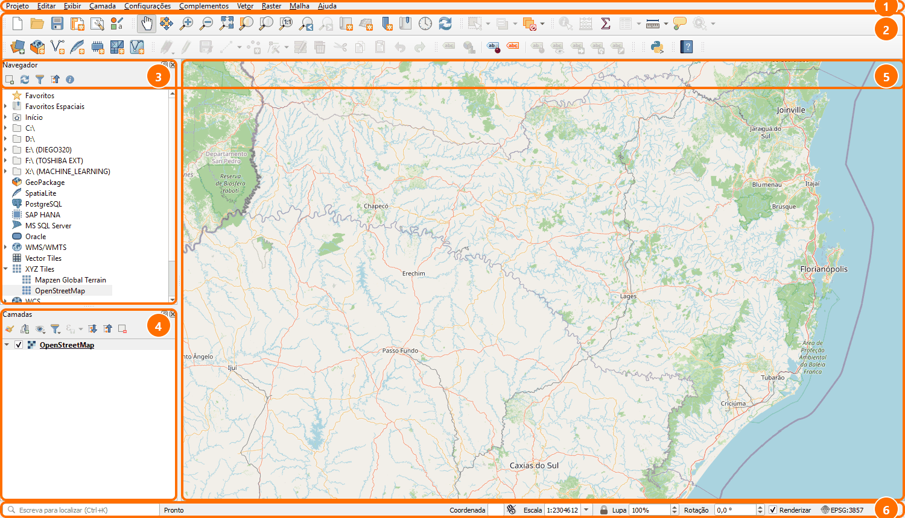

*Figura 4. As seis áreas da tela do QGIS, numeradas de acordo com a tabela abaixo.*

| **Nº** | **Área** | **Para que serve** |
|:--:|----|----|
| 1 | Barra de menus | todos os comandos do programa, agrupados por assunto: Projeto, Camada, Vetor, Raster... |
| 2 | Barras de ferramentas | atalhos com ícones para os comandos mais usados: abrir, salvar, mover o mapa, aproximar, identificar |
| 3 | Navegador | mostra as pastas do computador e as conexões com servidores. Dá para arrastar camadas daqui para o mapa |
| 4 | Painel Camadas | a lista das "folhas" do mapa. A caixinha liga e desliga cada camada, e a ordem define quem fica por cima |
| 5 | Área do mapa | onde o mapa é desenhado |
| 6 | Barra de status | mostra a coordenada do cursor, a escala e, no canto direito, o sistema de coordenadas do projeto (aqui EPSG:3857) |

> 💡 **Dica:** se um painel sumir, abra **Exibir > Painéis** e marque de novo **Navegador** ou **Camadas**. Para voltar ao layout padrão, feche e abra o QGIS.
{.is-success}

### 3.4 Mover o mapa e atalhos essenciais

Você não precisa decorar tudo. Comece pelos quatro primeiros atalhos da tabela e consulte o resto quando precisar.

| **Para** | **Faça** |
|----|----|
| Aproximar ou afastar | gire a **roda do mouse** sobre o mapa |
| Arrastar o mapa | segure a **barra de espaço** e mova o mouse, ou use a ferramenta da **mão** (ícone na barra 2) |
| Ver o estado inteiro de novo | botão direito na camada **uc** > **Aproximar para camada(s)** |
| Voltar para o enquadramento anterior | ícone da lupa com a seta para trás, na barra 2 |
| Novo projeto / Salvar projeto | <kbd>Ctrl</kbd>+<kbd>N</kbd> / <kbd>Ctrl</kbd>+<kbd>S</kbd> |
| Gerenciador de Fontes de Dados (adicionar camadas) | <kbd>Ctrl</kbd>+<kbd>L</kbd> |
| Abrir a tabela de atributos da camada selecionada | <kbd>F6</kbd> |
| Ferramenta Identificar feições | <kbd>Ctrl</kbd>+<kbd>Shift</kbd>+<kbd>I</kbd> |
| Painel de estilo da camada (cores rápidas) | <kbd>F7</kbd> |
| Caixa de Ferramentas de Processamento | <kbd>Ctrl</kbd>+<kbd>Alt</kbd>+<kbd>T</kbd> |
| Procurar qualquer comando ou camada pelo nome | <kbd>Ctrl</kbd>+<kbd>K</kbd> |

A descrição completa de cada parte da tela está no [manual do usuário do QGIS, capítulo Interface](https://docs.qgis.org/latest/pt_BR/docs/user_manual/introduction/qgis_gui.html).

### 3.5 Seu primeiro mapa: o mapa base

O primeiro passo de todo mapa é colocar um fundo de referência, com ruas e cidades, para você se localizar.

1. No painel **Navegador** (área 3 da Figura 4), clique na setinha ao lado de **XYZ Tiles** (passo 1 da Figura 5).
2. Dê dois cliques em **OpenStreetMap** (passo 2).

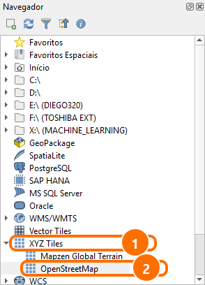

*Figura 5. No Navegador, abra "XYZ Tiles" (1) e dê dois cliques em "OpenStreetMap" (2).*

3. O mapa do mundo aparece. Gire a roda do mouse sobre o sul do Brasil para aproximar até Santa Catarina.

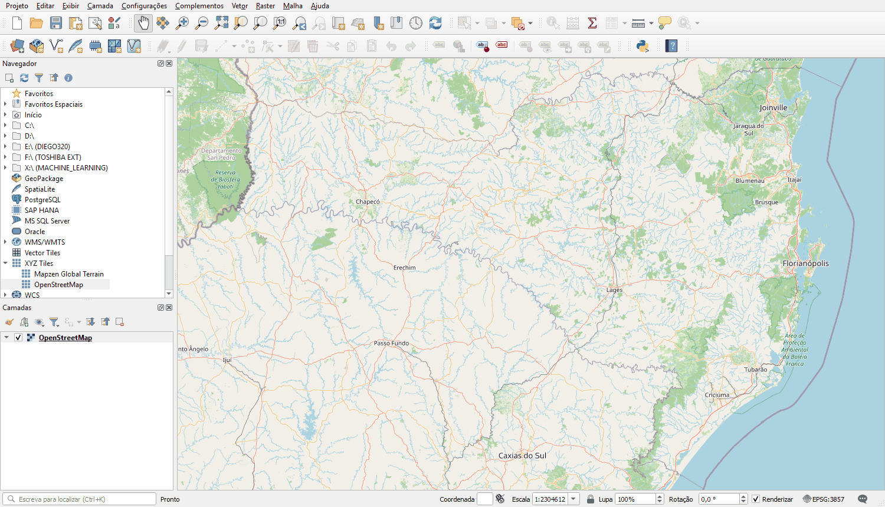

*Figura 6. O mapa base OpenStreetMap aproximado em Santa Catarina. A camada aparece no painel Camadas, à esquerda.*

> ✅ **Confira:** o painel **Camadas** mostra a linha **OpenStreetMap** com a caixinha marcada, e o mapa mostra Florianópolis, Joinville e Chapecó. Se o mapa ficou em branco, verifique a internet: o mapa base vem da web.
{.is-check}

### 3.6 Ver as UCs no mapa (WMS)

O **WMS** entrega o mapa já colorido, pronto para ver. É o jeito mais rápido de enxergar as UCs, as Zonas de Amortecimento e os Buffers. A conexão com o servidor é criada **uma única vez**: depois ela fica salva no seu QGIS.

**Criar a conexão (só na primeira vez)**

1. Abra **Camada > Gerenciador de Fontes de Dados** (atalho <kbd>Ctrl</kbd>+<kbd>L</kbd>).
2. Na lista da esquerda, clique em **WMS/WMTS** e depois no botão **Novo**.
3. Em **Nome**, escreva `Áreas Protegidas SC (WMS)` (passo 1 da Figura 7).
4. Em **URL**, cole o endereço abaixo (passo 2). Use o botão **Copiar** do quadro para não errar nenhuma letra.

```text
https://areasprotegidas-sc.com/geoserver/protected_areas_sc/wms
```

5. Deixe **Autenticação** como está, em **Sem autenticação**, e clique em **OK** (passo 3).

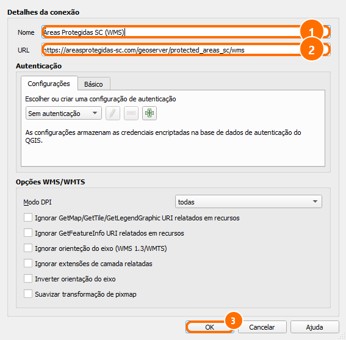

*Figura 7. Janela "Criar uma Nova Conexão WMS": nome (1), URL terminada em /wms (2) e OK (3).*

> ⚠️ **Atenção:** não preencha usuário e senha. Os serviços de mapa são abertos e, com senha, o servidor responde "erro 401". Confira também se a URL termina em **/wms**: um endereço terminado em /wfs ou /wcs nesta janela não funciona.
{.is-warning}

**Adicionar as camadas**

6. De volta ao Gerenciador, confira se a conexão criada está escolhida na lista de cima (passo 1 da Figura 8) e clique em **Conectar** (passo 2).
7. A lista mostra todas as camadas publicadas. Clique na linha **uc** (passo 3). Para escolher várias, segure <kbd>Ctrl</kbd> e clique também em **za_oficial** e **buffer_abrangencia**.
8. Clique em **Adicionar** (passo 4) e depois em **Fechar**.

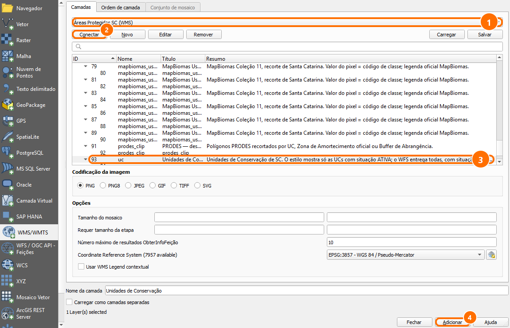

*Figura 8. Gerenciador de Fontes de Dados, aba WMS/WMTS: conexão (1), Conectar (2), camada uc selecionada (3) e Adicionar (4).*

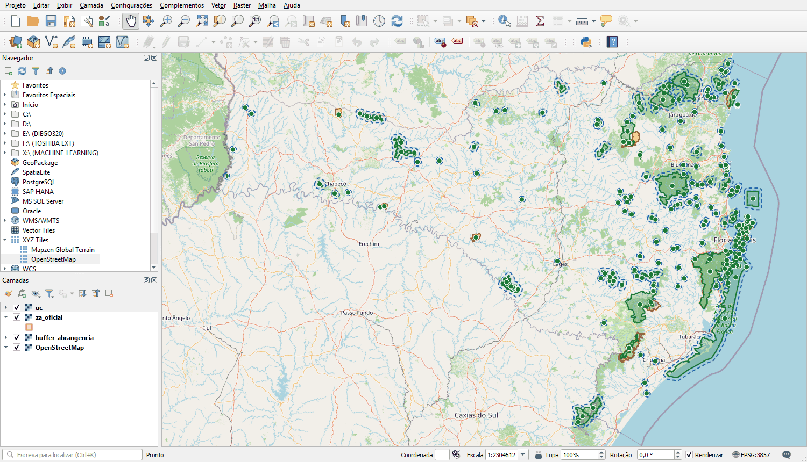

*Figura 9. Resultado: as UCs (verde), as Zonas de Amortecimento oficiais (laranja) e os Buffers de Abrangência (azul tracejado) sobre o mapa base.*

> ✅ **Confira:** o painel Camadas mostra **uc**, **za_oficial**, **buffer_abrangencia** e **OpenStreetMap**, nessa ordem. Aproxime na região de Florianópolis com a roda do mouse: os limites ficam mais detalhados, como na Figura 10.
{.is-check}

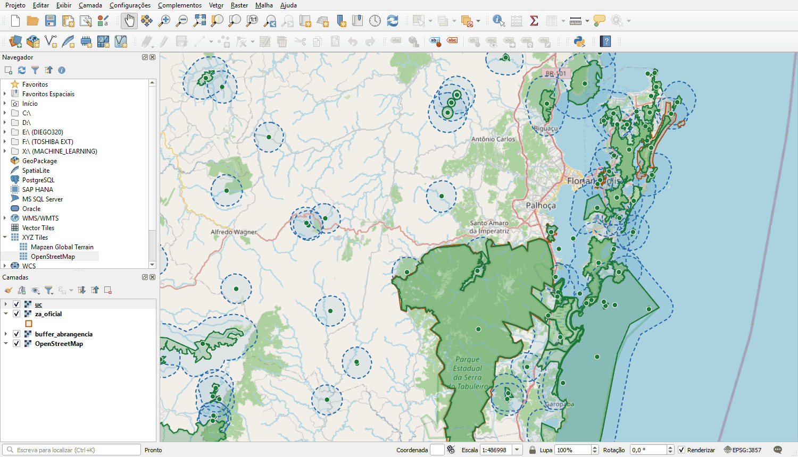

*Figura 10. Aproximando na Grande Florianópolis: o Parque Estadual da Serra do Tabuleiro, as UCs da Ilha e os Buffers de 3.000 m das UCs sem ZA oficial.*

> 💡 **Dica:** para navegar mais rápido, principalmente em oficinas, crie uma segunda conexão igual, com a URL WMTS `https://areasprotegidas-sc.com/geoserver/protected_areas_sc/gwc/service/wmts`. O WMTS entrega o mesmo mapa em ladrilhos pré-gerados.
{.is-success}

### 3.7 Baixar as feições com os atributos (WFS)

O WMS é uma "fotografia": dá para ver, mas não dá para filtrar nem calcular. Para analisar, use o **WFS**, que traz cada feição com todos os seus atributos.

1. Abra o Gerenciador (<kbd>Ctrl</kbd>+<kbd>L</kbd>) e clique em **WFS / OGC API - Feições**.
2. Clique em **Novo**, escreva o nome `Áreas Protegidas SC (WFS)` e cole a URL:

```text
https://areasprotegidas-sc.com/geoserver/protected_areas_sc/wfs
```

3. Em **Versão**, escolha **2.0.0** (ou **Detectar**). Deixe a autenticação em branco e clique em **OK**.
4. Com a conexão escolhida (passo 1 da Figura 11), clique em **Conectar** (passo 2).
5. Clique na linha **Unidades de Conservação** (passo 3) e em **Adicionar** (passo 4).

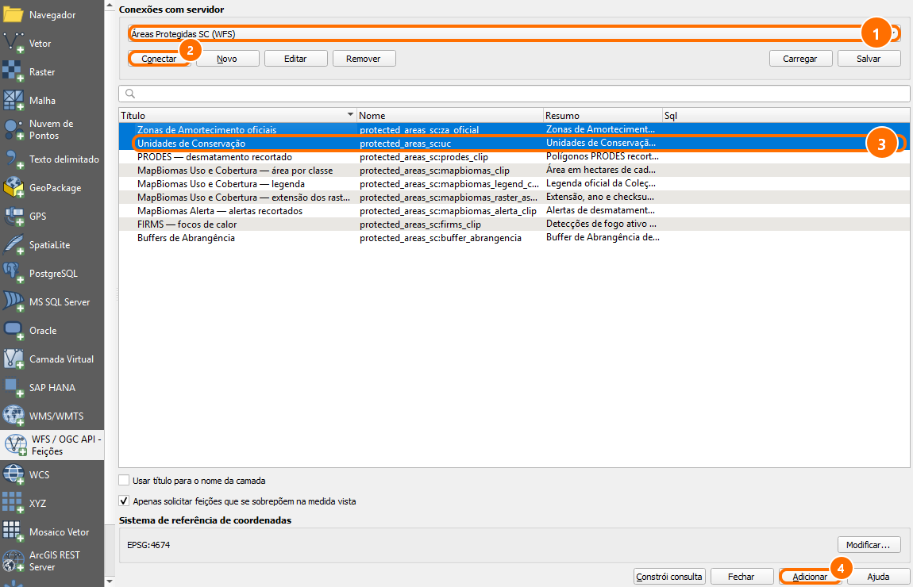

*Figura 11. Aba WFS do Gerenciador: conexão (1), Conectar (2), camada protected_areas_sc:uc (3) e Adicionar (4). Cada camada tem um título em português na primeira coluna.*

> ⚠️ **Atenção:** nas camadas grandes (**firms_clip** e **prodes_clip**), mantenha marcada a opção **Apenas solicitar feições que se sobrepõem na medida vista**, no rodapé da janela. Assim o QGIS baixa só o que está na tela, e o mapa não trava.
{.is-warning}

**Ver os dados de uma UC: a ferramenta Identificar**

6. Clique no ícone **Identificar feições** (o "i" azul com o cursor, destacado no topo da Figura 12) ou use <kbd>Ctrl</kbd>+<kbd>Shift</kbd>+<kbd>I</kbd>.
7. Clique sobre uma UC no mapa (passo 1). Ela fica destacada em vermelho, e o painel **Identificar Resultados** (passo 2) lista todos os atributos dela: nome, categoria, esfera, órgão gestor, área e datas.

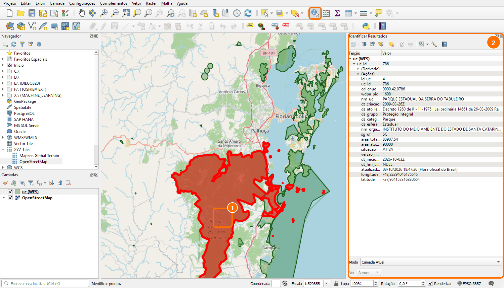

*Figura 12. Ferramenta Identificar: o clique sobre o Parque Estadual da Serra do Tabuleiro (1) mostra os atributos no painel à direita (2).*

**Ver todos os dados de uma vez: a tabela de atributos**

8. No painel Camadas, clique com o botão direito na camada **uc (WFS)** e escolha **Abrir tabela de atributos** (ou selecione a camada e aperte <kbd>F6</kbd>).

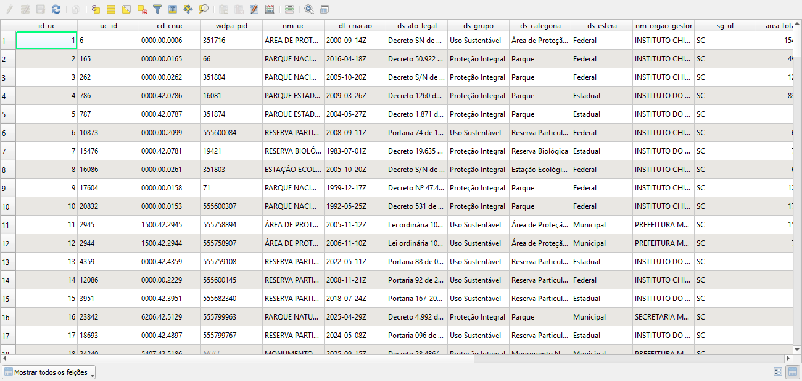

*Figura 13. Tabela de atributos da camada uc: cada linha é uma UC e cada coluna um atributo. Clique no título de uma coluna para ordenar.*

> ✅ **Confira:** a tabela tem uma linha para cada UC cadastrada (186 na leitura de 02/11/2026). O significado de cada coluna está no [dicionário de dados](#8-dicionário-de-dados), seção 8.3.
{.is-check}

### 3.8 Filtrar uma camada

Filtrar é mostrar só o que interessa, por exemplo os focos de calor **dentro** das UCs a partir de 2020. Aqui o exemplo usa a camada **firms_clip** (focos de calor), adicionada pelo WFS como no passo anterior.

1. No painel Camadas, clique com o botão direito em **firms_clip** e escolha **Filtrar...**.
2. Na lista **Campos** (passo 1 da Figura 14), clique em um campo, por exemplo **tipo_cruzamento**.
3. Clique em **Tudo**, abaixo de **Valores** (passo 2), para ver os valores existentes: BUFFER_ABRANGENCIA, UC e ZA.
4. No quadro de baixo (passo 3), escreva a condição. Dê dois cliques nos campos e valores para inseri-los sem erro de digitação.
5. Clique em **Testar** para ver quantas feições passam no filtro e depois em **OK** (passo 4).

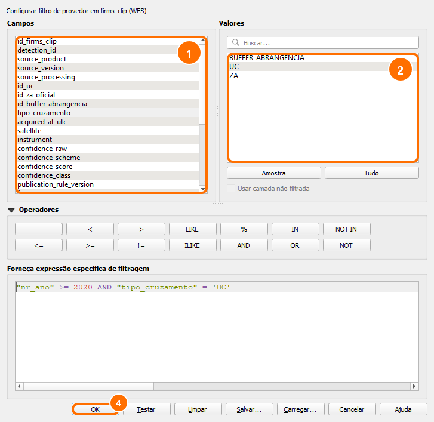

*Figura 14. Construtor de filtro: campos (1), valores do campo escolhido (2), expressão (3) e OK (4).*

Exemplos de filtros prontos para copiar:

```text
"tipo_cruzamento" = 'UC' AND "nr_ano" >= 2020
"source_product" LIKE 'VIIRS%' AND "daynight" = 'N'
"aoi_type" = 'UC' AND "class_code" IN (3, 4, 5, 6, 49)
```

> 💡 **Dica:** nomes de campo vão entre **aspas duplas** ("nr_ano") e textos entre **aspas simples** ('UC'). Um ícone de funil aparece ao lado da camada filtrada. Para remover o filtro, abra **Filtrar...** de novo e clique em **Limpar**.
{.is-success}

### 3.9 Mapa de calor dos focos

O mapa de calor mostra onde os focos se concentram, com cores mais fortes nas áreas com mais focos.

1. Selecione a camada **firms_clip** e abra **Propriedades** (botão direito > **Propriedades**, ou dois cliques na camada). Vá até a aba **Simbologia**.
2. Na lista do topo (passo 1 da Figura 15), troque **Símbolo simples** por **Mapa de calor**.
3. Em **Raio** (passo 2), comece com 10 a 12 milímetros e escolha um **Gradiente de cores** que vá do transparente ao vermelho.
4. Clique em **OK** (passo 3).

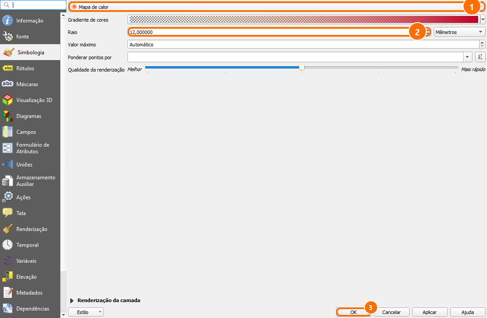

*Figura 15. Aba Simbologia: tipo "Mapa de calor" (1), raio (2) e OK (3).*

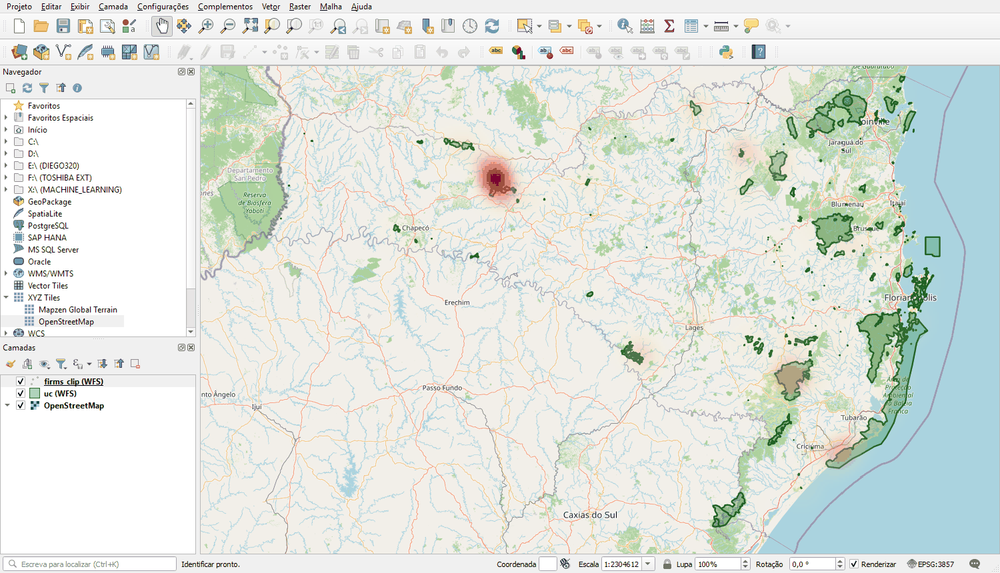

*Figura 16. Mapa de calor dos focos de calor publicados, sobre as UCs (verde) e o mapa base.*

> ⚠️ **Atenção:** o mapa de calor é uma forma de **visualizar**, não uma medida. Para números, conte os focos por UC e por ano ([receita na seção 3.13](#313-receitas-de-análise-no-qgis)). E lembre: um foco é uma detecção de calor num pixel de 375 m (VIIRS) ou 1 km (MODIS), não a área queimada.
{.is-warning}

### 3.10 MapBiomas: ver o mapa (WMS) e baixar o raster (WCS)

**Para ver o mapa de um ano**, use a mesma conexão WMS do [passo 3.6](#36-ver-as-ucs-no-mapa-wms) e adicione a camada **mapbiomas_uso_cobertura_2025** (ou de outro ano, de 1985 a 2025). Ela já vem com as cores oficiais do MapBiomas.

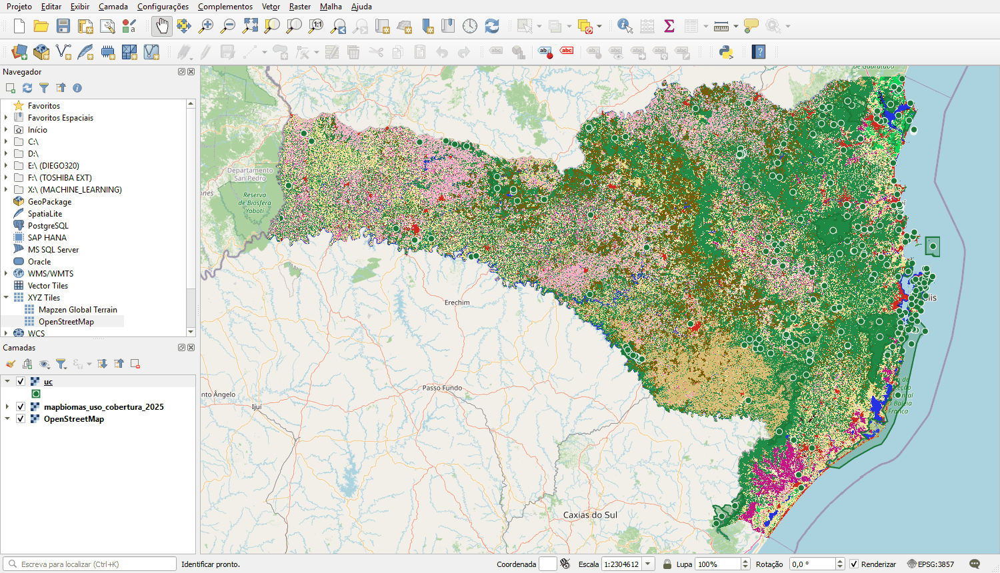

*Figura 17. Uso e cobertura da terra em 2025 (MapBiomas, Coleção 11) pelo WMS, com as UCs por cima.*

**Para analisar os pixels**, baixe o raster pelo **WCS**:

1. No Gerenciador (<kbd>Ctrl</kbd>+<kbd>L</kbd>), clique em **WCS** > **Novo**, dê um nome e cole a URL `https://areasprotegidas-sc.com/geoserver/protected_areas_sc/wcs`. **OK** e **Conectar**.
2. Escolha **protected_areas_sc__mapbiomas_uso_cobertura_&lt;ano&gt;** e clique em **Adicionar**.

> 📘 **Conceito:** o WCS entrega o **código da classe** em cada pixel, sem cores. Um pixel com valor 3 é Formação Florestal, 15 é Pastagem, 24 é Área Urbanizada. A lista completa de códigos está na camada **mapbiomas_legend_class** (WFS) e na [página oficial de códigos de legenda do MapBiomas](https://brasil.mapbiomas.org/codigos-de-legenda/).
{.is-concept}

> 💡 **Dica:** para saber a área de cada classe numa UC ou no entorno, **não** é preciso processar o raster: a tabela **mapbiomas_clip** já traz a área calculada, ano a ano. Use o raster só para áreas desenhadas por você (veja a receita na [seção 3.13](#313-receitas-de-análise-no-qgis)).
{.is-success}

### 3.11 Salvar os dados no seu computador

As camadas WMS e WFS vêm do servidor. Para trabalhar sem internet ou entregar um arquivo, salve uma cópia:

1. Clique com o botão direito na camada (por exemplo **uc (WFS)**) e escolha **Exportar > Salvar feições como...**.
2. Em **Formato** (passo 1 da Figura 18), escolha **GeoPackage**, o formato recomendado.
3. Em **Nome do arquivo** (passo 2), clique nos três pontinhos e escolha a pasta e o nome do arquivo.
4. Clique em **OK** (passo 3).

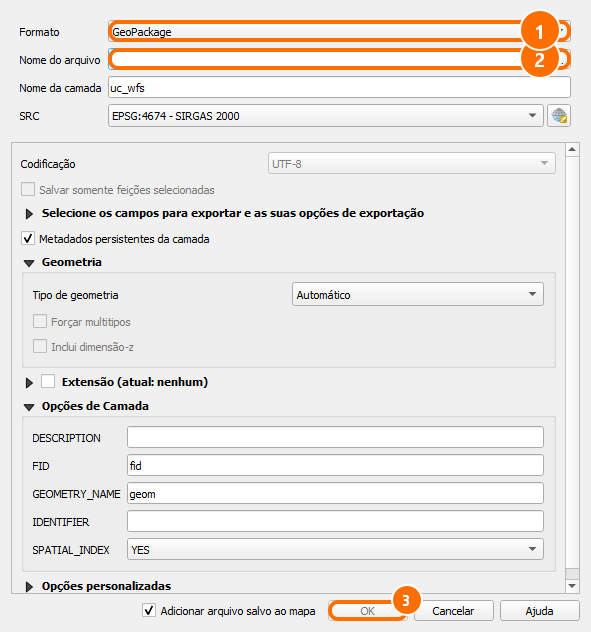

*Figura 18. Janela "Salvar camada vetorial como": formato GeoPackage (1), local e nome do arquivo (2) e OK (3).*

> 💡 **Dica:** prefira **GeoPackage** (.gpkg) ou **GeoJSON**. O Shapefile corta os nomes das colunas em 10 letras. Para levar a tabela ao Excel, escolha **Planilha XLSX** ou **CSV** no mesmo campo Formato.
{.is-success}

Por fim, salve o projeto com <kbd>Ctrl</kbd>+<kbd>S</kbd>. Da próxima vez, abra o arquivo .qgz e tudo volta como estava, com os dados atualizados do servidor.

### 3.12 ArcGIS Pro

No ArcGIS Pro, use **Inserir > Conexões > Servidor > Novo servidor WMS** (ou **Novo servidor WFS** / **Novo servidor WCS**) e informe as mesmas URLs, sem usuário e senha. As conexões aparecem no painel Catálogo, em Servidores, de onde as camadas são arrastadas para o mapa.

### 3.13 Receitas de análise no QGIS

As receitas abaixo pressupõem que você já fez os passos 3.5 a 3.8.

#### Focos por UC e por ano

1. Adicione **firms_clip** pelo WFS e, se quiser, filtre só os focos dentro das UCs ("tipo_cruzamento" = 'UC').
2. Abra a **Caixa de Ferramentas de Processamento** (<kbd>Ctrl</kbd>+<kbd>Alt</kbd>+<kbd>T</kbd>) e procure **Estatísticas por categorias**.
3. Em **Camada de entrada**, escolha firms_clip. Em **Campos com categorias**, escolha **id_uc** e **nr_ano**. Clique em **Executar**.
4. O resultado é uma tabela nova no painel Camadas, com a contagem por UC e ano. Abra-a com <kbd>F6</kbd>.

#### Mapa de calor que pode ser salvo e medido

O mapa de calor da seção 3.9 é só visual. Para um raster de densidade que pode ser analisado, use **Processamento > Caixa de Ferramentas > Mapa de calor (Estimativa de densidade Kernel)** sobre a camada reprojetada para SIRGAS 2000 / UTM 22S (EPSG:31982), para o raio ficar em metros.

#### Colorir o MapBiomas baixado pelo WCS

O WCS traz só os códigos das classes. Em **Propriedades > Simbologia > Estilo > Carregar estilo**, aplique o estilo oficial ESTILO_QGIS_COL11_PT.qml do pacote da Coleção 11 do MapBiomas (o administrador do projeto fornece o arquivo). As cores e os nomes ficam iguais aos do WMS.

#### Área por classe numa área desenhada por você

Para UCs e entornos, use a tabela mapbiomas_clip, que já traz a área calculada sobre o elipsoide. Para uma área própria (por exemplo, uma microbacia):

1. Carregue o MapBiomas do ano pelo WCS e a sua área (polígono).
2. **Processamento &gt; Recortar raster pela camada de máscara**, usando o seu polígono.
3. **Processamento &gt; Reprojetar** (Warp) o recorte para EPSG:31982, com reamostragem **Vizinho mais próximo** (nunca bilinear: os valores são códigos de classe).
4. **Processamento &gt; Relatório de valores únicos da camada raster**: a tabela traz, para cada código de classe, a quantidade de pixels e a área em m² (divida por 10.000 para hectares).
5. Traduza os códigos com a camada mapbiomas_legend_class (WFS).

#### Layout para relatório

Em **Projeto &gt; Novo Layout de Impressão**, adicione o mapa, a legenda, a escala e o norte. Cite as fontes no rodapé do layout ([capítulo 13](#13-créditos-e-citação-das-fontes)). O passo a passo do layout está no [manual do QGIS, Layouts de impressão](https://docs.qgis.org/latest/pt_BR/docs/user_manual/print_composer/index.html).

### 3.14 Para aprender mais sobre o QGIS

| **Material** | **Para quem** |
|----|----|
| [Uma introdução gentil ao SIG](https://docs.qgis.org/latest/pt_BR/docs/gentle_gis_introduction/index.html) | quem nunca estudou geoprocessamento: conceitos explicados com calma, em português |
| [Manual de treinamento do QGIS](https://docs.qgis.org/latest/pt_BR/docs/training_manual/index.html) | exercícios guiados, do básico ao avançado |
| [Manual do usuário do QGIS](https://docs.qgis.org/latest/pt_BR/docs/user_manual/index.html) | referência completa de cada janela |
| [Trabalhando com dados OGC no QGIS](https://docs.qgis.org/latest/pt_BR/docs/user_manual/working_with_ogc/ogc_client_support.html) | detalhes das conexões WMS, WFS e WCS usadas neste capítulo |
| [Tabela de atributos](https://docs.qgis.org/latest/pt_BR/docs/user_manual/working_with_vector/attribute_table.html) | selecionar, filtrar e calcular colunas |

## 4. Excel

O Excel lê as tabelas diretamente do serviço WFS em formato CSV, sem senha e sem instalar nada. Cada consulta vira uma tabela atualizável: basta clicar em **Atualizar Tudo** para trazer os dados mais recentes.

> 📘 **Conceito:** o Excel não abre o "arquivo" do projeto: ele faz um **pedido** ao servidor por meio de uma URL e recebe uma tabela. Quem faz esse pedido é o **Power Query** (guia **Dados > Obter Dados**), a parte do Excel que importa e limpa dados de fontes externas e lembra o caminho para atualizar depois. Funciona no Excel do Microsoft 365 e nas versões 2016 em diante, no Windows.
{.is-concept}

> ℹ️ **Ordem recomendada para a primeira vez:** (1) configure o separador decimal ([seção 4.3](#43-antes-de-importar-separador-decimal)), (2) escolha uma URL pronta ([seção 4.2](#42-uma-url-pronta-para-cada-base)), (3) importe ([seção 4.4](#44-importando-no-excel)) e (4) monte a Tabela Dinâmica. Pular o passo 1 é a causa número um de números errados.
{.is-info}

### 4.1 Montando a URL

A URL é o endereço do WFS seguido de parâmetros. O modelo é:

```text
https://areasprotegidas-sc.com/geoserver/protected_areas_sc/wfs?service=WFS&version=2.0.0&request=GetFeature
&typeNames=protected_areas_sc:<camada>
&outputFormat=csv
&propertyName=<coluna1>,<coluna2>,...
&CQL_FILTER=<filtro>
```


**Tabela 7.** Parâmetros úteis do WFS.

| **Parâmetro** | **Para que serve** | **Exemplo** |
|----|----|----|
| typeNames | camada desejada | protected_areas_sc:prodes_clip |
| outputFormat=csv | devolve CSV (obrigatório para o Excel) | csv |
| propertyName | escolhe as colunas; sem ele vêm todas, inclusive a geometria | id_uc,nr_ano,area_intersecao_km2 |
| CQL_FILTER | filtra as linhas | nr_ano&gt;=2020 AND tipo_cruzamento='UC' |
| sortBy | ordena | dt_deteccao DESC |
| count | limita a quantidade de linhas | 1000 |

Na URL, espaços viram %20, aspas simples viram %27 e o sinal de igual dentro do filtro vira %3D. Copie a URL inteira, numa linha só, sem espaços no meio.

> 📘 **Conceito:** leia a URL como uma frase. Tudo depois do **?** são pedidos separados por **&**: "serviço WFS, versão 2.0.0, quero feições (GetFeature), da camada prodes_clip, em CSV, só estas colunas, só as linhas que passam neste filtro". Mudar um pedaço da URL muda a tabela que chega.
{.is-concept}

### 4.2 Uma URL pronta para cada base

Todas as URLs abaixo foram testadas e trazem as colunas mais úteis de cada base, sem a geometria. Para ver todas as colunas, consulte o dicionário de dados ([capítulo 8](#8-dicionário-de-dados)) e acrescente os nomes em propertyName.

**Unidades de Conservação** (uc)

```text
https://areasprotegidas-sc.com/geoserver/protected_areas_sc/wfs?service=WFS&version=2.0.0&request=GetFeature&outputFormat=csv&typeNames=protected_areas_sc:uc&propertyName=id_uc,cd_cnuc,nm_uc,ds_grupo,ds_categoria,ds_esfera,nm_orgao_gestor,area_total_ha,situacao,longitude,latitude
```

**Zonas de Amortecimento oficiais vigentes** (za_oficial)

```text
https://areasprotegidas-sc.com/geoserver/protected_areas_sc/wfs?service=WFS&version=2.0.0&request=GetFeature&outputFormat=csv&typeNames=protected_areas_sc:za_oficial&propertyName=id_za_oficial,id_uc,ds_fonte,numero_versao,dt_inicio_vigencia,longitude,latitude&CQL_FILTER=fl_ativa%3Dtrue
```

**Buffers de Abrangência vigentes** (buffer_abrangencia)

```text
https://areasprotegidas-sc.com/geoserver/protected_areas_sc/wfs?service=WFS&version=2.0.0&request=GetFeature&outputFormat=csv&typeNames=protected_areas_sc:buffer_abrangencia&propertyName=id_buffer_abrangencia,id_uc,dist_buffer_m,numero_versao,dt_inicio_vigencia,longitude,latitude&CQL_FILTER=fl_ativa%3Dtrue
```

**Desmatamento PRODES (sem reservatórios)** (prodes_clip)

```text
https://areasprotegidas-sc.com/geoserver/protected_areas_sc/wfs?service=WFS&version=2.0.0&request=GetFeature&outputFormat=csv&typeNames=protected_areas_sc:prodes_clip&propertyName=id_uc,tipo_cruzamento,nr_ano,ds_class_name,area_intersecao_km2,longitude,latitude&CQL_FILTER=ds_class_name%3D%27desmatamento%27
```

**Alertas MapBiomas** (mapbiomas_alerta_clip)

```text
https://areasprotegidas-sc.com/geoserver/protected_areas_sc/wfs?service=WFS&version=2.0.0&request=GetFeature&outputFormat=csv&typeNames=protected_areas_sc:mapbiomas_alerta_clip&propertyName=id_uc,tipo_cruzamento,id_alerta_original,dt_deteccao,nr_ano,nr_mes,area_ha,ds_fonte_deteccao,longitude,latitude
```

**Focos de calor FIRMS** (firms_clip)

```text
https://areasprotegidas-sc.com/geoserver/protected_areas_sc/wfs?service=WFS&version=2.0.0&request=GetFeature&outputFormat=csv&typeNames=protected_areas_sc:firms_clip&propertyName=id_uc,tipo_cruzamento,detection_id,source_product,dt_deteccao_local,nr_ano,nr_mes,daynight,frp_mw,confidence_class,longitude,latitude
```

**Área por classe MapBiomas (UC e entorno, por ano)** (mapbiomas_clip)

```text
https://areasprotegidas-sc.com/geoserver/protected_areas_sc/wfs?service=WFS&version=2.0.0&request=GetFeature&outputFormat=csv&typeNames=protected_areas_sc:mapbiomas_clip&propertyName=id_uc,aoi_type,nr_ano,class_code,class_name_pt_br,class_color_hex,class_area_ha,aoi_area_ha_geodesic,coverage_ratio
```

**Gráfico da evolução de cada classe por UC (Tabela Dinâmica)**

Depois de carregar a tabela acima no Excel ([seção 4.4](#44-importando-no-excel)), os passos abaixo montam um gráfico de linhas com a área de cada classe ao longo dos anos, para a UC e o recorte escolhidos. A Figura 3 mostra o resultado.

**1. Criar a Tabela Dinâmica**

A consulta já chega ao Excel formatada como tabela. Clique em qualquer célula dela e use **Inserir &gt; Tabela Dinâmica &gt; Da Tabela/Intervalo**, escolha **Nova Planilha** e clique em **OK**.

**2. Organizar os campos**

No painel **Campos da Tabela Dinâmica**, arraste os campos para as áreas abaixo.

| **Área da Tabela Dinâmica** | **Campo**             |
|-----------------------------|-----------------------|
| Filtros                     | id_uc e aoi_type      |
| Colunas                     | class_name_pt_br      |
| Linhas                      | nr_ano                |
| Valores                     | Soma de class_area_ha |

Se aparecer **Contagem de class_area_ha**, clique na seta desse campo, escolha **Configurações do Campo de Valor**, selecione **Soma** e clique em **OK**.

**3. Filtrar o tipo de área**

A coluna aoi_type indica o recorte de cada linha. Para analisar um recorte por vez, use o filtro aoi_type da Tabela Dinâmica.

- UC para a área da própria unidade de conservação.
- ZA para a Zona de Amortecimento oficial, nas UCs que a possuem.
- BUFFER_ABRANGENCIA para o Buffer de Abrangência de 3.000 m, nas UCs sem ZA oficial.

> ⚠️ **Atenção:** Sem o filtro de aoi_type, o Excel soma as áreas dos recortes diferentes para o mesmo id_uc, classe e ano, e o gráfico mostra valores maiores que a área real da UC.
{.is-warning}

**4. Criar o Gráfico Dinâmico**

Clique na Tabela Dinâmica e use **Inserir &gt; Gráfico Dinâmico &gt; Linhas &gt; Linha com Marcadores &gt; OK**. No painel **Campos do Gráfico Dinâmico**, a distribuição fica como abaixo.

| **Área do Gráfico Dinâmico** | **Campo**             |
|------------------------------|-----------------------|
| Filtros                      | id_uc e aoi_type      |
| Legenda (Série)              | class_name_pt_br      |
| Eixos (Categorias)           | nr_ano                |
| Valores                      | Soma de class_area_ha |

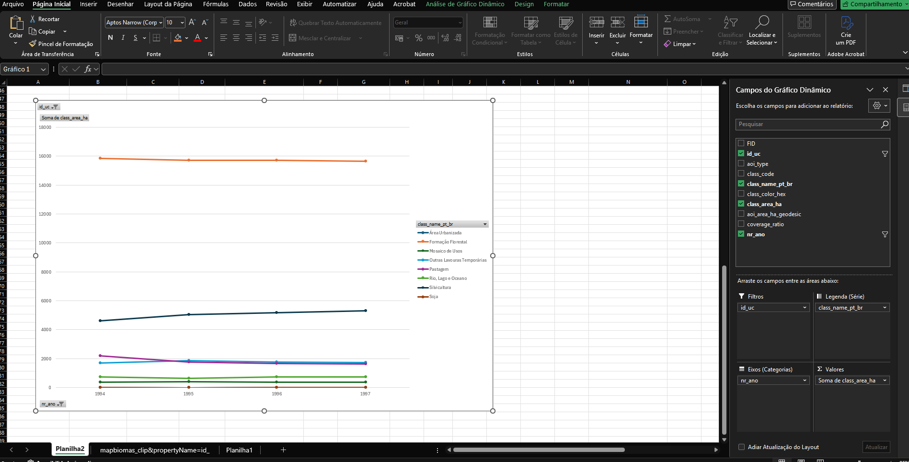

*Figura 3. Gráfico Dinâmico da área por classe e ano, com os campos distribuídos no painel (imagem ilustrativa).*

**5. Escolher a unidade e ler o gráfico**

Nos filtros do gráfico, escolha, por exemplo, id_uc = 12 e aoi_type = UC. O gráfico passa a mostrar:

- no eixo horizontal, os anos
- no eixo vertical, a área em hectares
- em cada linha, uma classe de cobertura, como Formação Florestal, Silvicultura ou Pastagem
- em cada ponto, a área daquela classe no ano, para a unidade e o recorte escolhidos.

Como título do gráfico, use, por exemplo, “Evolução da cobertura e uso da terra, UC 12”, e “Área (ha)” como título do eixo vertical.

**6. Criar botões para os filtros**

Selecione a Tabela Dinâmica e use **Análise de Tabela Dinâmica &gt; Inserir Segmentação de Dados**, marque id_uc e aoi_type e clique em **OK**. Os botões criados trocam a unidade e o recorte, e o gráfico se atualiza na hora.

**Legenda MapBiomas** (mapbiomas_legend_class)

```text
https://areasprotegidas-sc.com/geoserver/protected_areas_sc/wfs?service=WFS&version=2.0.0&request=GetFeature&outputFormat=csv&typeNames=protected_areas_sc:mapbiomas_legend_class&propertyName=class_code,parent_class_code,hierarchy_level,name_pt_br,name_en,color_hex,is_terminal
```

**Anos MapBiomas publicados** (mapbiomas_raster_asset)

```text
https://areasprotegidas-sc.com/geoserver/protected_areas_sc/wfs?service=WFS&version=2.0.0&request=GetFeature&outputFormat=csv&typeNames=protected_areas_sc:mapbiomas_raster_asset&propertyName=reference_year,coverage_scope,checksum_sha256,byte_size,published_at
```

Variações úteis, acrescentadas ao fim de qualquer URL:

**Tabela 8.** Filtros prontos para as URLs do WFS.

| **Para** | **Acrescente** |
|----|----|
| só o que caiu dentro das UCs | &CQL_FILTER=tipo_cruzamento%3D%27UC%27 |
| a partir de 2020 | &CQL_FILTER=nr_ano%3E%3D2020 |
| as duas condições juntas | &CQL_FILTER=tipo_cruzamento%3D%27UC%27%20AND%20nr_ano%3E%3D2020 |
| uma UC específica | &CQL_FILTER=id_uc%3D4 |
| ordenar do mais recente para o mais antigo (alertas) | &sortBy=dt_deteccao%20DESC |

Nas bases que já têm um filtro (ZA, Buffer e PRODES), junte a nova condição à existente com %20AND%20, sem repetir &CQL_FILTER=.

### 4.3 Antes de importar: separador decimal

O CSV do serviço usa **ponto** como separador decimal (618.0669), o padrão internacional. O Excel em português entende o ponto como separador de **milhar** e transforma 618.0669 em 6180669, sem mostrar erro nenhum. Para evitar isso, faça esta configuração **uma vez em cada pasta de trabalho, antes da primeira importação**:

1. Abra a guia **Dados &gt; Obter Dados &gt; Opções de Consulta**.
2. Em **Pasta de Trabalho Atual**, clique em **Configurações Regionais**.
3. Em **Localidade**, escolha **Inglês (Estados Unidos)** e clique em **OK**.

Com isso, o Power Query lê os números e as datas do CSV no formato correto. Na planilha, eles continuam aparecendo no formato do Windows em português (618,0669).

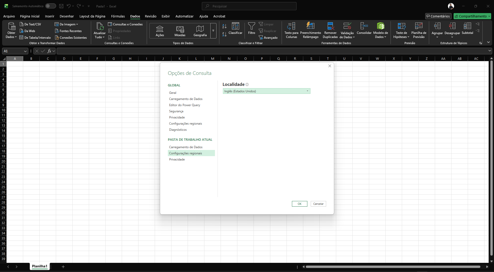

> ⚠️ **Atenção:** **Conferência rápida depois de carregar:** em mapbiomas_clip, o coverage_ratio deve ficar perto de **1** (por exemplo, 1,00004) e a class_area_ha de uma classe nunca passa da aoi_area_ha_geodesic da mesma linha. Em prodes_clip, a area_intersecao_km2 costuma ser menor que 1. Valores milhares de vezes maiores indicam que a configuração acima não foi feita: refaça a consulta depois de configurar.
{.is-warning}


### 4.4 Importando no Excel

1. No Excel (Microsoft 365 ou 2016 em diante), abra a guia **Dados** e clique em **Da Web** (ou **Obter Dados &gt; De Outras Fontes &gt; Da Web**).
2. Cole a URL e clique em **OK**. Se perguntar o tipo de acesso, escolha **Anônimo** e **Conectar**.
3. Na prévia, clique em **Transformar Dados** para abrir o Power Query.
4. Remova a coluna FID (identificador técnico do serviço).
5. Confira se as colunas decimais aparecem com o ícone de número decimal (1.2) e com valores coerentes. Se uma coluna ainda estiver errada, clique no ícone do tipo, escolha **Usando Localidade...**, tipo **Número Decimal** e localidade **Inglês (Estados Unidos)**.
6. Clique em **Fechar e Carregar**.

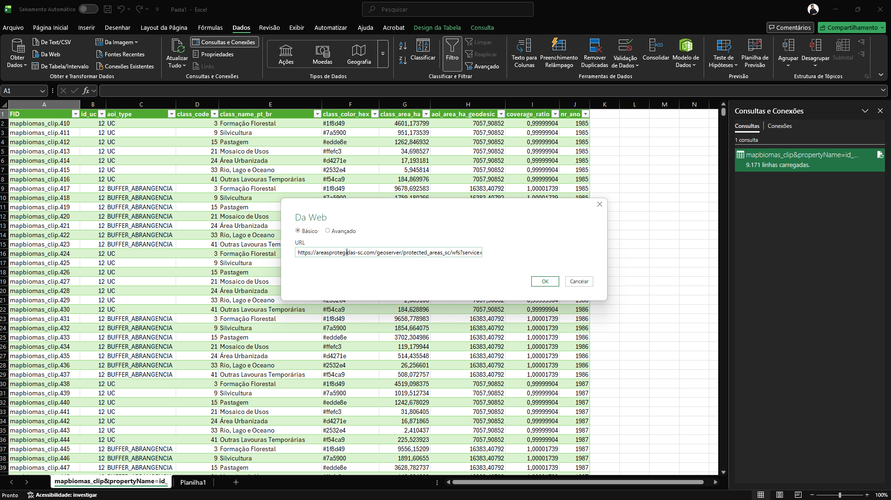

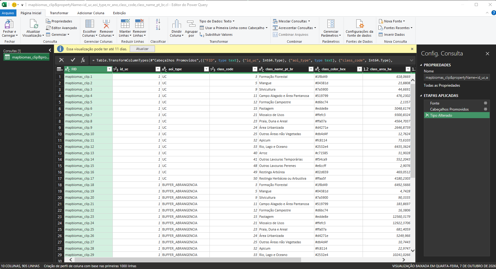

> ⚠️ **Atenção:** Se os acentos aparecerem trocados (por exemplo, á), na etapa Fonte do Power Query defina a origem do arquivo como **65001: Unicode (UTF-8)**.
>
> Não traga a coluna geom: o texto da geometria pode ultrapassar o limite de caracteres de uma célula do Excel. Use longitude e latitude para localizar os registros.
{.is-warning}

> 💡 **Dica:** Com duas consultas no mesmo arquivo (por exemplo, uc e mapbiomas_clip), use **PROCX** (ou PROCV) por id_uc para trazer o nome da UC, ou crie uma Tabela Dinâmica com as duas tabelas no Modelo de Dados.
{.is-success}


### 4.5 Receitas de análise no Excel

#### Evolução da floresta por UC (gráfico de linhas)

1. Importe só as classes florestais dentro das UCs com a URL abaixo (Formação Florestal, Formação Savânica, Mangue, Floresta Alagável e Restinga Arbórea).
2. Importe também a camada uc ([seção 4.2](#42-uma-url-pronta-para-cada-base)) para ter o nome de cada UC.
3. Selecione a tabela de florestas e use **Inserir &gt; Tabela Dinâmica**. Linhas: id_uc; Colunas: nr_ano; Valores: Soma de class_area_ha.
4. Com a Tabela Dinâmica selecionada, **Inserir &gt; Gráfico de Linhas**. Cada linha do gráfico é uma UC, e o eixo horizontal são os anos.

```text
https://areasprotegidas-sc.com/geoserver/protected_areas_sc/wfs?service=WFS&version=2.0.0&request=GetFeature&typeNames=protected_areas_sc:mapbiomas_clip&outputFormat=csv&propertyName=id_uc,nr_ano,class_code,class_name_pt_br,class_area_ha&CQL_FILTER=aoi_type%3D%27UC%27%20AND%20class_code%20IN%20(3,4,5,6,49)
```

#### Focos de calor por ano e sensor

1. Importe firms_clip ([seção 4.2](#42-uma-url-pronta-para-cada-base)) e, na janela de importação, marque **Adicionar estes dados ao Modelo de Dados**.
2. **Inserir &gt; Tabela Dinâmica** a partir do Modelo de Dados. Linhas: nr_ano; Colunas: source_product; Valores: detection_id com **Contagem Distinta** (em Configurações do Campo de Valor).
3. Compare a tendência de cada sensor; não some colunas de sensores diferentes.

#### Desmatamento PRODES dentro da UC e no entorno

1. Importe prodes_clip ([seção 4.2](#42-uma-url-pronta-para-cada-base), já sem reservatórios).
2. No Power Query, use **Adicionar Coluna &gt; Coluna Personalizada** com o nome area_ha e a fórmula \[area_intersecao_km2\] \* 100.
3. Tabela Dinâmica com Linhas: nr_ano; Colunas: tipo_cruzamento; Valores: Soma de area_ha.

> 💡 **Dica:** Para atualizar todas as consultas de uma vez, use **Dados > Atualizar Tudo**. As Tabelas Dinâmicas acompanham depois de **Atualizar** (botão direito sobre elas).
{.is-success}

**Para aprender mais:** [Criar uma Tabela Dinâmica](https://support.microsoft.com/pt-br/office/criar-uma-tabela-din%C3%A2mica-para-analisar-dados-da-planilha-a9a84538-bfe9-40a9-a8e9-f99134456576) (suporte da Microsoft) e [documentação do Power Query](https://learn.microsoft.com/pt-br/power-query/).


## 5. Power BI Desktop

> 📘 **Conceito:** o **Power BI Desktop** é o programa gratuito da Microsoft para montar painéis interativos (gráficos, mapas e filtros que conversam entre si). Ele usa o mesmo Power Query do Excel para buscar os dados. Baixe pela [página oficial do Power BI Desktop](https://learn.microsoft.com/pt-br/power-bi/fundamentals/desktop-get-the-desktop) ou pela Microsoft Store, e veja o [guia de introdução](https://learn.microsoft.com/pt-br/power-bi/fundamentals/desktop-getting-started) se nunca usou.
{.is-concept}

O Power BI pode ser conectado de duas formas: direto no banco (recomendado para o grupo do laboratório, com o login do laboratório) ou pelo WFS em CSV, como no Excel, sem login.

### 5.1 Antes da primeira conexão ao banco: certificado da AWS

O banco exige conexão criptografada (SSL), e o Power BI só confia em certificados instalados no Windows. O certificado da autoridade da Amazon (Amazon RDS us-east-1 Root CA RSA2048 G1) não vem no Windows e precisa ser instalado uma vez por computador. Não é preciso ser administrador:

1. Obtenha com o administrador o arquivo amazon-rds-us-east-1-root-rsa2048-g1.cer.
2. Dê dois cliques no arquivo e clique em **Instalar Certificado...**.
3. Escolha **Usuário Atual** e clique em **Avançar**.
4. Marque **Colocar todos os certificados no repositório a seguir**, clique em **Procurar** e escolha **Autoridades de Certificação Raiz Confiáveis**.
5. **Avançar &gt; Concluir** e confirme o Aviso de Segurança com **Sim**. Feche e abra o Power BI.

Confira o arquivo antes de instalar: validade de 25/05/2021 a 25/05/2061 e impressão digital SHA-1 2FA77EF894D983BA9D37AD699C84AB0F657BE1C8. Em laboratórios com muitas máquinas, peça à equipe de TI para instalar o mesmo certificado no repositório da máquina.

### 5.2 Conexão ao banco

1. **Página Inicial &gt; Obter Dados &gt; Mais... &gt; Banco de dados PostgreSQL &gt; Conectar**.
2. Servidor e Banco de dados: os dois valores entregues pelo administrador junto com o login. Modo de Conectividade: **Importar**. **OK**.
3. Na janela de credenciais, escolha a aba **Banco de dados** (não Windows), informe o usuário (login do laboratório ou do evento) e a senha. Mantenha **Criptografar conexões** marcado. **Conectar**.
4. No Navegador, marque as views de reporting desejadas (por exemplo, reporting.uc, reporting.mapbiomas_clip, reporting.firms_clip) e clique em **Transformar Dados**.
5. Em cada consulta com geometria, remova a coluna geom (botão direito &gt; Remover). **Fechar e Aplicar**.

Também é possível colar uma das consultas do [capítulo 9](#9-consultas-prontas): na janela do passo 2, abra **Opções avançadas** e cole o SQL em **Instrução SQL**.

> ✅ **Confira:** no Navegador do Power BI aparecem só as views que começam com **reporting.** Se aparecer erro de certificado, volte à [seção 5.1](#51-antes-da-primeira-conexão-ao-banco-certificado-da-aws). Detalhes do conector estão na [documentação do conector PostgreSQL](https://learn.microsoft.com/pt-br/power-query/connectors/postgresql).
{.is-check}

### 5.3 Modelo de dados recomendado

Crie os relacionamentos a partir de uc\[id_uc\] (lado um) para o id_uc de cada view temática (lado muitos). Para cruzar temas por ano, crie uma tabela calendário de anos e relacione-a com o nr_ano de cada view, que tem o mesmo nome em todas:

```text
Anos = SELECTCOLUMNS(GENERATESERIES(1985, 2026, 1), "nr_ano", [Value])
```

Assim, um único filtro de ano controla ao mesmo tempo os gráficos de desmatamento, alertas, focos e uso da terra. Para mapas, use o visual **Mapa** ou **Azure Maps** com latitude e longitude.

### 5.4 Alternativa sem login: WFS em CSV

Em **Obter Dados &gt; Web**, cole uma URL do WFS em CSV ([capítulo 4](#4-excel)). Antes, configure a leitura do ponto decimal em **Arquivo &gt; Opções e configurações &gt; Opções &gt; Arquivo Atual &gt; Configurações Regionais**, com **Localidade para importação** em **Inglês (Estados Unidos)**; sem isso, o Power BI em português lê 618.0669 como 6180669. A conexão direta ao banco ([seção 5.2](#52-conexão-ao-banco)) não tem esse problema, porque os números chegam já como números. Esse caminho não precisa de certificado nem de login, mas só alcança as camadas publicadas no WFS.

> ⚠️ **Atenção:** O login do evento deixa de existir quando o modo eventos é desativado: relatórios montados em oficina continuam abertos, mas não atualizam mais. Relatórios permanentes do laboratório devem usar o login do laboratório.
{.is-warning}


### 5.5 Medidas sugeridas (DAX)

Com o modelo da [seção 5.3](#53-modelo-de-dados-recomendado) e um relacionamento de mapbiomas_legend_class\[class_code\] (lado um) para mapbiomas_clip\[class_code\] (lado muitos), crie as medidas em **Modelagem &gt; Nova medida**:

```text
Floresta (ha) =
CALCULATE ( SUM ( mapbiomas_clip[class_area_ha] ), mapbiomas_legend_class[parent_class_code] = 1 )
Vegetação nativa (ha) =
CALCULATE ( SUM ( mapbiomas_clip[class_area_ha] ), mapbiomas_legend_class[parent_class_code] IN { 1, 10 } )
Desmatamento PRODES (ha) =
CALCULATE ( SUM ( prodes_clip[area_intersecao_km2] ) * 100, prodes_clip[ds_class_name] = "desmatamento" )
Alertas = DISTINCTCOUNT ( mapbiomas_alerta_clip[id_alerta_original] )
Focos = DISTINCTCOUNT ( firms_clip[detection_id] )
Focos por 1.000 ha =
DIVIDE ( [Focos], SUM ( uc[area_total_ha] ) ) * 1000
```


Use as medidas com segmentações de nm_uc, tipo_cruzamento (ou aoi_type) e da tabela de anos. Para gráficos de uso da terra com as cores oficiais, use class_color_hex em **Formatar &gt; Cores &gt; fx &gt; Valor do campo**.

## 6. DBeaver e outros clientes SQL

> 📘 **Conceito:** o **DBeaver** é um programa gratuito para conversar com bancos de dados: você escreve uma pergunta em SQL e ele mostra a resposta numa tabela. Baixe a versão **Community** em [dbeaver.io/download](https://dbeaver.io/download/) (instalador para Windows, opção *Windows installer*). O [manual do DBeaver](https://dbeaver.com/docs/dbeaver/) explica cada janela.
{.is-concept}

O DBeaver (versão Community, gratuita) é o caminho para consultas livres em SQL, inclusive espaciais com as funções do PostGIS. Os mesmos dados valem para qualquer cliente PostgreSQL (pgAdmin, DataGrip, psql, Python, R).

1. **Banco de dados &gt; Nova conexão &gt; PostgreSQL &gt; Avançar**.
2. Aba **Principal**: Host, Porta e Banco de dados entregues pelo administrador junto com o login, Autenticação **Database Native**, usuário e senha (login do laboratório ou do evento).
3. Aba **SSL**: marque **Usar SSL** e escolha o modo **require**.
4. Clique em **Testar conexão**. Na primeira vez, o DBeaver baixa o driver do PostgreSQL. **Concluir**.
5. No navegador de banco de dados, abra **protected_areas_sc &gt; Esquemas &gt; reporting &gt; Views**.

> 💡 **Dica:** Para economizar conexões (o login do grupo tem limite de 12 simultâneas), em **Editar Conexão > Configurações da conexão** desmarque **Abrir conexão separada para leitura de metadados** e **Abrir conexão separada para cada editor**.
>
> A aba **Dados espaciais** do DBeaver desenha a coluna geom num mapa: útil para conferir o resultado de uma consulta espacial.
>
> O DBeaver exibe inteiros com separador de milhar (o ano 1989 aparece como 1.989). É só formatação de tela; o valor é 1989. Para desligar, em **Janela > Preferências > Editores > Editor de Dados > Formatos de Dados**, escolha o tipo **Number** e desmarque **Use grouping**.
{.is-success}


Para conferir a conexão, abra um editor SQL (botão direito na conexão > **Editor SQL > Novo script**, ou <kbd>Ctrl</kbd>+<kbd>]</kbd>), cole a linha abaixo e aperte <kbd>Ctrl</kbd>+<kbd>Enter</kbd>:

```sql
SELECT current_user, count(*) AS ucs FROM reporting.uc;
```

> 📘 **Conceito: como ler uma consulta SQL.** Toda consulta é uma frase em inglês com partes fixas. Veja a mesma pergunta, "quantos focos dentro de cada UC por ano, desde 2020?":
>
> - `SELECT id_uc, nr_ano, count(*) AS focos`: **quais colunas** quero ver (aqui, a UC, o ano e a contagem)
> - `FROM reporting.firms_clip`: **de qual tabela**
> - `WHERE tipo_cruzamento = 'UC' AND nr_ano >= 2020`: **quais linhas** entram (o filtro)
> - `GROUP BY id_uc, nr_ano`: **como agrupar** para contar
> - `ORDER BY focos DESC`: **em que ordem** mostrar
>
> As 15 consultas do [capítulo 9](#9-consultas-prontas) seguem esse mesmo esqueleto, com mais colunas e junções. Para aprender SQL espacial com calma, veja o [workshop introdutório do PostGIS](https://postgis.net/workshops/postgis-intro/) (em inglês).
{.is-concept}

```sql
SELECT id_uc, nr_ano, count(*) AS focos
FROM reporting.firms_clip
WHERE tipo_cruzamento = 'UC' AND nr_ano >= 2020
GROUP BY id_uc, nr_ano
ORDER BY focos DESC;
```

## 7. Problemas comuns

**Tabela 9.** Erros comuns e soluções.

| **Sintoma** | **Causa provável** | **Solução** |
|----|----|----|
| QGIS: a camada foi adicionada mas o mapa continua vazio | o mapa está mostrando outra região do mundo | botão direito na camada > **Aproximar para camada(s)** |
| QGIS: o mapa base não aparece (fundo branco) | sem internet ou com bloqueio de rede | confira a conexão; o mapa base e os serviços vêm da web |
| QGIS: sumiu o painel Camadas ou o Navegador | o painel foi fechado | **Exibir > Painéis** e marque o painel de novo |
| QGIS: a camada some ao aproximar ou afastar | caixinha desmarcada ou filtro ativo | marque a caixinha da camada e confira se há um ícone de funil (filtro) ao lado dela |
| QGIS: "O servidor requer autenticação" (HTTP 401) no WMS, WFS ou WCS | usuário e senha preenchidos na conexão de mapa | apague usuário e senha; os serviços de mapa são abertos |
| QGIS: erro 404 ao conectar | URL terminando em /protected_areas_sc/, sem o serviço | use a URL com /wms, /wfs, /wcs ou /gwc/service/wmts |
| Excel ou Power BI: números milhares de vezes maiores (618.0669 virou 6180669) | o ponto decimal do CSV foi lido como separador de milhar | configure a localidade Inglês (Estados Unidos) antes de importar ([seções 4.3](#43-antes-de-importar-separador-decimal) e 5.4) e refaça a consulta |
| DBeaver: ano aparece como 1.989 | formatação de tela com separador de milhar | nada a corrigir nos dados; desligue o agrupamento nas preferências ([seção 6](#6-dbeaver-e-outros-clientes-sql)) |
| Excel: acentos trocados | codificação do arquivo | origem do arquivo 65001: Unicode (UTF-8) |
| WFS: "Requested property ... is not available" | nome de coluna errado em propertyName | confira o nome no dicionário de dados ([capítulo 8](#8-dicionário-de-dados)) |
| Power BI: "The remote certificate is invalid" | certificado da AWS não instalado | instale o certificado ([seção 5.1](#51-antes-da-primeira-conexão-ao-banco-certificado-da-aws)) e reabra o Power BI |
| no pg_hba.conf entry ... no encryption | conexão sem SSL | ative o SSL (modo require) ou Criptografar conexões |
| password authentication failed | senha errada, aba Windows no Power BI ou evento encerrado | confira a aba Banco de dados e peça a senha atual ao administrador |
| permission denied for schema public | consulta a tabelas internas | use apenas o esquema reporting |
| cannot execute ... in a read-only transaction | tentativa de gravar | o acesso é somente leitura |
| canceling statement due to statement timeout | consulta passou do limite de tempo | filtre por UC ou ano, ou agregue antes de trazer |
| too many connections for role | limite de conexões do login atingido | feche abas e conexões ociosas ([seção 6](#6-dbeaver-e-outros-clientes-sql), Dica) |
| 502 ou 504 nos mapas por alguns minutos | troca de tamanho do servidor no modo eventos | aguarde cerca de 2 minutos e recarregue |

## 8. Dicionário de dados

Esta seção descreve cada view do esquema reporting, que é o mesmo conteúdo publicado no WFS. Para cada uma: o que ela contém, como o dado foi gerado, para que pode ser útil, as colunas e os cuidados de interpretação.

### 8.1 Conceitos que valem para todas as views

- **Área de interesse.** Cada UC é analisada em duas partes que não se sobrepõem: a própria UC e o seu entorno. O entorno é a Zona de Amortecimento oficial (ZA), quando existe, ou o Buffer de Abrangência de 3.000 m, quando não existe. O que cai no entorno é sempre a parte fora da UC.
- **tipo_cruzamento** (ou **aoi_type**). Diz em qual dessas partes o registro caiu: UC, ZA ou BUFFER_ABRANGENCIA.
- **Sistema de referência.** Todas as geometrias estão em SIRGAS 2000, código EPSG:4674, o sistema oficial brasileiro. Áreas são calculadas em projeção métrica ou sobre o elipsoide, nunca em graus.
- **Histórico.** Quando o limite de uma UC muda, todos os temas são recalculados para o novo limite, e os cadastros guardam as versões anteriores com as datas de vigência.
- **nr_ano.** Todas as views temáticas têm a coluna nr_ano com o mesmo nome, para relacionar com uma tabela de anos.
- **Sobreposição entre UCs.** Algumas UCs se sobrepõem (um parque dentro de uma APA, por exemplo). Por isso, somar valores de UCs diferentes pode contar a mesma área ou o mesmo foco duas vezes. Somas por UC são sempre corretas.

### 8.2 Fontes e atualização

**Tabela 10.** Origem e atualização dos dados.

| **Tema** | **Fonte** | **Atualização no projeto** | **Período** |
|----|----|----|----|
| UCs, ZAs e Buffers | cadastro do projeto (painel e API); limites oficiais | a cada envio pelo painel | vigente e histórico |
| PRODES | INPE, TerraBrasilis | anual, em janeiro (a fonte é anual) | série PRODES disponível |
| MapBiomas Alerta | API do MapBiomas Alerta | semanal, às segundas-feiras | desde 2019 |
| FIRMS | NASA FIRMS (MODIS e VIIRS) | semanal, às segundas-feiras | desde novembro de 2000 |
| MapBiomas Uso e Cobertura | MapBiomas, Coleção 11 | a cada nova coleção | 1985 a 2025 |

### 8.3 uc: Unidades de Conservação

**O que é.** Cadastro das Unidades de Conservação (UCs) monitoradas em Santa Catarina, com o limite vigente de cada uma. É a view central: todas as outras se ligam a ela por id_uc.

**Como foi gerado.** As UCs entram pelo painel do projeto (envio de Shapefile, GeoJSON ou KML pela API), passam por validação de geometria e de identidade (CNUC, WDPA ou identificador oficial) e são gravadas pelo pipeline. UCs pontuais (sem polígono) também são aceitas. Cada alteração de limite gera uma nova versão e dispara o reprocessamento de todos os temas para a UC.

**Para que serve.** Base de qualquer mapa ou relatório: filtro por categoria, esfera ou órgão gestor, cálculo de densidades (área oficial em area_total_ha) e nomes para os gráficos.

| **Coluna** | **Tipo** | **Descrição** |
|----|----|----|
| id_uc | inteiro | Identificador interno da UC no projeto. |
| uc_id | texto | Identificador oficial da UC na fonte de origem. |
| cd_cnuc | texto | Código no Cadastro Nacional de Unidades de Conservação (CNUC/MMA). |
| wdpa_pid | texto | Identificador na World Database on Protected Areas (Protected Planet). |
| nm_uc | texto | Nome oficial da UC. |
| dt_criacao, ds_ato_legal | data, texto | Data de criação e ato legal que instituiu a UC. |
| ds_grupo | texto | Grupo do SNUC: Proteção Integral ou Uso Sustentável. |
| ds_categoria | texto | Categoria (Parque, Área de Proteção Ambiental, Reserva Biológica etc.). |
| ds_esfera | texto | Esfera de gestão: Federal, Estadual ou Municipal. |
| nm_orgao_gestor | texto | Órgão responsável pela gestão. |
| area_total_ha, area_ato_ha | decimal | Área oficial informada pela fonte e área do ato legal, em hectares. |
| situacao | texto | ATIVA ou extinta. |
| versao_registro | inteiro | Versão do cadastro (aumenta a cada alteração). |
| dt_inicio_vigencia, dt_fim_vigencia | data | Período de vigência do registro; fim vazio indica a versão atual. |
| atualizado_em | data e hora | Última atualização do registro. |
| longitude, latitude | decimal | Ponto interno da geometria em SIRGAS 2000, para ferramentas que não leem geometria (Power BI, Excel). |
| geom | geometria | Geometria em SIRGAS 2000 (EPSG:4674). Remova esta coluna no Power BI e no Excel. |

> ⚠️ **Atenção:** Use area_total_ha (área oficial) para densidades; ela pode diferir um pouco da área calculada a partir do polígono.
{.is-warning}


### 8.4 za_oficial: Zonas de Amortecimento oficiais

**O que é.** Zonas de Amortecimento (ZAs) instituídas oficialmente para as UCs, com todo o histórico de versões.

**Como foi gerado.** Vêm de fontes oficiais carregadas pelo pipeline ou enviadas pelo painel. Quando uma UC recebe uma ZA oficial, o Buffer de Abrangência dela é encerrado na mesma operação, e todos os temas são recalculados para a nova área.

**Para que serve.** Análises de entorno legal da UC: o que acontece na ZA está sujeito a regras de uso definidas no plano de manejo.

| **Coluna** | **Tipo** | **Descrição** |
|----|----|----|
| id_za_oficial | inteiro | Identificador da versão da ZA. |
| id_uc | inteiro | UC dona da ZA. |
| ds_fonte | texto | Fonte oficial do limite. |
| numero_versao | inteiro | Versão do limite para a mesma UC. |
| fl_ativa | booleano | true na versão vigente. |
| dt_inicio_vigencia, dt_fim_vigencia | data | Período de vigência. |
| dt_carga | data e hora | Quando a versão foi gravada. |
| longitude, latitude | decimal | Ponto interno da geometria em SIRGAS 2000, para ferramentas que não leem geometria (Power BI, Excel). |
| geom | geometria | Geometria em SIRGAS 2000 (EPSG:4674). Remova esta coluna no Power BI e no Excel. |

> ⚠️ **Atenção:** Para mapas atuais, filtre fl_ativa = true. O WMS já desenha só a versão vigente.
{.is-warning}


### 8.5 buffer_abrangencia: Buffers de Abrangência

**O que é.** Faixa de 3.000 metros em torno das UCs que não têm Zona de Amortecimento oficial, também com histórico.

**Como foi gerado.** Calculada pelo pipeline a partir do limite da UC, com base no critério de entorno da Resolução CONAMA 428/2010. É refeita sempre que o limite da UC muda e encerrada quando a UC passa a ter ZA oficial. Uma UC nunca tem ZA oficial e Buffer de Abrangência ativos ao mesmo tempo.

**Para que serve.** Entorno de análise para UCs sem ZA, permitindo comparar a pressão no entorno de todas as UCs com o mesmo critério.

| **Coluna** | **Tipo** | **Descrição** |
|----|----|----|
| id_buffer_abrangencia | inteiro | Identificador da versão do Buffer. |
| id_uc | inteiro | UC de origem. |
| ds_fonte | texto | Origem do cálculo. |
| dist_buffer_m | decimal | Distância do buffer, em metros (3.000). |
| numero_versao, fl_ativa | inteiro, booleano | Versão e indicador da versão vigente. |
| dt_geracao | data e hora | Quando o buffer foi calculado. |
| dt_inicio_vigencia, dt_fim_vigencia, dt_carga | data | Vigência e gravação. |
| longitude, latitude | decimal | Ponto interno da geometria em SIRGAS 2000, para ferramentas que não leem geometria (Power BI, Excel). |
| geom | geometria | Geometria em SIRGAS 2000 (EPSG:4674). Remova esta coluna no Power BI e no Excel. |

> ⚠️ **Atenção:** O Buffer de Abrangência é um recorte técnico de análise; ele não substitui juridicamente uma Zona de Amortecimento.
{.is-warning}


### 8.6 prodes_clip: PRODES: desmatamento recortado

**O que é.** Polígonos de desmatamento anual do PRODES (INPE) que tocam as UCs e seus entornos, recortados em cada área.

**Como foi gerado.** O pipeline baixa a série do PRODES (TerraBrasilis/INPE), corrige geometrias, converte para SIRGAS 2000 e cruza cada polígono com as UCs, as ZAs e os Buffers. A partição é exclusiva: a parte dentro da UC vira um registro UC; a parte no entorno, fora da UC, vira ZA ou BUFFER_ABRANGENCIA. A área do recorte é recalculada em projeção métrica.

**Para que serve.** Quantificar o desmatamento oficial dentro e no entorno das UCs, por ano.

| **Coluna** | **Tipo** | **Descrição** |
|----|----|----|
| id_prodes_clip | inteiro | Identificador do recorte. |
| id_uc | inteiro | UC a que o registro se refere. Chave para relacionar com uc.id_uc. |
| id_za_oficial | inteiro | Zona de Amortecimento oficial do recorte, quando tipo_cruzamento = 'ZA'; vazio nos demais. |
| id_buffer_abrangencia | inteiro | Buffer de Abrangência do recorte, quando tipo_cruzamento = 'BUFFER_ABRANGENCIA'; vazio nos demais. |
| tipo_cruzamento | texto | Onde o registro caiu: UC (dentro da UC), ZA (na Zona de Amortecimento, fora da UC) ou BUFFER_ABRANGENCIA (no Buffer, fora da UC). |
| id_prodes_original | texto | Identificador do polígono na base PRODES. |
| nr_ano | inteiro | Ano PRODES (agosto do ano anterior a julho deste ano). |
| ds_class_name | texto | desmatamento ou reservatorio (área alagada por represa). |
| area_km2 | decimal | Área do polígono PRODES original, em km². |
| area_intersecao_km2 | decimal | Área do recorte dentro da UC ou do entorno, em km². Multiplique por 100 para hectares. |
| dt_carga | data e hora | Quando o registro foi gravado. |
| longitude, latitude | decimal | Ponto interno da geometria em SIRGAS 2000, para ferramentas que não leem geometria (Power BI, Excel). |
| geom | geometria | Geometria em SIRGAS 2000 (EPSG:4674). Remova esta coluna no Power BI e no Excel. |

> ⚠️ **Atenção:** Some area_intersecao_km2, nunca area_km2 (que repete a área do polígono inteiro em cada recorte). Exclua reservatorio quando o interesse for desmatamento.
{.is-warning}


### 8.7 mapbiomas_alerta_clip: MapBiomas Alerta: alertas recortados

**O que é.** Alertas de desmatamento validados pelo MapBiomas Alerta que tocam as UCs e seus entornos.

**Como foi gerado.** O pipeline consulta semanalmente a API do MapBiomas Alerta (desde 2019), guarda o histórico completo e cruza os alertas com UCs, ZAs e Buffers, com a mesma partição exclusiva do PRODES. Cada alerta é verificado por analistas do MapBiomas a partir de imagens de alta resolução antes de ser publicado.

**Para que serve.** Monitoramento recente e quase contínuo do desmatamento, com datas das imagens que comprovam a perda.

| **Coluna** | **Tipo** | **Descrição** |
|----|----|----|
| id_alerta_clip | inteiro | Identificador do recorte. |
| id_uc | inteiro | UC a que o registro se refere. Chave para relacionar com uc.id_uc. |
| id_za_oficial | inteiro | Zona de Amortecimento oficial do recorte, quando tipo_cruzamento = 'ZA'; vazio nos demais. |
| id_buffer_abrangencia | inteiro | Buffer de Abrangência do recorte, quando tipo_cruzamento = 'BUFFER_ABRANGENCIA'; vazio nos demais. |
| tipo_cruzamento | texto | Onde o registro caiu: UC (dentro da UC), ZA (na Zona de Amortecimento, fora da UC) ou BUFFER_ABRANGENCIA (no Buffer, fora da UC). |
| id_alerta_original | texto | Código do alerta no MapBiomas Alerta (consultável no site do MapBiomas). |
| dt_deteccao | data | Data de detecção do alerta. |
| dt_imagem_anterior, dt_imagem_posterior | data | Datas das imagens antes e depois da supressão. |
| area_ha | decimal | Área do recorte, em hectares. |
| ds_bioma | texto | Bioma do alerta. |
| ds_fonte_deteccao | texto | Sistemas que detectaram o alerta (GLAD, SAD Mata Atlântica, SOS/INPE, PRODES Mata Atlântica...). |
| dt_carga | data e hora | Quando o registro foi gravado. |
| longitude, latitude | decimal | Ponto interno da geometria em SIRGAS 2000, para ferramentas que não leem geometria (Power BI, Excel). |
| geom | geometria | Geometria em SIRGAS 2000 (EPSG:4674). Remova esta coluna no Power BI e no Excel. |
| nr_ano, nr_mes | inteiro | Ano e mês de dt_deteccao, prontos para filtros e gráficos. |

> ⚠️ **Atenção:** O mesmo alerta pode gerar um recorte na UC e outro no entorno; para contar alertas distintos, use count(DISTINCT id_alerta_original).
{.is-warning}


### 8.8 firms_clip: FIRMS: focos de calor

**O que é.** Focos de calor (detecções de fogo ativo) da NASA FIRMS dentro das UCs e de seus entornos, desde 2000.

**Como foi gerado.** O pipeline baixa os focos por satélite: MODIS (desde 2000) e VIIRS dos satélites Suomi-NPP, NOAA-20 e NOAA-21, nas versões de processamento padrão (SP, definitivas) e quase em tempo real (NRT, atualizadas semanalmente). Os pontos são filtrados para Santa Catarina e relacionados às UCs, ZAs e Buffers; se o ponto cai dentro da UC, ele é UC, mesmo que também esteja no entorno. Só os focos de confiança alta são publicados: classe h no VIIRS e confiança acima de 70 no MODIS.

**Para que serve.** Séries de queimadas, sazonalidade, intensidade do fogo e análise espacial da proximidade dos focos aos limites das UCs.

| **Coluna** | **Tipo** | **Descrição** |
|----|----|----|
| id_firms_clip | inteiro | Identificador da relação foco × área. |
| detection_id | texto | Identificador da detecção (produto, versão, satélite, data e coordenadas). |
| source_product | texto | Produto: MODIS_SP, MODIS_NRT, VIIRS_SNPP_SP, VIIRS_NOAA20_NRT etc. |
| source_version, source_processing | texto | Versão da coleção e tipo de processamento (SP ou NRT). |
| id_uc | inteiro | UC a que o registro se refere. Chave para relacionar com uc.id_uc. |
| id_za_oficial | inteiro | Zona de Amortecimento oficial do recorte, quando tipo_cruzamento = 'ZA'; vazio nos demais. |
| id_buffer_abrangencia | inteiro | Buffer de Abrangência do recorte, quando tipo_cruzamento = 'BUFFER_ABRANGENCIA'; vazio nos demais. |
| tipo_cruzamento | texto | Onde o registro caiu: UC (dentro da UC), ZA (na Zona de Amortecimento, fora da UC) ou BUFFER_ABRANGENCIA (no Buffer, fora da UC). |
| acquired_at_utc | data e hora | Instante da passagem do satélite, em UTC. |
| satellite, instrument | texto | Satélite e instrumento (MODIS ou VIIRS). |
| confidence_raw, confidence_scheme, confidence_score, confidence_class | texto e número | Confiança original da NASA (l/n/h no VIIRS, 0 a 100 no MODIS) e a classe padronizada pelo projeto. |
| publication_rule_version | texto | Versão da regra de publicação aplicada. |
| frp_mw | decimal | Potência Radiativa do Fogo (FRP), em megawatts: indicador da intensidade. |
| brightness_kelvin, brightness_secondary_kelvin | decimal | Temperatura de brilho nos canais do sensor, em kelvin. |
| scan_km, track_km | decimal | Tamanho do pixel no solo, em km. |
| daynight | texto | D (dia) ou N (noite). |
| detection_type | texto | Tipo da detecção, quando informado pela NASA. |
| dt_carga | data e hora | Quando o registro foi gravado. |
| longitude, latitude, geom | decimal, geometria | Posição do foco (centro do pixel). |
| dt_deteccao_local | data | Data do foco no horário de Brasília. |
| nr_ano, nr_mes | inteiro | Ano e mês da data de Brasília (um foco às 01h UTC de 1º de janeiro pertence ao ano anterior no Brasil). |

> ⚠️ **Atenção:** Um foco é a detecção de calor em um pixel de 375 m (VIIRS) ou 1 km (MODIS), não um incêndio. Sensores diferentes detectam o mesmo fogo; não some produtos diferentes como contagem única. O mesmo foco pode aparecer em duas UCs vizinhas.
{.is-warning}


### 8.9 mapbiomas_clip: MapBiomas Uso e Cobertura: área por classe

**O que é.** Área, em hectares, de cada classe de uso e cobertura da terra do MapBiomas (Coleção 11), por ano de 1985 a 2025, dentro de cada UC e de cada entorno.

**Como foi gerado.** O pipeline recorta o mapa anual do MapBiomas (pixels de 30 m) para Santa Catarina e, para cada área (UC, ZA ou Buffer), soma a área dos pixels de cada classe. A área de cada pixel é calculada sobre o elipsoide, linha a linha do raster, e o pixel entra na área quando o seu centro está dentro dela. Os totais do estado são conferidos com a estatística oficial do MapBiomas antes da publicação.

**Para que serve.** Séries históricas de floresta, agropecuária, silvicultura, área urbana e mineração; composição atual das UCs; avaliação de efetividade da proteção.

| **Coluna** | **Tipo** | **Descrição** |
|----|----|----|
| id_mb_clip | inteiro | Identificador do registro. |
| id_uc, id_za_oficial, id_buffer_abrangencia | inteiro | Área a que a estatística se refere. |
| aoi_type | texto | Tipo de área: UC, ZA ou BUFFER_ABRANGENCIA (mesmo papel do tipo_cruzamento). |
| collection_code, collection_version | texto | Coleção (11) e versão do MapBiomas. |
| reference_year | inteiro | Ano do mapa. |
| class_code | inteiro | Código oficial da classe MapBiomas. |
| class_name_pt_br, class_name_en | texto | Nome da classe em português e em inglês. |
| class_color_hex | texto | Cor oficial da classe (use nos gráficos). |
| pixel_count | inteiro | Quantidade de pixels da classe na área. |
| class_area_ha | decimal | Área da classe, em hectares. |
| classified_area_ha | decimal | Soma das classes na área. |
| aoi_area_ha_geodesic | decimal | Área total da UC ou do entorno, calculada sobre o elipsoide. |
| coverage_ratio | decimal | classified_area_ha / aoi_area_ha_geodesic; perto de 1 indica cobertura completa. |
| area_method, area_method_version, boundary_policy | texto | Método de cálculo da área e regra de borda (pixel_center). |
| dt_carga | data e hora | Quando o registro foi gravado. |
| nr_ano | inteiro | Igual a reference_year, com o mesmo nome usado nas demais views. |

> ⚠️ **Atenção:** View sem geometria. Os grupos (Floresta, Agropecuária...) não aparecem como linhas: some as classes usando parent_class_code da legenda. Somas entre UCs diferentes podem contar duas vezes áreas de UCs sobrepostas.
{.is-warning}


### 8.10 mapbiomas_legend_class: MapBiomas: legenda

**O que é.** Legenda oficial da Coleção 11, com a hierarquia das classes.

**Como foi gerado.** Derivada dos arquivos oficiais da Coleção 11 (CSV de códigos, PDF de legenda e estilo QGIS), com as correções de grafia documentadas pelo projeto.

**Para que serve.** Agrupar classes em níveis (por exemplo, todas as florestas) e colorir gráficos com as cores oficiais.

| **Coluna** | **Tipo** | **Descrição** |
|----|----|----|
| id_legend_class | inteiro | Identificador interno. |
| collection_code, collection_version | texto | Coleção e versão. |
| class_code | inteiro | Código da classe. |
| parent_class_code | inteiro | Classe-mãe (1 Floresta, 10 Vegetação Herbácea e Arbustiva, 14 Agropecuária, 22 Área não Vegetada, 26 Corpo D'água). |
| hierarchy_level | inteiro | Nível na hierarquia (1 = grupo). |
| name_pt_br, name_en | texto | Nome da classe. |
| color_hex | texto | Cor oficial. |
| is_terminal | booleano | true para classes que aparecem no mapa; false para grupos. |
| is_active | booleano | Classe vigente na coleção. |

> ⚠️ **Atenção:** Classes marcadas como beta pelo MapBiomas (por exemplo, Savana Alagada) devem ser interpretadas com cautela.
{.is-warning}


### 8.11 mapbiomas_raster_asset: MapBiomas: catálogo dos rasters publicados

**O que é.** Um registro por ano de mapa MapBiomas publicado para Santa Catarina, com a extensão e a impressão digital do arquivo.

**Como foi gerado.** Gerado quando o pipeline publica o raster anual (formato COG) na camada Gold; só anos com publicação concluída aparecem.

**Para que serve.** Saber quais anos estão disponíveis no WMS e no WCS e conferir a integridade de uma cópia baixada.

| **Coluna** | **Tipo** | **Descrição** |
|----|----|----|
| reference_year | inteiro | Ano do mapa. |
| coverage_scope | texto | Recorte (SC). |
| checksum_sha256, byte_size | texto, inteiro | Impressão digital e tamanho do arquivo publicado. |
| crs_epsg, width_px, height_px, data_type, nodata_value, compression | vários | Características técnicas do raster. |
| published_at | data e hora | Quando o ano foi publicado. |
| footprint | geometria | Extensão do raster. |

> ⚠️ **Atenção:** Os valores do pixel são códigos de classe; use a legenda para traduzir.
{.is-warning}


## 9. Consultas prontas

As 15 consultas a seguir rodam no DBeaver (ou em qualquer cliente SQL) com o login do laboratório ou do evento, e também podem ser coladas no Power BI ([seção 5.2](#52-conexão-ao-banco)). Elas usam só as views de reporting. Ajuste filtros como o nome da UC (WHERE u.nm_uc ILIKE '%tabuleiro%') ou o intervalo de anos (AND m.reference_year &gt;= 2000) conforme a análise.

### 9.1 Top 10 UCs com mais alertas MapBiomas (dentro da UC e no entorno)

Para que serve: ranquear as UCs pela pressão de desmatamento recente detectada pelo MapBiomas Alerta, separando o que ocorreu dentro da UC do que ocorreu no entorno.

Como ler: muitas ocorrências no entorno e poucas dentro da UC indicam pressão de borda; área total alta com poucos alertas indica eventos grandes e concentrados.

```sql
SELECT u.nm_uc,
count(*) FILTER (WHERE a.tipo_cruzamento = 'UC') AS alertas_na_uc,
count(*) FILTER (WHERE a.tipo_cruzamento IN ('ZA', 'BUFFER_ABRANGENCIA')) AS alertas_no_entorno,
count(*) AS total_alertas,
round(sum(a.area_ha)::numeric, 2) AS area_total_ha
FROM reporting.mapbiomas_alerta_clip a
JOIN reporting.uc u ON u.id_uc = a.id_uc AND u.dt_fim_vigencia IS NULL
GROUP BY u.nm_uc
ORDER BY total_alertas DESC
LIMIT 10;
```


### 9.2 Top 10 UCs com maior área desmatada (PRODES), separando UC e entorno

Para que serve: comparar as UCs pela área desmatada acumulada segundo o PRODES, a série oficial do INPE.

Como ler: area_intersecao_km2 multiplicada por 100 resulta em hectares. Os reservatórios (ds_class_name = 'reservatorio') ficam de fora, porque não são desmatamento.

```sql
SELECT u.nm_uc,
round(sum(p.area_intersecao_km2) FILTER (WHERE p.tipo_cruzamento = 'UC') * 100, 2) AS desmat_na_uc_ha,
round(sum(p.area_intersecao_km2) FILTER (WHERE p.tipo_cruzamento <> 'UC') * 100, 2) AS desmat_no_entorno_ha,
round(sum(p.area_intersecao_km2) * 100, 2) AS desmat_total_ha
FROM reporting.prodes_clip p
JOIN reporting.uc u ON u.id_uc = p.id_uc AND u.dt_fim_vigencia IS NULL
WHERE p.ds_class_name = 'desmatamento'
GROUP BY u.nm_uc
ORDER BY desmat_total_ha DESC
LIMIT 10;
```


### 9.3 Evolução da floresta (todas as classes do grupo Floresta) em hectares, por UC e ano

Para que serve: acompanhar ano a ano a cobertura florestal dentro de cada UC, somando todas as classes do grupo Floresta da legenda (Formação Florestal, Mangue, Restinga Arbórea e outras).

Como ler: queda contínua sinaliza perda de floresta; oscilações pequenas entre anos vizinhos podem vir da própria classificação por satélite e devem ser lidas como tendência, não como valor exato de um ano.

```sql
SELECT u.nm_uc, m.reference_year AS ano, round(sum(m.class_area_ha)::numeric, 1) AS floresta_ha
FROM reporting.mapbiomas_clip m
JOIN reporting.mapbiomas_legend_class l
ON l.class_code = m.class_code AND l.collection_code = m.collection_code AND l.collection_version = m.collection_version
JOIN reporting.uc u ON u.id_uc = m.id_uc AND u.dt_fim_vigencia IS NULL
WHERE m.aoi_type = 'UC' AND l.parent_class_code = 1
GROUP BY u.nm_uc, m.reference_year
ORDER BY u.nm_uc, ano;
```


### 9.4 Evolução de áreas não vegetadas sem uso definido ("solo exposto": Outras Áreas não Vegetadas + Mineração)

Para que serve: acompanhar áreas sem vegetação e sem uso definido, que é o que mais se aproxima de "solo exposto" na legenda MapBiomas, além da mineração.

Como ler: o MapBiomas não tem uma classe chamada solo exposto; usamos Outras Áreas não Vegetadas (código 25) e Mineração (código 30). A soma entre UCs diferentes pode contar a mesma área duas vezes quando UCs se sobrepõem (por exemplo, um parque dentro de uma APA).

```sql
SELECT m.reference_year AS ano, m.aoi_type AS area,
round(sum(m.class_area_ha) FILTER (WHERE m.class_code = 25)::numeric, 1) AS outras_nao_vegetadas_ha,
round(sum(m.class_area_ha) FILTER (WHERE m.class_code = 30)::numeric, 1) AS mineracao_ha
FROM reporting.mapbiomas_clip m
WHERE m.class_code IN (25, 30)
GROUP BY m.reference_year, m.aoi_type
ORDER BY ano, area;
```


### 9.5 Evolução da área urbanizada dentro e no entorno de cada UC

Para que serve: medir o avanço da mancha urbana sobre as UCs e seus entornos.

Como ler: crescimento no entorno costuma anteceder crescimento dentro da UC; é um indicador de pressão de expansão urbana.

```sql
SELECT u.nm_uc, m.reference_year AS ano,
round(sum(m.class_area_ha) FILTER (WHERE m.aoi_type = 'UC')::numeric, 1) AS urbano_na_uc_ha,
round(sum(m.class_area_ha) FILTER (WHERE m.aoi_type <> 'UC')::numeric, 1) AS urbano_no_entorno_ha
FROM reporting.mapbiomas_clip m
JOIN reporting.uc u ON u.id_uc = m.id_uc AND u.dt_fim_vigencia IS NULL
WHERE m.class_code = 24
GROUP BY u.nm_uc, m.reference_year
ORDER BY u.nm_uc, ano;
```


### 9.6 Composição do uso e cobertura no ano mais recente, em % da área de cada UC

Para que serve: retratar a composição atual de cada UC, com a cor oficial de cada classe para montar gráficos de pizza ou barras empilhadas.

Como ler: pct é a participação da classe na área classificada da UC no ano mais recente disponível.

```sql
WITH ultimo AS (SELECT max(reference_year) AS ano FROM reporting.mapbiomas_clip)
SELECT u.nm_uc, m.class_name_pt_br AS classe, m.class_color_hex AS cor,
round(m.class_area_ha::numeric, 1) AS area_ha,
round(100 * m.class_area_ha / sum(m.class_area_ha) OVER (PARTITION BY m.id_uc)::numeric, 2) AS pct
FROM reporting.mapbiomas_clip m
JOIN ultimo ON m.reference_year = ultimo.ano
JOIN reporting.uc u ON u.id_uc = m.id_uc AND u.dt_fim_vigencia IS NULL
WHERE m.aoi_type = 'UC'
ORDER BY u.nm_uc, pct DESC;
```


### 9.7 Ganho ou perda de vegetação nativa entre o primeiro e o último ano, por UC

Para que serve: resumir em um número o ganho ou a perda de vegetação nativa (grupos Floresta e Vegetação Herbácea e Arbustiva) entre o primeiro e o último ano da série.

Como ler: valores negativos indicam perda líquida. A consulta ordena das maiores perdas para os maiores ganhos.

```sql
WITH nativa AS (
SELECT m.id_uc, m.reference_year, sum(m.class_area_ha) AS ha
FROM reporting.mapbiomas_clip m
JOIN reporting.mapbiomas_legend_class l
ON l.class_code = m.class_code AND l.collection_code = m.collection_code AND l.collection_version = m.collection_version
WHERE m.aoi_type = 'UC' AND l.parent_class_code IN (1, 10)
GROUP BY m.id_uc, m.reference_year
), extremos AS (
SELECT id_uc,
(array_agg(ha ORDER BY reference_year))[1] AS ha_inicio,
(array_agg(ha ORDER BY reference_year DESC))[1] AS ha_fim,
min(reference_year) AS ano_inicio, max(reference_year) AS ano_fim
FROM nativa GROUP BY id_uc
)
SELECT u.nm_uc, e.ano_inicio, e.ano_fim,
round(e.ha_inicio::numeric, 1) AS nativa_inicio_ha, round(e.ha_fim::numeric, 1) AS nativa_fim_ha,
round((e.ha_fim - e.ha_inicio)::numeric, 1) AS variacao_ha,
round(100 * (e.ha_fim - e.ha_inicio) / nullif(e.ha_inicio, 0)::numeric, 2) AS variacao_pct
FROM extremos e
JOIN reporting.uc u ON u.id_uc = e.id_uc AND u.dt_fim_vigencia IS NULL
ORDER BY variacao_ha;
```


### 9.8 Pressão agropecuária no entorno (ZA ou Buffer de Abrangência): pastagem, agricultura, silvicultura e mosaico

Para que serve: medir a ocupação agropecuária no entorno (Zona de Amortecimento ou Buffer de Abrangência), onde a pressão sobre a UC costuma começar.

Como ler: pct_do_entorno é a fração da área do entorno ocupada por pastagem, agricultura, silvicultura e mosaico de usos.

```sql
SELECT u.nm_uc, m.reference_year AS ano,
round(sum(m.class_area_ha)::numeric, 1) AS agropecuaria_ha,
round(100 * sum(m.class_area_ha) / max(m.aoi_area_ha_geodesic)::numeric, 2) AS pct_do_entorno
FROM reporting.mapbiomas_clip m
JOIN reporting.mapbiomas_legend_class l
ON l.class_code = m.class_code AND l.collection_code = m.collection_code AND l.collection_version = m.collection_version
JOIN reporting.uc u ON u.id_uc = m.id_uc AND u.dt_fim_vigencia IS NULL
WHERE m.aoi_type <> 'UC'
AND (l.parent_class_code = 14 OR l.parent_class_code IN (19, 36))
GROUP BY u.nm_uc, m.reference_year
ORDER BY u.nm_uc, ano;
```


### 9.9 Avanço da silvicultura (plantios de pinus e eucalipto) dentro e no entorno das UCs

Para que serve: acompanhar a silvicultura (plantios de pinus e eucalipto), relevante em Santa Catarina pela invasão biológica do pinus em campos e restingas.

Como ler: série anual somada para todas as UCs, separando dentro e entorno; a mesma ressalva de sobreposição entre UCs da Q04 vale aqui.

```sql
SELECT m.reference_year AS ano,
round(sum(m.class_area_ha) FILTER (WHERE m.aoi_type = 'UC')::numeric, 1) AS silvicultura_na_uc_ha,
round(sum(m.class_area_ha) FILTER (WHERE m.aoi_type <> 'UC')::numeric, 1) AS silvicultura_no_entorno_ha
FROM reporting.mapbiomas_clip m
WHERE m.class_code = 9
GROUP BY m.reference_year
ORDER BY ano;
```


### 9.10 Focos de calor por ano e sensor (não some sensores diferentes como se fossem um só)

Para que serve: ver a série anual de focos de calor por produto de satélite.

Como ler: cada sensor tem resolução e horário de passagem próprios. Não some produtos diferentes como se fossem uma contagem única de incêndios; compare a tendência de cada um.

```sql
SELECT f.nr_ano AS ano, f.source_product AS produto,
count(DISTINCT f.detection_id) AS focos
FROM reporting.firms_clip f
GROUP BY 1, 2
ORDER BY 1, 2;
```


### 9.11 Sazonalidade dos focos de calor: distribuição por mês (nr_mes já vem na data de Brasília)

Para que serve: identificar a estação do fogo nas UCs, mês a mês.

Como ler: nr_mes já está na data de Brasília. Em Santa Catarina os focos tendem a se concentrar no inverno e no início da primavera, mas confira o padrão de cada região.

```sql
SELECT f.nr_mes AS mes,
count(DISTINCT f.detection_id) FILTER (WHERE f.source_product LIKE 'MODIS%') AS focos_modis,
count(DISTINCT f.detection_id) FILTER (WHERE f.source_product LIKE 'VIIRS%') AS focos_viirs
FROM reporting.firms_clip f
GROUP BY 1
ORDER BY 1;
```


### 9.12 Focos por UC: densidade por 1.000 ha, intensidade média (FRP) e proporção noturna

Para que serve: comparar UCs de tamanhos diferentes pela densidade de focos (por 1.000 ha), pela intensidade média e pela proporção de detecções noturnas.

Como ler: frp_mw (Potência Radiativa do Fogo) é um indicador da intensidade da queima; focos noturnos são menos comuns em queimadas de manejo agrícola.

```sql
SELECT u.nm_uc,
count(*) AS focos_na_uc,
round(1000.0 * count(*) / nullif(u.area_total_ha, 0), 3) AS focos_por_mil_ha,
round(avg(f.frp_mw)::numeric, 1) AS frp_medio_mw,
round(100.0 * count(*) FILTER (WHERE f.daynight = 'N') / count(*), 1) AS pct_noturnos
FROM reporting.firms_clip f
JOIN reporting.uc u ON u.id_uc = f.id_uc AND u.dt_fim_vigencia IS NULL
WHERE f.tipo_cruzamento = 'UC'
GROUP BY u.nm_uc, u.area_total_ha
ORDER BY focos_na_uc DESC;
```


### 9.13 Série anual de desmatamento PRODES: dentro da UC x entorno

Para que serve: série anual do desmatamento PRODES separada em UC, Zona de Amortecimento e Buffer de Abrangência.

Como ler: o ano PRODES vai de agosto do ano anterior a julho do ano indicado em nr_ano.

```sql
SELECT p.nr_ano AS ano,
round(sum(p.area_intersecao_km2) FILTER (WHERE p.tipo_cruzamento = 'UC') * 100, 2) AS na_uc_ha,
round(sum(p.area_intersecao_km2) FILTER (WHERE p.tipo_cruzamento = 'ZA') * 100, 2) AS na_za_ha,
round(sum(p.area_intersecao_km2) FILTER (WHERE p.tipo_cruzamento = 'BUFFER_ABRANGENCIA') * 100, 2) AS no_buffer_ha
FROM reporting.prodes_clip p
WHERE p.ds_class_name = 'desmatamento'
GROUP BY p.nr_ano
ORDER BY p.nr_ano;
```


### 9.14 Alertas MapBiomas por ano de detecção e sistema de origem, com área média

Para que serve: ver por ano quais sistemas de detecção originaram os alertas e o tamanho médio dos eventos.

Como ler: um alerta pode ter mais de uma fonte (por exemplo, GLAD; SAD-MATA-ATLANTICA), o que reforça a confiança na detecção.

```sql
SELECT a.nr_ano AS ano, a.ds_fonte_deteccao AS fonte,
count(*) AS alertas, round(avg(a.area_ha)::numeric, 2) AS area_media_ha,
round(sum(a.area_ha)::numeric, 2) AS area_total_ha
FROM reporting.mapbiomas_alerta_clip a
GROUP BY 1, 2
ORDER BY 1, 2;
```


### 9.15 Focos de calor do entorno mais próximos do limite da UC (distância em metros, cálculo geodésico)

Para que serve: análise espacial típica de GIS, a distância de cada foco do entorno até o limite da UC, calculada sobre o elipsoide (em metros).

Como ler: focos a poucas centenas de metros do limite merecem atenção, porque o fogo pode avançar para dentro da UC. Abra o resultado no QGIS (DBeaver: botão de exportar, ou a camada PostGIS) para ver os pontos no mapa.

```sql
SELECT u.nm_uc, f.tipo_cruzamento, f.source_product, f.acquired_at_utc,
round(ST_Distance(f.geom::geography, ST_Boundary(u.geom)::geography)::numeric, 0) AS distancia_limite_m
FROM reporting.firms_clip f
JOIN reporting.uc u ON u.id_uc = f.id_uc AND u.dt_fim_vigencia IS NULL
WHERE f.tipo_cruzamento <> 'UC'
ORDER BY distancia_limite_m
LIMIT 20;
```


## 10. Acesso por Python

> 📘 **Conceito:** **pandas** é a biblioteca do Python para tabelas (como um Excel programável) e **geopandas** acrescenta a geometria, para trabalhar com mapas. A vantagem sobre o Excel é a reprodutibilidade: o mesmo script refaz a análise inteira quando os dados forem atualizados. Comece pelos guias oficiais do [pandas](https://pandas.pydata.org/docs/getting_started/index.html) e do [geopandas](https://geopandas.org/en/stable/getting_started/introduction.html).
{.is-concept}

Analistas que usam Python podem ler as mesmas bases sem o Excel. Instale geopandas (que traz pandas) com `pip install geopandas` ou pelo conda.

### 10.1 Pelo WFS, sem login

```python
import geopandas as gpd
import pandas as pd

WFS = "https://areasprotegidas-sc.com/geoserver/protected_areas_sc/wfs"
BASE = WFS + "?service=WFS&version=2.0.0&request=GetFeature"

# Tabela (CSV): área por classe MapBiomas
mb = pd.read_csv(
    BASE + "&typeNames=protected_areas_sc:mapbiomas_clip&outputFormat=csv"
    "&propertyName=id_uc,aoi_type,nr_ano,class_name_pt_br,class_area_ha"
)
print(mb.head())

# Feições com geometria (GeoJSON): UCs
ucs = gpd.read_file(BASE + "&typeNames=protected_areas_sc:uc&outputFormat=application/json")
print(ucs.crs, len(ucs))

# Área calculada em projeção métrica (SIRGAS 2000 / UTM 22S)
ucs["area_calc_ha"] = ucs.to_crs(31982).area / 10_000
print(ucs[["nm_uc", "area_total_ha", "area_calc_ha"]].head())

# Floresta (grupo 1 da legenda) por UC e ano, dentro da UC
leg = pd.read_csv(
    BASE + "&typeNames=protected_areas_sc:mapbiomas_legend_class&outputFormat=csv"
    "&propertyName=class_code,parent_class_code"
)
mb2 = pd.read_csv(
    BASE + "&typeNames=protected_areas_sc:mapbiomas_clip&outputFormat=csv"
    "&propertyName=id_uc,aoi_type,nr_ano,class_code,class_area_ha"
)
floresta = (
    mb2.merge(leg, on="class_code")
    .query("aoi_type == 'UC' and parent_class_code == 1")
    .groupby(["id_uc", "nr_ano"])["class_area_ha"].sum()
    .unstack("nr_ano")
)
print(floresta.round(1).head())
```


### 10.2 Pelo banco, com login

Com o login do laboratório ou do evento, instale também sqlalchemy e psycopg2-binary. Guarde o usuário, a senha e o endereço do servidor em variáveis de ambiente, nunca no código:

```python
import os

import geopandas as gpd
import pandas as pd
import sqlalchemy

usuario = os.environ["PA_SC_USUARIO"]
senha = os.environ["PA_SC_SENHA"]
servidor = os.environ["PA_SC_SERVIDOR"]  # host:porta/banco, entregue pelo administrador

engine = sqlalchemy.create_engine(
    f"postgresql+psycopg2://{usuario}:{senha}@{servidor}?sslmode=require"
)
ucs = gpd.read_postgis("SELECT id_uc, nm_uc, geom FROM reporting.uc", engine, geom_col="geom")
focos = pd.read_sql(
    "SELECT nr_ano, source_product, count(DISTINCT detection_id) AS focos "
    "FROM reporting.firms_clip GROUP BY 1, 2 ORDER BY 1, 2",
    engine,
)
```


As 15 consultas do [capítulo 9](#9-consultas-prontas) funcionam em pd.read_sql; as que trazem geom funcionam em gpd.read_postgis.

## 11. Oficinas: modo eventos

Em oficinas com muitas pessoas, o administrador ativa o **modo eventos** no painel (aba Modo eventos, só para administradores). O servidor de mapas ganha mais memória e é criado um login de banco temporário para a turma. Os endereços dos serviços e do banco não mudam.

**Tabela 11.** Etapas do modo eventos.

| **Quando** | **O que acontece** | **O que fazer** |
|----|----|----|
| Pelo menos 30 minutos antes | o administrador ativa ou agenda o modo eventos | não deixe para a hora: a troca deixa os mapas fora do ar por cerca de 2 minutos |
| Durante a troca | site, API e mapas respondem 502 ou 504; o banco continua no ar | aguarde e recarregue as camadas |
| Evento ativo | login ws\_&lt;instituição&gt;\_&lt;data&gt; disponível; ladrilhos do WMTS de Santa Catarina já gerados | distribua o login (painel, botão Mostrar dados de acesso) e prefira o WMTS para navegar |
| Fim do evento | o login do evento é apagado e as conexões com ele caem | relatórios montados com ele deixam de atualizar |

Roteiro sugerido para a turma: QGIS com WMS ou WMTS e WFS ([capítulo 3](#3-qgis)), Excel com as URLs prontas ([capítulo 4](#4-excel)) e, para quem quiser SQL, DBeaver com o login do evento ([capítulo 6](#6-dbeaver-e-outros-clientes-sql)), usando as consultas do [capítulo 9](#9-consultas-prontas).

> 💡 **Dica:** Peça à equipe de TI do laboratório que instale antes o certificado da AWS ([seção 5.1](#51-antes-da-primeira-conexão-ao-banco-certificado-da-aws)), se a turma for usar o Power BI conectado ao banco.
>
> O login do evento tem limite de 120 segundos por consulta: em turma grande, prefira as consultas agregadas do [capítulo 9](#9-consultas-prontas) a baixar tabelas inteiras.
{.is-success}


## 12. Cobertura e limitações dos dados

Situação das bases na leitura de 02/11/2026. Os números crescem com as cargas semanais e com novas UCs.

**Tabela 12.** Cobertura atual de cada base.

| **Base** | **Período disponível** | **Registros** |
|----|----|----:|
| UCs (uc) | cadastro vigente | 186 UCs |
| Entornos (za_oficial, buffer_abrangencia) | versões vigentes | 12 ZAs e 174 Buffers |
| PRODES (prodes_clip) | 2004 a 2023 (15 mapeamentos) | 16.006 recortes em 182 UCs |
| MapBiomas Alerta (mapbiomas_alerta_clip) | 19/01/2019 a 31/07/2026 | 312 recortes em 107 UCs |
| FIRMS (firms_clip) | 16/11/2000 a 20/10/2026 | 1.759 relações de 1.628 focos, em 132 UCs |
| MapBiomas Uso e Cobertura (mapbiomas_clip) | 1985 a 2025 (41 anos) | 93.905 linhas em 186 UCs |
| Rasters MapBiomas (WMS e WCS) | 41 anos publicados | 41 mapas |

- **PRODES:** a série vai até o último ano publicado pelo INPE e carregado no projeto. O ano PRODES vai de agosto a julho.
- **MapBiomas Alerta:** alertas validados desde 2019; alertas recentes podem ser revisados pelo MapBiomas, e a carga semanal incorpora essas revisões.
- **FIRMS:** os produtos NRT (quase tempo real) chegam semanalmente; os produtos SP (definitivos) são publicados pela NASA meses depois. O VIIRS do satélite NOAA-21 só tem a versão NRT, porque a NASA não publica a versão SP desse satélite. Os dados NRT não são substituídos automaticamente pela versão SP quando ela sai: para séries longas, compare cada sensor com ele mesmo.
- **MapBiomas Uso e Cobertura:** Coleção 11, de 1985 a 2025, com pixels de 30 m. Classes marcadas como beta devem ser lidas com cautela.
- **Cadastro:** uma UC nova cadastrada pelo painel recebe automaticamente o histórico completo de todos os temas; enquanto o processamento não termina, os números dela ficam incompletos.

## 13. Créditos e citação das fontes

Os dados publicados são derivados de fontes oficiais. Ao usá-los em trabalhos, relatórios e mapas, cite a fonte original e o projeto, e consulte os termos de uso de cada fonte:

**Tabela 13.** Fontes originais dos dados.

| **Tema** | **Fonte original** |
|----|----|
| Desmatamento PRODES | INPE, Programa de Monitoramento do Desmatamento (PRODES), TerraBrasilis (terrabrasilis.dpi.inpe.br) |
| Uso e Cobertura da Terra | Projeto MapBiomas, Coleção 11 da Série Anual de Mapas de Cobertura e Uso da Terra do Brasil (brasil.mapbiomas.org) |
| Alertas de desmatamento | MapBiomas Alerta (alerta.mapbiomas.org) |
| Focos de calor | NASA Fire Information for Resource Management System (FIRMS), produtos MODIS e VIIRS (firms.modaps.eosdis.nasa.gov) |
| Limite estadual | IBGE, Malha Territorial 2025 |
| Unidades de Conservação | Cadastro Nacional de Unidades de Conservação (CNUC/MMA) e órgãos gestores |

Sugestão de citação do projeto: **Áreas Protegidas SC. Dados de monitoramento de Unidades de Conservação de Santa Catarina. Disponível em: https://areasprotegidas-sc.com. Acesso em: &lt;data&gt;.** Informe a data da consulta, porque os dados são atualizados periodicamente.

## 14. Siglas

| **Sigla** | **Significado** |
|----|----|
| APA | Área de Proteção Ambiental |
| AWS | Amazon Web Services |
| CNUC | Cadastro Nacional de Unidades de Conservação |
| CONAMA | Conselho Nacional do Meio Ambiente |
| COG | Cloud Optimized GeoTIFF |
| CSV | Comma-Separated Values (valores separados por vírgula) |
| EPSG | European Petroleum Survey Group (registro de sistemas de referência) |
| FIRMS | Fire Information for Resource Management System (NASA) |
| FRP | Fire Radiative Power (Potência Radiativa do Fogo) |
| GIS | Geographic Information System (Sistema de Informação Geográfica) |
| INPE | Instituto Nacional de Pesquisas Espaciais |
| MODIS | Moderate Resolution Imaging Spectroradiometer |
| NRT | Near Real Time (quase tempo real) |
| OGC | Open Geospatial Consortium |
| PRODES | Projeto de Monitoramento do Desmatamento por Satélite |
| RDS | Relational Database Service (banco de dados da AWS) |
| SIRGAS | Sistema de Referência Geocêntrico para as Américas |
| SNUC | Sistema Nacional de Unidades de Conservação |
| SP | Standard Processing (processamento padrão, definitivo) |
| SQL | Structured Query Language |
| SSL | Secure Sockets Layer (conexão criptografada) |
| UC | Unidade de Conservação |
| VIIRS | Visible Infrared Imaging Radiometer Suite |
| WCS, WFS, WMS, WMTS | Web Coverage, Feature, Map e Map Tile Service |
| WDPA | World Database on Protected Areas |
| ZA | Zona de Amortecimento |

---

## Para aprender mais

Uma seleção curta de materiais confiáveis e gratuitos, do mais básico ao mais técnico. Todos foram conferidos em novembro de 2026.

| **Tema** | **Material** | **Nível** |
|----|----|----|
| Geoprocessamento do zero | [Uma introdução gentil ao SIG](https://docs.qgis.org/latest/pt_BR/docs/gentle_gis_introduction/index.html) (QGIS, em português) | iniciante |
| QGIS passo a passo | [Manual de treinamento do QGIS](https://docs.qgis.org/latest/pt_BR/docs/training_manual/index.html) | iniciante a intermediário |
| Sistemas de coordenadas | [Sistemas de referência de coordenadas](https://docs.qgis.org/latest/pt_BR/docs/gentle_gis_introduction/coordinate_reference_systems.html) e os registros [EPSG:4674](https://epsg.io/4674) e [EPSG:31982](https://epsg.io/31982) | iniciante |
| Unidades de Conservação | [Lei nº 9.985/2000 (SNUC)](https://www.planalto.gov.br/ccivil_03/leis/l9985.htm) e [Painel do CNUC](https://www.gov.br/mma/pt-br/assuntos/biodiversidade-e-biomas/areas-protegidas/plataforma-cnuc-1) | iniciante |
| MapBiomas | [Códigos e cores da legenda](https://brasil.mapbiomas.org/codigos-de-legenda/) e [Plataforma MapBiomas](https://plataforma.brasil.mapbiomas.org/) para comparar com os dados oficiais | iniciante |
| Focos de calor | [Perguntas frequentes do NASA FIRMS](https://www.earthdata.nasa.gov/data/tools/firms/faq) e o [mapa interativo do FIRMS](https://firms.modaps.eosdis.nasa.gov/map/) (em inglês) | intermediário |
| Desmatamento | [PRODES, INPE](http://www.obt.inpe.br/OBT/assuntos/programas/amazonia/prodes) e o [mapa do TerraBrasilis](https://terrabrasilis.dpi.inpe.br/app/map/deforestation) | intermediário |
| Excel e Power BI | [Documentação do Power Query](https://learn.microsoft.com/pt-br/power-query/) e [Introdução ao Power BI Desktop](https://learn.microsoft.com/pt-br/power-bi/fundamentals/desktop-getting-started) | iniciante a intermediário |
| SQL espacial | [Workshop introdutório do PostGIS](https://postgis.net/workshops/postgis-intro/) (em inglês) | intermediário |
| Python | [Primeiros passos com pandas](https://pandas.pydata.org/docs/getting_started/index.html) e [com geopandas](https://geopandas.org/en/stable/getting_started/introduction.html) (em inglês) | intermediário |

---

## Referências

**Fontes dos dados**

- [PRODES Mata Atlântica, INPE (TerraBrasilis)](https://terrabrasilis.dpi.inpe.br)
- [MapBiomas, Coleção 11 de Cobertura e Uso da Terra](https://brasil.mapbiomas.org)
- [MapBiomas Alerta](https://alerta.mapbiomas.org)
- [NASA FIRMS, focos de calor MODIS e VIIRS](https://firms.modaps.eosdis.nasa.gov)
- [CNUC, Cadastro Nacional de Unidades de Conservação (MMA)](https://www.gov.br/mma/pt-br/assuntos/biodiversidade-e-biomas/areas-protegidas/plataforma-cnuc-1)
- [IBGE, Malha Territorial](https://www.ibge.gov.br/geociencias/organizacao-do-territorio/malhas-territoriais/15774-malhas.html)
- [Protected Planet, World Database on Protected Areas (WDPA)](https://www.protectedplanet.net/en)
- [MapBiomas, códigos de legenda da Coleção 11](https://brasil.mapbiomas.org/codigos-de-legenda/)
- [NASA FIRMS, perguntas frequentes](https://www.earthdata.nasa.gov/data/tools/firms/faq)
- [Brasil, Lei nº 9.985/2000, Sistema Nacional de Unidades de Conservação](https://www.planalto.gov.br/ccivil_03/leis/l9985.htm)

**Padrões e ferramentas**

- [OGC, padrões WMS, WMTS, WFS e WCS](https://www.ogc.org/standards/)
- [Documentação do GeoServer](https://docs.geoserver.org), serviços [WMS](https://docs.geoserver.org/stable/en/user/services/wms/index.html) e [WFS](https://docs.geoserver.org/stable/en/user/services/wfs/index.html)
- [QGIS, download oficial](https://qgis.org/download/)
- [QGIS, manual do usuário](https://docs.qgis.org/latest/pt_BR/docs/user_manual/)
- [QGIS, introdução gentil ao SIG](https://docs.qgis.org/latest/pt_BR/docs/gentle_gis_introduction/index.html)
- [DBeaver Community, download](https://dbeaver.io/download/)
- [Power BI Desktop, download](https://learn.microsoft.com/pt-br/power-bi/fundamentals/desktop-get-the-desktop)
- [PostGIS, referência das funções](https://postgis.net/docs/)

**Código do projeto (licença MIT)**

- [Pipeline de dados (Airflow, PostGIS e GeoServer)](https://github.com/diegof-d2fs/pipeline-protected-areas-sc)
- [API do produto (FastAPI)](https://github.com/diegof-d2fs/fast-api-protected-areas-sc)
- [Interface web](https://github.com/diegof-d2fs/frontend-protected-areas-sc)
