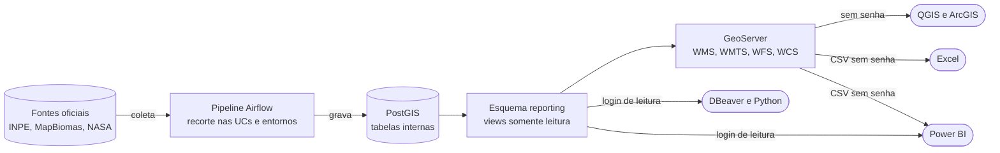
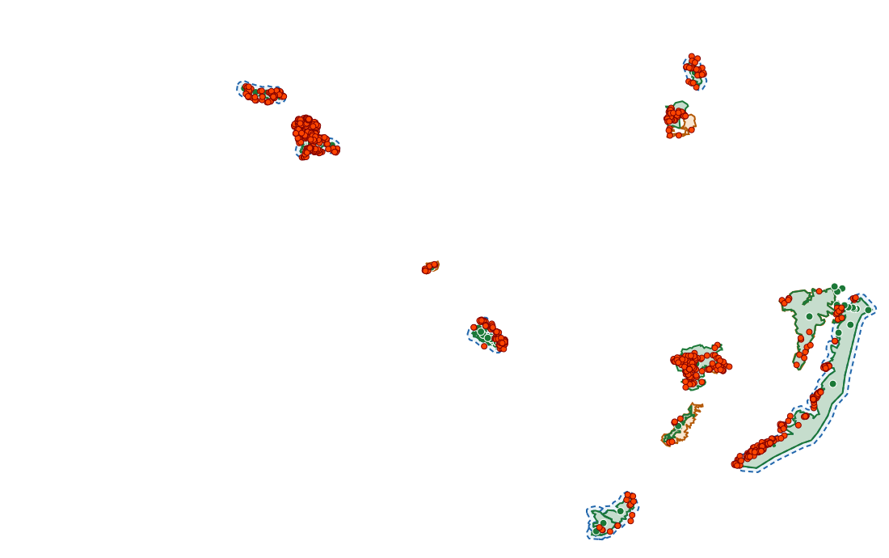
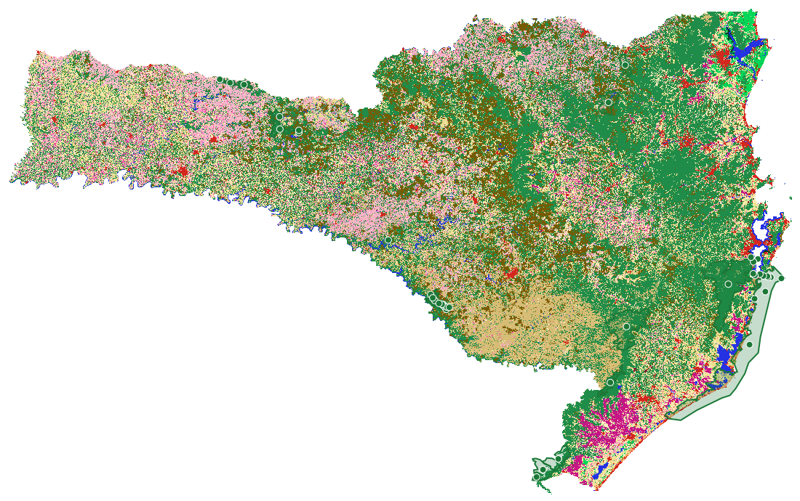
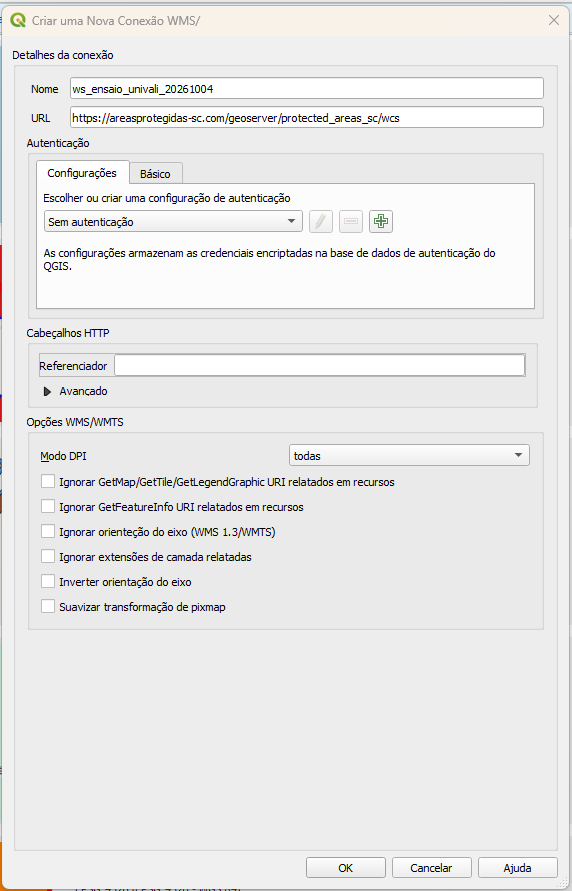
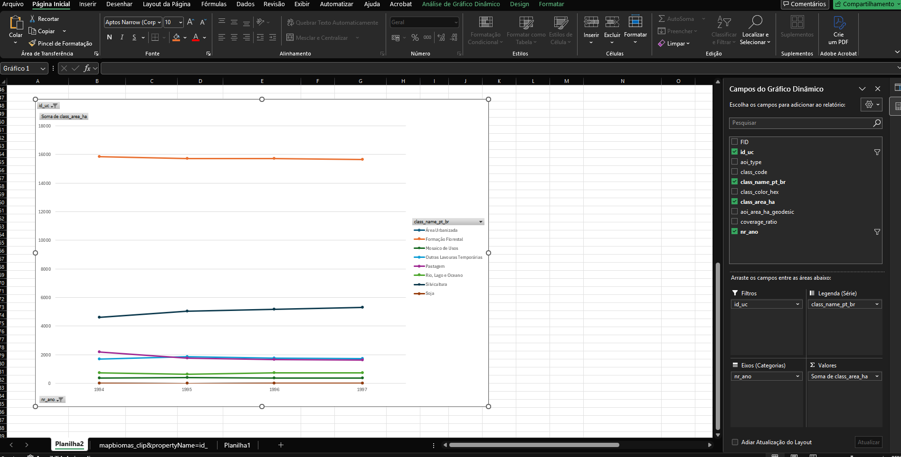
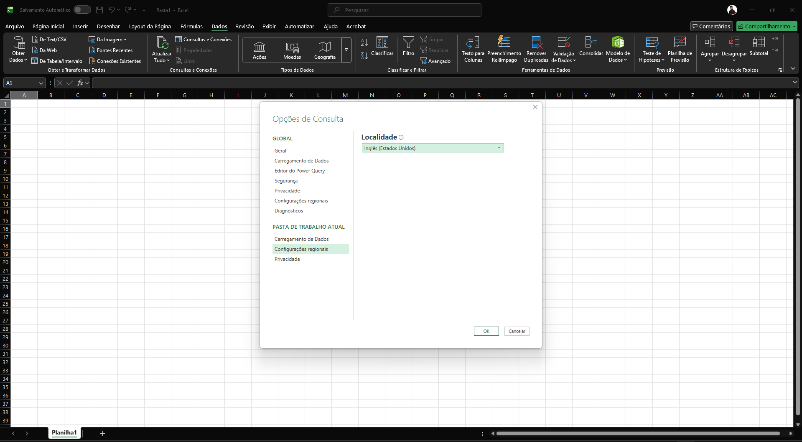
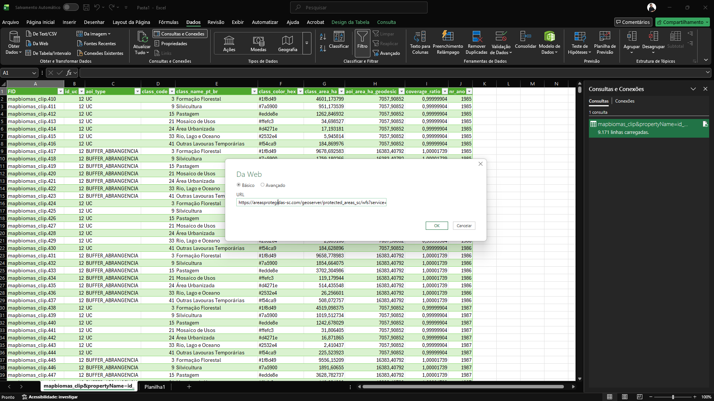
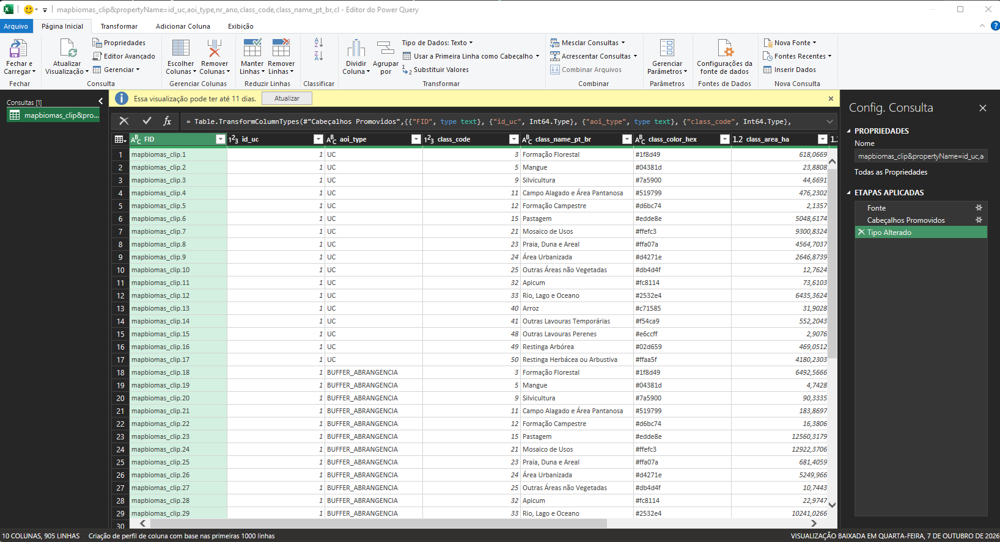

# 🗺️ Wiki de acesso aos dados

> ℹ️ Esta página reúne **como acessar os dados publicados pelo projeto Áreas Protegidas SC** sobre as Unidades de Conservação de Santa Catarina e seus entornos: os serviços de mapa, o Excel, o Power BI, o SQL e o Python, com o dicionário de dados e 15 consultas prontas. Os números de cobertura são um **retrato de 02/11/2026** e crescem com as cargas semanais.
{.is-info}

> ⚠️ **ATENÇÃO:** os serviços de mapa e o download em CSV são **abertos e sem senha**. O acesso ao banco exige um login, e o administrador entrega o usuário, a senha e o endereço do servidor por canal privado. Nunca publique esses dados em relatórios, repositórios ou mensagens de grupo.
{.is-warning}

---

## Sumário

- [Visão geral](#visão-geral)
- [Mapa do acesso](#mapa-do-acesso)
- [1. Apresentação](#1-apresentação)
- [2. Os serviços de mapa (WMS, WMTS, WFS e WCS)](#2-os-serviços-de-mapa-wms-wmts-wfs-e-wcs)
- [3. QGIS](#3-qgis)
- [4. Excel](#4-excel)
- [5. Power BI Desktop](#5-power-bi-desktop)
- [6. DBeaver e outros clientes SQL](#6-dbeaver-e-outros-clientes-sql)
- [7. Problemas comuns](#7-problemas-comuns)
- [8. Dicionário de dados](#8-dicionário-de-dados)
- [9. Consultas prontas](#9-consultas-prontas)
- [10. Acesso por Python](#10-acesso-por-python)
- [11. Oficinas: modo eventos](#11-oficinas-modo-eventos)
- [12. Cobertura e limitações dos dados](#12-cobertura-e-limitações-dos-dados)
- [13. Créditos e citação das fontes](#13-créditos-e-citação-das-fontes)
- [14. Siglas](#14-siglas)
- [Referências](#referências)

---

## Visão geral

| | |
|---|---|
| **O que é** | Os dados de monitoramento ambiental das 186 Unidades de Conservação (UCs) de Santa Catarina e de seus entornos, já recortados e prontos para análise: desmatamento (PRODES e MapBiomas Alerta), focos de calor (NASA FIRMS) e uso e cobertura da terra (MapBiomas). |
| **Quem usa** | Pesquisadores e estudantes do projeto de extensão, participantes de oficinas e qualquer pessoa que queira analisar as UCs de Santa Catarina. |
| **Como acessar** | Pelo endereço [areasprotegidas-sc.com](https://areasprotegidas-sc.com): serviços de mapa e CSV sem senha, e banco de dados com login de leitura. |
| **Como os dados chegam** | Um pipeline em Apache Airflow baixa as fontes oficiais, recorta cada tema nas UCs e nos entornos e publica o resultado no banco PostGIS e no GeoServer. Alertas e focos são atualizados toda segunda-feira. |

| Ferramenta | Acesso | Senha | Para quê |
|---|---|:---:|---|
| [QGIS, ArcGIS e outros GIS](#3-qgis) | WMS, WMTS, WFS, WCS | não | Ver mapas, baixar feições e o raster MapBiomas |
| [Excel](#4-excel) | WFS em CSV | não | Tabelas atualizáveis e gráficos dinâmicos |
| [Power BI](#5-power-bi-desktop) | banco ou WFS em CSV | banco: sim | Painéis com várias bases relacionadas |
| [DBeaver e clientes SQL](#6-dbeaver-e-outros-clientes-sql) | banco PostgreSQL | sim | Consultas livres e espaciais em SQL |
| [Python](#10-acesso-por-python) | WFS ou banco | banco: sim | Análises reprodutíveis com pandas e geopandas |

---

## Mapa do acesso



> ℹ️ Ninguém de fora acessa as tabelas internas. Tudo o que é publicado passa pelo **esquema reporting**, e o GeoServer lê essa mesma camada. Por isso um mapa no QGIS, uma planilha no Excel e uma consulta SQL mostram sempre os mesmos números.
{.is-info}

---

## 1. Apresentação

Este guia mostra como os operadores do projeto Áreas Protegidas SC acessam os dados que o sistema publica sobre as Unidades de Conservação (UCs) de Santa Catarina e seus entornos: desmatamento (PRODES e MapBiomas Alerta), focos de calor (NASA FIRMS) e uso e cobertura da terra (MapBiomas).

Ele cobre quatro formas de acesso, da mais simples para a mais técnica:

- **Softwares de GIS** (QGIS, ArcGIS e similares), pelos serviços de mapa WMS, WMTS, WFS e WCS, sem senha;
- **Excel**, baixando tabelas do serviço WFS em formato CSV, também sem senha;
- **Power BI**, conectado ao banco de dados com login;
- **DBeaver** (ou outro cliente SQL), conectado ao banco com login, para consultas livres em SQL.

O [capítulo 8](#8-dicionário-de-dados) traz o dicionário de dados: o que cada tabela contém, de onde vem cada dado, como ele foi gerado e para que serve. O [capítulo 9](#9-consultas-prontas) reúne 15 consultas prontas para análises de geoprocessamento e sensoriamento remoto. Os capítulos 10 a 13 tratam do acesso por Python, das oficinas com o modo eventos, da cobertura e das limitações de cada base e de como citar as fontes.

### 1.1 Como o acesso está organizado

Ninguém de fora acessa as tabelas de produção do sistema. Tudo o que é publicado passa por uma camada de leitura, o esquema reporting, formado por views (tabelas virtuais) que mostram só os produtos prontos, sem dados internos de operação. O GeoServer, servidor de mapas do projeto, lê essa camada e a oferece como serviços web. Quem precisa de SQL conecta direto nessa mesma camada, sempre em modo somente leitura.

O [mapa do acesso](#mapa-do-acesso), no início desta página, mostra esses caminhos.

### 1.2 Qual credencial usar

**Tabela 1.** Ferramenta, forma de acesso e credencial.

| **Ferramenta** | **Acesso** | **Credencial** |
|----|----|----|
| QGIS, ArcGIS e outros softwares de GIS | WMS, WMTS, WFS, WCS | nenhuma |
| Excel | WFS em CSV (Dados &gt; Da Web) | nenhuma |
| Power BI | conector PostgreSQL | login de banco |
| DBeaver ou outro cliente SQL | PostgreSQL | login de banco |

Existem dois logins de banco para pessoas:

**Tabela 2.** Logins de banco para pessoas.

| **Login** | **Para quem** | **Como obter** | **Validade** |
|----|----|----|----|
| login do laboratório | grupo fixo do laboratório (projeto de extensão) | usuário, senha e endereço do servidor repassados pelo administrador, por canal privado | permanente; a senha muda quando alguém sai do grupo |
| ws\_&lt;instituição&gt;\_&lt;data&gt; | participantes de uma oficina | o administrador lê no painel, aba Modo eventos, botão Mostrar dados de acesso | só enquanto o modo eventos estiver ativo |

Os dois têm as mesmas permissões: leem apenas as views de reporting, não conseguem gravar nada e têm limite de tempo por consulta (220 segundos no login do laboratório, 120 no login do evento) e de conexões simultâneas (12 no login do laboratório).

> ⚠️ **Atenção:** A conta do painel (administrador ou operador) **não** dá acesso ao banco. E os serviços de mapa (WMS, WFS, WCS) **não pedem senha**: se você preencher usuário e senha neles, o servidor responde com erro 401.
{.is-warning}


## 2. Os serviços de mapa (WMS, WMTS, WFS e WCS)

Os serviços seguem padrões abertos do Open Geospatial Consortium (OGC), o que permite usá-los em qualquer software de GIS. A diferença entre eles está no que cada um devolve:

**Tabela 3.** Diferença entre os serviços OGC.

| **Serviço** | **O que devolve** | **Analogia** | **Use quando** |
|----|----|----|----|
| WMS (Web Map Service) | uma imagem pronta do mapa, já colorida | uma fotografia do mapa | quiser ver e sobrepor camadas, montar um layout |
| WMTS (Web Map Tile Service) | o mesmo mapa em ladrilhos pré-gerados | um álbum de fotos já impressas | precisar de navegação rápida (oficinas, muitas pessoas) |
| WFS (Web Feature Service) | as feições vetoriais com todos os atributos (também em CSV ou JSON) | a planilha com o desenho de cada polígono ou ponto | for analisar, filtrar, calcular, exportar |
| WCS (Web Coverage Service) | o raster com o valor original de cada pixel | o arquivo de imagem de satélite classificado | for fazer análise raster (MapBiomas) |

Todos partem do mesmo endereço base, mas cada um tem o seu final. A base sozinha não funciona.

**Tabela 4.** Endereços dos serviços.

| **Serviço** | **URL** |
|----|----|
| WMS | https://areasprotegidas-sc.com/geoserver/protected_areas_sc/wms |
| WMTS | https://areasprotegidas-sc.com/geoserver/protected_areas_sc/gwc/service/wmts |
| WFS | https://areasprotegidas-sc.com/geoserver/protected_areas_sc/wfs |
| WCS | https://areasprotegidas-sc.com/geoserver/protected_areas_sc/wcs |
| Todos (endereço único, útil em scripts) | https://areasprotegidas-sc.com/geoserver/protected_areas_sc/ows |

### 2.1 Camadas publicadas

**Tabela 5.** Camadas e serviços disponíveis.

| **Camada** | **WMS** | **WFS** | **WCS** | **Conteúdo** |
|----|----|----|----|----|
| uc | sim | sim |  | Unidades de Conservação |
| za_oficial | sim | sim |  | Zonas de Amortecimento oficiais |
| buffer_abrangencia | sim | sim |  | Buffers de Abrangência de 3.000 m |
| prodes_clip | sim | sim |  | Desmatamento PRODES recortado |
| mapbiomas_alerta_clip | sim | sim |  | Alertas MapBiomas recortados |
| firms_clip | sim | sim |  | Focos de calor |
| mapbiomas_raster_asset | sim | sim |  | Catálogo dos rasters MapBiomas |
| mapbiomas_clip |  | sim |  | Área por classe MapBiomas (tabela, sem geometria) |
| mapbiomas_legend_class |  | sim |  | Legenda MapBiomas (tabela, sem geometria) |
| mapbiomas_uso_cobertura\_&lt;ano&gt; | sim |  | sim | Mapa MapBiomas de cada ano, de 1985 a 2025 |

No WFS, os nomes levam o prefixo protected_areas_sc: (por exemplo, protected_areas_sc:uc). No WCS, o prefixo é protected_areas_sc\_\_.



*Figura 1. Resposta real do WMS: UCs, Zonas de Amortecimento (laranja), Buffers de Abrangência (azul tracejado) e focos de calor.*



*Figura 2. Resposta real do WMS: MapBiomas 2025 em Santa Catarina com as UCs sobrepostas.*

### 2.2 Baixar arquivos direto pelo navegador

O WFS também entrega arquivos prontos. Cole a URL no navegador e o download começa. Troque uc pelo nome da camada desejada:

**Tabela 6.** Formatos de download do WFS.

| **Formato** | **Parâmetro** | **Exemplo** |
|----|----|----|
| CSV (planilha) | outputFormat=csv | https://areasprotegidas-sc.com/geoserver/protected_areas_sc/wfs?service=WFS&version=2.0.0&request=GetFeature&typeNames=protected_areas_sc:uc&outputFormat=csv |
| GeoJSON (geometria e atributos) | outputFormat=application/json | https://areasprotegidas-sc.com/geoserver/protected_areas_sc/wfs?service=WFS&version=2.0.0&request=GetFeature&typeNames=protected_areas_sc:uc&outputFormat=application/json |
| Shapefile compactado (.zip) | outputFormat=SHAPE-ZIP | https://areasprotegidas-sc.com/geoserver/protected_areas_sc/wfs?service=WFS&version=2.0.0&request=GetFeature&typeNames=protected_areas_sc:uc&outputFormat=SHAPE-ZIP |

> ⚠️ **Atenção:** O Shapefile corta nomes de coluna em 10 caracteres e separa as feições por tipo de geometria (polígonos e pontos em arquivos diferentes). Para guardar os dados com nomes completos, prefira GeoJSON ou, no QGIS, exporte a camada WFS para GeoPackage.
>
> Todas as geometrias vêm em SIRGAS 2000 (EPSG:4674), com 8 casas decimais.
{.is-warning}


### 2.3 Descobrir as colunas e baixar em partes

Para listar as colunas e os tipos de uma camada, sem baixar dados:

```text
https://areasprotegidas-sc.com/geoserver/protected_areas_sc/wfs?service=WFS&version=2.0.0&request=DescribeFeatureType&typeNames=protected_areas_sc:firms_clip&outputFormat=application/json
```

Para saber quantos registros uma consulta devolve, sem baixá-los, use resultType=hits (a resposta traz numberMatched):

```text
https://areasprotegidas-sc.com/geoserver/protected_areas_sc/wfs?service=WFS&version=2.0.0&request=GetFeature&typeNames=protected_areas_sc:prodes_clip&resultType=hits
```

Para baixar em partes (por exemplo, de 1.000 em 1.000), combine count e startIndex: a primeira parte usa startIndex=0, a segunda startIndex=1000, e assim por diante. O serviço aceita até 1.000.000 de registros por requisição, mais do que todas as bases têm hoje; a divisão só é útil em conexões lentas.

## 3. QGIS

Os passos valem para o QGIS 3.28 ou mais recente. Todos começam em **Camada &gt; Gerenciador de Fontes de Dados** (atalho Ctrl+L).

### 3.1 Ver os mapas (WMS ou WMTS)

1. Abra a aba **WMS/WMTS** e clique em **Novo**.
2. Nome: Áreas Protegidas SC. URL: https://areasprotegidas-sc.com/geoserver/protected_areas_sc/wms. Deixe a autenticação em branco e clique em **OK**.
3. Clique em **Conectar**, selecione as camadas desejadas e clique em **Adicionar**.
4. Para navegação mais rápida, crie uma segunda conexão com a URL WMTS https://areasprotegidas-sc.com/geoserver/protected_areas_sc/gwc/service/wmts.



### 3.2 Baixar feições para análise (WFS)

1. Abra a aba **WFS / OGC API - Features** e clique em **Novo**.
2. URL: https://areasprotegidas-sc.com/geoserver/protected_areas_sc/wfs. Versão: **2.0.0** (ou Detectar). Autenticação em branco. **OK**.
3. Clique em **Conectar**, escolha a camada e clique em **Adicionar**.
4. Em camadas grandes (como firms_clip e prodes_clip), marque **Apenas requisitar feições que se sobrepõem à extensão da visualização** para baixar só o que está na tela.

Com o WFS a camada chega com todos os atributos: dá para abrir a tabela de atributos, filtrar, usar a calculadora de campos, gerar estatísticas e exportar (botão direito &gt; Exportar &gt; Salvar feições como) para Shapefile, GeoPackage ou planilha.

### 3.3 Baixar o raster MapBiomas (WCS)

1. Abra a aba **WCS** e clique em **Novo**.
2. URL: https://areasprotegidas-sc.com/geoserver/protected_areas_sc/wcs. **OK** e **Conectar**.
3. Escolha protected_areas_sc\_\_mapbiomas_uso_cobertura\_&lt;ano&gt; e clique em **Adicionar**.

O WCS entrega o código da classe em cada pixel, sem cores. Para colorir, use o estilo oficial do MapBiomas (arquivo QML da Coleção 11) ou carregue o mesmo ano pelo WMS, que já vem colorido. Para traduzir os códigos, use a legenda (mapbiomas_legend_class).

> 💡 **Dica:** Para recortar o raster de uma UC, carregue a UC pelo WFS e use Raster > Extração > Recortar Raster pela Camada de Máscara. Para calcular área por classe, prefira a tabela mapbiomas_clip, que já traz o cálculo geodésico pronto.
{.is-success}


### 3.4 ArcGIS Pro

No ArcGIS Pro, use **Inserir &gt; Conexões &gt; Servidor &gt; Novo servidor WMS** (ou **Novo servidor WFS** / **Novo servidor WCS**) e informe as mesmas URLs, sem usuário e senha. As conexões aparecem no painel Catálogo, em Servidores, de onde as camadas são arrastadas para o mapa.

### 3.5 Receitas de análise no QGIS

#### Filtrar uma camada

Clique com o botão direito na camada, escolha **Filtrar...** e escreva a expressão. Exemplos:

```text
"tipo_cruzamento" = 'UC' AND "nr_ano" >= 2020
"source_product" LIKE 'VIIRS%' AND "daynight" = 'N'
"aoi_type" = 'UC' AND "class_code" IN (3, 4, 5, 6, 49)
```


#### Mapa de calor dos focos

1. Carregue firms_clip pelo WFS e, se quiser, filtre o período ("nr_ano" &gt;= 2020).
2. Em **Propriedades &gt; Simbologia**, troque Símbolo simples por **Mapa de calor**.
3. Defina o **Raio** em quilômetros (2 a 5 km funciona bem na escala do estado) e escolha uma rampa de cores.

Para um raster de densidade que pode ser salvo e analisado, use **Processamento &gt; Caixa de Ferramentas &gt; Mapa de calor (Estimativa de densidade Kernel)** sobre a camada reprojetada para SIRGAS 2000 / UTM 22S (EPSG:31982), para o raio ficar em metros.

#### Colorir o MapBiomas baixado pelo WCS

O WCS traz só os códigos das classes. Em **Propriedades &gt; Simbologia &gt; Estilo &gt; Carregar estilo**, aplique o estilo oficial ESTILO_QGIS_COL11_PT.qml do pacote da Coleção 11 do MapBiomas (o administrador do projeto fornece o arquivo). As cores e os nomes ficam iguais aos do WMS.

#### Área por classe numa área desenhada por você

Para UCs e entornos, use a tabela mapbiomas_clip, que já traz a área calculada sobre o elipsoide. Para uma área própria (por exemplo, uma microbacia):

1. Carregue o MapBiomas do ano pelo WCS e a sua área (polígono).
2. **Processamento &gt; Recortar raster pela camada de máscara**, usando o seu polígono.
3. **Processamento &gt; Reprojetar** (Warp) o recorte para EPSG:31982, com reamostragem **Vizinho mais próximo** (nunca bilinear: os valores são códigos de classe).
4. **Processamento &gt; Relatório de valores únicos da camada raster**: a tabela traz, para cada código de classe, a quantidade de pixels e a área em m² (divida por 10.000 para hectares).
5. Traduza os códigos com a camada mapbiomas_legend_class (WFS).

#### Focos por UC e por ano

Carregue firms_clip e use **Processamento &gt; Estatísticas por categorias**, com os campos de categoria id_uc e nr_ano. O resultado é uma tabela com a contagem por UC e ano. Para separar dentro e entorno, filtre antes por tipo_cruzamento.

#### Layout para relatório

Em **Projeto &gt; Novo Layout de Impressão**, adicione o mapa, a legenda, a escala e o norte. Cite as fontes no rodapé do layout ([capítulo 13](#13-créditos-e-citação-das-fontes)).

## 4. Excel

O Excel lê as tabelas diretamente do serviço WFS em formato CSV, sem senha e sem instalar nada. Cada consulta vira uma tabela atualizável: basta clicar em **Atualizar Tudo** para trazer os dados mais recentes.

### 4.1 Montando a URL

A URL é o endereço do WFS seguido de parâmetros. O modelo é:

```text
https://areasprotegidas-sc.com/geoserver/protected_areas_sc/wfs?service=WFS&version=2.0.0&request=GetFeature
&typeNames=protected_areas_sc:<camada>
&outputFormat=csv
&propertyName=<coluna1>,<coluna2>,...
&CQL_FILTER=<filtro>
```


**Tabela 7.** Parâmetros úteis do WFS.

| **Parâmetro** | **Para que serve** | **Exemplo** |
|----|----|----|
| typeNames | camada desejada | protected_areas_sc:prodes_clip |
| outputFormat=csv | devolve CSV (obrigatório para o Excel) | csv |
| propertyName | escolhe as colunas; sem ele vêm todas, inclusive a geometria | id_uc,nr_ano,area_intersecao_km2 |
| CQL_FILTER | filtra as linhas | nr_ano&gt;=2020 AND tipo_cruzamento='UC' |
| sortBy | ordena | dt_deteccao DESC |
| count | limita a quantidade de linhas | 1000 |

Na URL, espaços viram %20, aspas simples viram %27 e o sinal de igual dentro do filtro vira %3D. Copie a URL inteira, numa linha só, sem espaços no meio.

### 4.2 Uma URL pronta para cada base

Todas as URLs abaixo foram testadas e trazem as colunas mais úteis de cada base, sem a geometria. Para ver todas as colunas, consulte o dicionário de dados ([capítulo 8](#8-dicionário-de-dados)) e acrescente os nomes em propertyName.

**Unidades de Conservação** (uc)

```text
https://areasprotegidas-sc.com/geoserver/protected_areas_sc/wfs?service=WFS&version=2.0.0&request=GetFeature&outputFormat=csv&typeNames=protected_areas_sc:uc&propertyName=id_uc,cd_cnuc,nm_uc,ds_grupo,ds_categoria,ds_esfera,nm_orgao_gestor,area_total_ha,situacao,longitude,latitude
```

**Zonas de Amortecimento oficiais vigentes** (za_oficial)

```text
https://areasprotegidas-sc.com/geoserver/protected_areas_sc/wfs?service=WFS&version=2.0.0&request=GetFeature&outputFormat=csv&typeNames=protected_areas_sc:za_oficial&propertyName=id_za_oficial,id_uc,ds_fonte,numero_versao,dt_inicio_vigencia,longitude,latitude&CQL_FILTER=fl_ativa%3Dtrue
```

**Buffers de Abrangência vigentes** (buffer_abrangencia)

```text
https://areasprotegidas-sc.com/geoserver/protected_areas_sc/wfs?service=WFS&version=2.0.0&request=GetFeature&outputFormat=csv&typeNames=protected_areas_sc:buffer_abrangencia&propertyName=id_buffer_abrangencia,id_uc,dist_buffer_m,numero_versao,dt_inicio_vigencia,longitude,latitude&CQL_FILTER=fl_ativa%3Dtrue
```

**Desmatamento PRODES (sem reservatórios)** (prodes_clip)

```text
https://areasprotegidas-sc.com/geoserver/protected_areas_sc/wfs?service=WFS&version=2.0.0&request=GetFeature&outputFormat=csv&typeNames=protected_areas_sc:prodes_clip&propertyName=id_uc,tipo_cruzamento,nr_ano,ds_class_name,area_intersecao_km2,longitude,latitude&CQL_FILTER=ds_class_name%3D%27desmatamento%27
```

**Alertas MapBiomas** (mapbiomas_alerta_clip)

```text
https://areasprotegidas-sc.com/geoserver/protected_areas_sc/wfs?service=WFS&version=2.0.0&request=GetFeature&outputFormat=csv&typeNames=protected_areas_sc:mapbiomas_alerta_clip&propertyName=id_uc,tipo_cruzamento,id_alerta_original,dt_deteccao,nr_ano,nr_mes,area_ha,ds_fonte_deteccao,longitude,latitude
```

**Focos de calor FIRMS** (firms_clip)

```text
https://areasprotegidas-sc.com/geoserver/protected_areas_sc/wfs?service=WFS&version=2.0.0&request=GetFeature&outputFormat=csv&typeNames=protected_areas_sc:firms_clip&propertyName=id_uc,tipo_cruzamento,detection_id,source_product,dt_deteccao_local,nr_ano,nr_mes,daynight,frp_mw,confidence_class,longitude,latitude
```

**Área por classe MapBiomas (UC e entorno, por ano)** (mapbiomas_clip)

```text
https://areasprotegidas-sc.com/geoserver/protected_areas_sc/wfs?service=WFS&version=2.0.0&request=GetFeature&outputFormat=csv&typeNames=protected_areas_sc:mapbiomas_clip&propertyName=id_uc,aoi_type,nr_ano,class_code,class_name_pt_br,class_color_hex,class_area_ha,aoi_area_ha_geodesic,coverage_ratio
```

**Gráfico da evolução de cada classe por UC (Tabela Dinâmica)**

Depois de carregar a tabela acima no Excel ([seção 4.4](#44-importando-no-excel)), os passos abaixo montam um gráfico de linhas com a área de cada classe ao longo dos anos, para a UC e o recorte escolhidos. A Figura 3 mostra o resultado.

**1. Criar a Tabela Dinâmica**

A consulta já chega ao Excel formatada como tabela. Clique em qualquer célula dela e use **Inserir &gt; Tabela Dinâmica &gt; Da Tabela/Intervalo**, escolha **Nova Planilha** e clique em **OK**.

**2. Organizar os campos**

No painel **Campos da Tabela Dinâmica**, arraste os campos para as áreas abaixo.

| **Área da Tabela Dinâmica** | **Campo**             |
|-----------------------------|-----------------------|
| Filtros                     | id_uc e aoi_type      |
| Colunas                     | class_name_pt_br      |
| Linhas                      | nr_ano                |
| Valores                     | Soma de class_area_ha |

Se aparecer **Contagem de class_area_ha**, clique na seta desse campo, escolha **Configurações do Campo de Valor**, selecione **Soma** e clique em **OK**.

**3. Filtrar o tipo de área**

A coluna aoi_type indica o recorte de cada linha. Para analisar um recorte por vez, use o filtro aoi_type da Tabela Dinâmica.

- UC para a área da própria unidade de conservação.
- ZA para a Zona de Amortecimento oficial, nas UCs que a possuem.
- BUFFER_ABRANGENCIA para o Buffer de Abrangência de 3.000 m, nas UCs sem ZA oficial.

> ⚠️ **Atenção:** Sem o filtro de aoi_type, o Excel soma as áreas dos recortes diferentes para o mesmo id_uc, classe e ano, e o gráfico mostra valores maiores que a área real da UC.
{.is-warning}

**4. Criar o Gráfico Dinâmico**

Clique na Tabela Dinâmica e use **Inserir &gt; Gráfico Dinâmico &gt; Linhas &gt; Linha com Marcadores &gt; OK**. No painel **Campos do Gráfico Dinâmico**, a distribuição fica como abaixo.

| **Área do Gráfico Dinâmico** | **Campo**             |
|------------------------------|-----------------------|
| Filtros                      | id_uc e aoi_type      |
| Legenda (Série)              | class_name_pt_br      |
| Eixos (Categorias)           | nr_ano                |
| Valores                      | Soma de class_area_ha |



*Figura 3. Gráfico Dinâmico da área por classe e ano, com os campos distribuídos no painel (imagem ilustrativa).*

**5. Escolher a unidade e ler o gráfico**

Nos filtros do gráfico, escolha, por exemplo, id_uc = 12 e aoi_type = UC. O gráfico passa a mostrar:

- no eixo horizontal, os anos
- no eixo vertical, a área em hectares
- em cada linha, uma classe de cobertura, como Formação Florestal, Silvicultura ou Pastagem
- em cada ponto, a área daquela classe no ano, para a unidade e o recorte escolhidos.

Como título do gráfico, use, por exemplo, “Evolução da cobertura e uso da terra, UC 12”, e “Área (ha)” como título do eixo vertical.

**6. Criar botões para os filtros**

Selecione a Tabela Dinâmica e use **Análise de Tabela Dinâmica &gt; Inserir Segmentação de Dados**, marque id_uc e aoi_type e clique em **OK**. Os botões criados trocam a unidade e o recorte, e o gráfico se atualiza na hora.

**Legenda MapBiomas** (mapbiomas_legend_class)

```text
https://areasprotegidas-sc.com/geoserver/protected_areas_sc/wfs?service=WFS&version=2.0.0&request=GetFeature&outputFormat=csv&typeNames=protected_areas_sc:mapbiomas_legend_class&propertyName=class_code,parent_class_code,hierarchy_level,name_pt_br,name_en,color_hex,is_terminal
```

**Anos MapBiomas publicados** (mapbiomas_raster_asset)

```text
https://areasprotegidas-sc.com/geoserver/protected_areas_sc/wfs?service=WFS&version=2.0.0&request=GetFeature&outputFormat=csv&typeNames=protected_areas_sc:mapbiomas_raster_asset&propertyName=reference_year,coverage_scope,checksum_sha256,byte_size,published_at
```

Variações úteis, acrescentadas ao fim de qualquer URL:

**Tabela 8.** Filtros prontos para as URLs do WFS.

| **Para** | **Acrescente** |
|----|----|
| só o que caiu dentro das UCs | &CQL_FILTER=tipo_cruzamento%3D%27UC%27 |
| a partir de 2020 | &CQL_FILTER=nr_ano%3E%3D2020 |
| as duas condições juntas | &CQL_FILTER=tipo_cruzamento%3D%27UC%27%20AND%20nr_ano%3E%3D2020 |
| uma UC específica | &CQL_FILTER=id_uc%3D4 |
| ordenar do mais recente para o mais antigo (alertas) | &sortBy=dt_deteccao%20DESC |

Nas bases que já têm um filtro (ZA, Buffer e PRODES), junte a nova condição à existente com %20AND%20, sem repetir &CQL_FILTER=.

### 4.3 Antes de importar: separador decimal

O CSV do serviço usa **ponto** como separador decimal (618.0669), o padrão internacional. O Excel em português entende o ponto como separador de **milhar** e transforma 618.0669 em 6180669, sem mostrar erro nenhum. Para evitar isso, faça esta configuração **uma vez em cada pasta de trabalho, antes da primeira importação**:

1. Abra a guia **Dados &gt; Obter Dados &gt; Opções de Consulta**.
2. Em **Pasta de Trabalho Atual**, clique em **Configurações Regionais**.
3. Em **Localidade**, escolha **Inglês (Estados Unidos)** e clique em **OK**.

Com isso, o Power Query lê os números e as datas do CSV no formato correto. Na planilha, eles continuam aparecendo no formato do Windows em português (618,0669).



> ⚠️ **Atenção:** **Conferência rápida depois de carregar:** em mapbiomas_clip, o coverage_ratio deve ficar perto de **1** (por exemplo, 1,00004) e a class_area_ha de uma classe nunca passa da aoi_area_ha_geodesic da mesma linha. Em prodes_clip, a area_intersecao_km2 costuma ser menor que 1. Valores milhares de vezes maiores indicam que a configuração acima não foi feita: refaça a consulta depois de configurar.
{.is-warning}


### 4.4 Importando no Excel

1. No Excel (Microsoft 365 ou 2016 em diante), abra a guia **Dados** e clique em **Da Web** (ou **Obter Dados &gt; De Outras Fontes &gt; Da Web**).
2. Cole a URL e clique em **OK**. Se perguntar o tipo de acesso, escolha **Anônimo** e **Conectar**.
3. Na prévia, clique em **Transformar Dados** para abrir o Power Query.
4. Remova a coluna FID (identificador técnico do serviço).
5. Confira se as colunas decimais aparecem com o ícone de número decimal (1.2) e com valores coerentes. Se uma coluna ainda estiver errada, clique no ícone do tipo, escolha **Usando Localidade...**, tipo **Número Decimal** e localidade **Inglês (Estados Unidos)**.
6. Clique em **Fechar e Carregar**.





> ⚠️ **Atenção:** Se os acentos aparecerem trocados (por exemplo, á), na etapa Fonte do Power Query defina a origem do arquivo como **65001: Unicode (UTF-8)**.
>
> Não traga a coluna geom: o texto da geometria pode ultrapassar o limite de caracteres de uma célula do Excel. Use longitude e latitude para localizar os registros.
{.is-warning}

> 💡 **Dica:** Com duas consultas no mesmo arquivo (por exemplo, uc e mapbiomas_clip), use **PROCX** (ou PROCV) por id_uc para trazer o nome da UC, ou crie uma Tabela Dinâmica com as duas tabelas no Modelo de Dados.
{.is-success}


### 4.5 Receitas de análise no Excel

#### Evolução da floresta por UC (gráfico de linhas)

1. Importe só as classes florestais dentro das UCs com a URL abaixo (Formação Florestal, Formação Savânica, Mangue, Floresta Alagável e Restinga Arbórea).
2. Importe também a camada uc ([seção 4.2](#42-uma-url-pronta-para-cada-base)) para ter o nome de cada UC.
3. Selecione a tabela de florestas e use **Inserir &gt; Tabela Dinâmica**. Linhas: id_uc; Colunas: nr_ano; Valores: Soma de class_area_ha.
4. Com a Tabela Dinâmica selecionada, **Inserir &gt; Gráfico de Linhas**. Cada linha do gráfico é uma UC, e o eixo horizontal são os anos.

```text
https://areasprotegidas-sc.com/geoserver/protected_areas_sc/wfs?service=WFS&version=2.0.0&request=GetFeature&typeNames=protected_areas_sc:mapbiomas_clip&outputFormat=csv&propertyName=id_uc,nr_ano,class_code,class_name_pt_br,class_area_ha&CQL_FILTER=aoi_type%3D%27UC%27%20AND%20class_code%20IN%20(3,4,5,6,49)
```

#### Focos de calor por ano e sensor

1. Importe firms_clip ([seção 4.2](#42-uma-url-pronta-para-cada-base)) e, na janela de importação, marque **Adicionar estes dados ao Modelo de Dados**.
2. **Inserir &gt; Tabela Dinâmica** a partir do Modelo de Dados. Linhas: nr_ano; Colunas: source_product; Valores: detection_id com **Contagem Distinta** (em Configurações do Campo de Valor).
3. Compare a tendência de cada sensor; não some colunas de sensores diferentes.

#### Desmatamento PRODES dentro da UC e no entorno

1. Importe prodes_clip ([seção 4.2](#42-uma-url-pronta-para-cada-base), já sem reservatórios).
2. No Power Query, use **Adicionar Coluna &gt; Coluna Personalizada** com o nome area_ha e a fórmula \[area_intersecao_km2\] \* 100.
3. Tabela Dinâmica com Linhas: nr_ano; Colunas: tipo_cruzamento; Valores: Soma de area_ha.

> 💡 **Dica:** Para atualizar todas as consultas de uma vez, use **Dados > Atualizar Tudo**. As Tabelas Dinâmicas acompanham depois de **Atualizar** (botão direito sobre elas).
{.is-success}


## 5. Power BI Desktop

O Power BI pode ser conectado de duas formas: direto no banco (recomendado para o grupo do laboratório, com o login do laboratório) ou pelo WFS em CSV, como no Excel, sem login.

### 5.1 Antes da primeira conexão ao banco: certificado da AWS

O banco exige conexão criptografada (SSL), e o Power BI só confia em certificados instalados no Windows. O certificado da autoridade da Amazon (Amazon RDS us-east-1 Root CA RSA2048 G1) não vem no Windows e precisa ser instalado uma vez por computador. Não é preciso ser administrador:

1. Obtenha com o administrador o arquivo amazon-rds-us-east-1-root-rsa2048-g1.cer.
2. Dê dois cliques no arquivo e clique em **Instalar Certificado...**.
3. Escolha **Usuário Atual** e clique em **Avançar**.
4. Marque **Colocar todos os certificados no repositório a seguir**, clique em **Procurar** e escolha **Autoridades de Certificação Raiz Confiáveis**.
5. **Avançar &gt; Concluir** e confirme o Aviso de Segurança com **Sim**. Feche e abra o Power BI.

Confira o arquivo antes de instalar: validade de 25/05/2021 a 25/05/2061 e impressão digital SHA-1 2FA77EF894D983BA9D37AD699C84AB0F657BE1C8. Em laboratórios com muitas máquinas, peça à equipe de TI para instalar o mesmo certificado no repositório da máquina.

### 5.2 Conexão ao banco

1. **Página Inicial &gt; Obter Dados &gt; Mais... &gt; Banco de dados PostgreSQL &gt; Conectar**.
2. Servidor e Banco de dados: os dois valores entregues pelo administrador junto com o login. Modo de Conectividade: **Importar**. **OK**.
3. Na janela de credenciais, escolha a aba **Banco de dados** (não Windows), informe o usuário (login do laboratório ou do evento) e a senha. Mantenha **Criptografar conexões** marcado. **Conectar**.
4. No Navegador, marque as views de reporting desejadas (por exemplo, reporting.uc, reporting.mapbiomas_clip, reporting.firms_clip) e clique em **Transformar Dados**.
5. Em cada consulta com geometria, remova a coluna geom (botão direito &gt; Remover). **Fechar e Aplicar**.

Também é possível colar uma das consultas do [capítulo 9](#9-consultas-prontas): na janela do passo 2, abra **Opções avançadas** e cole o SQL em **Instrução SQL**.

### 5.3 Modelo de dados recomendado

Crie os relacionamentos a partir de uc\[id_uc\] (lado um) para o id_uc de cada view temática (lado muitos). Para cruzar temas por ano, crie uma tabela calendário de anos e relacione-a com o nr_ano de cada view, que tem o mesmo nome em todas:

```text
Anos = SELECTCOLUMNS(GENERATESERIES(1985, 2026, 1), "nr_ano", [Value])
```

Assim, um único filtro de ano controla ao mesmo tempo os gráficos de desmatamento, alertas, focos e uso da terra. Para mapas, use o visual **Mapa** ou **Azure Maps** com latitude e longitude.

### 5.4 Alternativa sem login: WFS em CSV

Em **Obter Dados &gt; Web**, cole uma URL do WFS em CSV ([capítulo 4](#4-excel)). Antes, configure a leitura do ponto decimal em **Arquivo &gt; Opções e configurações &gt; Opções &gt; Arquivo Atual &gt; Configurações Regionais**, com **Localidade para importação** em **Inglês (Estados Unidos)**; sem isso, o Power BI em português lê 618.0669 como 6180669. A conexão direta ao banco ([seção 5.2](#52-conexão-ao-banco)) não tem esse problema, porque os números chegam já como números. Esse caminho não precisa de certificado nem de login, mas só alcança as camadas publicadas no WFS.

> ⚠️ **Atenção:** O login do evento deixa de existir quando o modo eventos é desativado: relatórios montados em oficina continuam abertos, mas não atualizam mais. Relatórios permanentes do laboratório devem usar o login do laboratório.
{.is-warning}


### 5.5 Medidas sugeridas (DAX)

Com o modelo da [seção 5.3](#53-modelo-de-dados-recomendado) e um relacionamento de mapbiomas_legend_class\[class_code\] (lado um) para mapbiomas_clip\[class_code\] (lado muitos), crie as medidas em **Modelagem &gt; Nova medida**:

```text
Floresta (ha) =
CALCULATE ( SUM ( mapbiomas_clip[class_area_ha] ), mapbiomas_legend_class[parent_class_code] = 1 )
Vegetação nativa (ha) =
CALCULATE ( SUM ( mapbiomas_clip[class_area_ha] ), mapbiomas_legend_class[parent_class_code] IN { 1, 10 } )
Desmatamento PRODES (ha) =
CALCULATE ( SUM ( prodes_clip[area_intersecao_km2] ) * 100, prodes_clip[ds_class_name] = "desmatamento" )
Alertas = DISTINCTCOUNT ( mapbiomas_alerta_clip[id_alerta_original] )
Focos = DISTINCTCOUNT ( firms_clip[detection_id] )
Focos por 1.000 ha =
DIVIDE ( [Focos], SUM ( uc[area_total_ha] ) ) * 1000
```


Use as medidas com segmentações de nm_uc, tipo_cruzamento (ou aoi_type) e da tabela de anos. Para gráficos de uso da terra com as cores oficiais, use class_color_hex em **Formatar &gt; Cores &gt; fx &gt; Valor do campo**.

## 6. DBeaver e outros clientes SQL

O DBeaver (versão Community, gratuita) é o caminho para consultas livres em SQL, inclusive espaciais com as funções do PostGIS. Os mesmos dados valem para qualquer cliente PostgreSQL (pgAdmin, DataGrip, psql, Python, R).

1. **Banco de dados &gt; Nova conexão &gt; PostgreSQL &gt; Avançar**.
2. Aba **Principal**: Host, Porta e Banco de dados entregues pelo administrador junto com o login, Autenticação **Database Native**, usuário e senha (login do laboratório ou do evento).
3. Aba **SSL**: marque **Usar SSL** e escolha o modo **require**.
4. Clique em **Testar conexão**. Na primeira vez, o DBeaver baixa o driver do PostgreSQL. **Concluir**.
5. No navegador de banco de dados, abra **protected_areas_sc &gt; Esquemas &gt; reporting &gt; Views**.

> 💡 **Dica:** Para economizar conexões (o login do grupo tem limite de 12 simultâneas), em **Editar Conexão > Configurações da conexão** desmarque **Abrir conexão separada para leitura de metadados** e **Abrir conexão separada para cada editor**.
>
> A aba **Dados espaciais** do DBeaver desenha a coluna geom num mapa: útil para conferir o resultado de uma consulta espacial.
>
> O DBeaver exibe inteiros com separador de milhar (o ano 1989 aparece como 1.989). É só formatação de tela; o valor é 1989. Para desligar, em **Janela > Preferências > Editores > Editor de Dados > Formatos de Dados**, escolha o tipo **Number** e desmarque **Use grouping**.
{.is-success}


Para conferir a conexão, rode:

```sql
SELECT current_user, count(*) AS ucs FROM reporting.uc;
```

## 7. Problemas comuns

**Tabela 9.** Erros comuns e soluções.

| **Sintoma** | **Causa provável** | **Solução** |
|----|----|----|
| QGIS: "O servidor requer autenticação" (HTTP 401) no WMS, WFS ou WCS | usuário e senha preenchidos na conexão de mapa | apague usuário e senha; os serviços de mapa são abertos |
| QGIS: erro 404 ao conectar | URL terminando em /protected_areas_sc/, sem o serviço | use a URL com /wms, /wfs, /wcs ou /gwc/service/wmts |
| Excel ou Power BI: números milhares de vezes maiores (618.0669 virou 6180669) | o ponto decimal do CSV foi lido como separador de milhar | configure a localidade Inglês (Estados Unidos) antes de importar ([seções 4.3](#43-antes-de-importar-separador-decimal) e 5.4) e refaça a consulta |
| DBeaver: ano aparece como 1.989 | formatação de tela com separador de milhar | nada a corrigir nos dados; desligue o agrupamento nas preferências ([seção 6](#6-dbeaver-e-outros-clientes-sql)) |
| Excel: acentos trocados | codificação do arquivo | origem do arquivo 65001: Unicode (UTF-8) |
| WFS: "Requested property ... is not available" | nome de coluna errado em propertyName | confira o nome no dicionário de dados ([capítulo 8](#8-dicionário-de-dados)) |
| Power BI: "The remote certificate is invalid" | certificado da AWS não instalado | instale o certificado ([seção 5.1](#51-antes-da-primeira-conexão-ao-banco-certificado-da-aws)) e reabra o Power BI |
| no pg_hba.conf entry ... no encryption | conexão sem SSL | ative o SSL (modo require) ou Criptografar conexões |
| password authentication failed | senha errada, aba Windows no Power BI ou evento encerrado | confira a aba Banco de dados e peça a senha atual ao administrador |
| permission denied for schema public | consulta a tabelas internas | use apenas o esquema reporting |
| cannot execute ... in a read-only transaction | tentativa de gravar | o acesso é somente leitura |
| canceling statement due to statement timeout | consulta passou do limite de tempo | filtre por UC ou ano, ou agregue antes de trazer |
| too many connections for role | limite de conexões do login atingido | feche abas e conexões ociosas ([seção 6](#6-dbeaver-e-outros-clientes-sql), Dica) |
| 502 ou 504 nos mapas por alguns minutos | troca de tamanho do servidor no modo eventos | aguarde cerca de 2 minutos e recarregue |

## 8. Dicionário de dados

Esta seção descreve cada view do esquema reporting, que é o mesmo conteúdo publicado no WFS. Para cada uma: o que ela contém, como o dado foi gerado, para que pode ser útil, as colunas e os cuidados de interpretação.

### 8.1 Conceitos que valem para todas as views

- **Área de interesse.** Cada UC é analisada em duas partes que não se sobrepõem: a própria UC e o seu entorno. O entorno é a Zona de Amortecimento oficial (ZA), quando existe, ou o Buffer de Abrangência de 3.000 m, quando não existe. O que cai no entorno é sempre a parte fora da UC.
- **tipo_cruzamento** (ou **aoi_type**). Diz em qual dessas partes o registro caiu: UC, ZA ou BUFFER_ABRANGENCIA.
- **Sistema de referência.** Todas as geometrias estão em SIRGAS 2000, código EPSG:4674, o sistema oficial brasileiro. Áreas são calculadas em projeção métrica ou sobre o elipsoide, nunca em graus.
- **Histórico.** Quando o limite de uma UC muda, todos os temas são recalculados para o novo limite, e os cadastros guardam as versões anteriores com as datas de vigência.
- **nr_ano.** Todas as views temáticas têm a coluna nr_ano com o mesmo nome, para relacionar com uma tabela de anos.
- **Sobreposição entre UCs.** Algumas UCs se sobrepõem (um parque dentro de uma APA, por exemplo). Por isso, somar valores de UCs diferentes pode contar a mesma área ou o mesmo foco duas vezes. Somas por UC são sempre corretas.

### 8.2 Fontes e atualização

**Tabela 10.** Origem e atualização dos dados.

| **Tema** | **Fonte** | **Atualização no projeto** | **Período** |
|----|----|----|----|
| UCs, ZAs e Buffers | cadastro do projeto (painel e API); limites oficiais | a cada envio pelo painel | vigente e histórico |
| PRODES | INPE, TerraBrasilis | anual, em janeiro (a fonte é anual) | série PRODES disponível |
| MapBiomas Alerta | API do MapBiomas Alerta | semanal, às segundas-feiras | desde 2019 |
| FIRMS | NASA FIRMS (MODIS e VIIRS) | semanal, às segundas-feiras | desde novembro de 2000 |
| MapBiomas Uso e Cobertura | MapBiomas, Coleção 11 | a cada nova coleção | 1985 a 2025 |

### 8.3 uc: Unidades de Conservação

**O que é.** Cadastro das Unidades de Conservação (UCs) monitoradas em Santa Catarina, com o limite vigente de cada uma. É a view central: todas as outras se ligam a ela por id_uc.

**Como foi gerado.** As UCs entram pelo painel do projeto (envio de Shapefile, GeoJSON ou KML pela API), passam por validação de geometria e de identidade (CNUC, WDPA ou identificador oficial) e são gravadas pelo pipeline. UCs pontuais (sem polígono) também são aceitas. Cada alteração de limite gera uma nova versão e dispara o reprocessamento de todos os temas para a UC.

**Para que serve.** Base de qualquer mapa ou relatório: filtro por categoria, esfera ou órgão gestor, cálculo de densidades (área oficial em area_total_ha) e nomes para os gráficos.

| **Coluna** | **Tipo** | **Descrição** |
|----|----|----|
| id_uc | inteiro | Identificador interno da UC no projeto. |
| uc_id | texto | Identificador oficial da UC na fonte de origem. |
| cd_cnuc | texto | Código no Cadastro Nacional de Unidades de Conservação (CNUC/MMA). |
| wdpa_pid | texto | Identificador na World Database on Protected Areas (Protected Planet). |
| nm_uc | texto | Nome oficial da UC. |
| dt_criacao, ds_ato_legal | data, texto | Data de criação e ato legal que instituiu a UC. |
| ds_grupo | texto | Grupo do SNUC: Proteção Integral ou Uso Sustentável. |
| ds_categoria | texto | Categoria (Parque, Área de Proteção Ambiental, Reserva Biológica etc.). |
| ds_esfera | texto | Esfera de gestão: Federal, Estadual ou Municipal. |
| nm_orgao_gestor | texto | Órgão responsável pela gestão. |
| area_total_ha, area_ato_ha | decimal | Área oficial informada pela fonte e área do ato legal, em hectares. |
| situacao | texto | ATIVA ou extinta. |
| versao_registro | inteiro | Versão do cadastro (aumenta a cada alteração). |
| dt_inicio_vigencia, dt_fim_vigencia | data | Período de vigência do registro; fim vazio indica a versão atual. |
| atualizado_em | data e hora | Última atualização do registro. |
| longitude, latitude | decimal | Ponto interno da geometria em SIRGAS 2000, para ferramentas que não leem geometria (Power BI, Excel). |
| geom | geometria | Geometria em SIRGAS 2000 (EPSG:4674). Remova esta coluna no Power BI e no Excel. |

> ⚠️ **Atenção:** Use area_total_ha (área oficial) para densidades; ela pode diferir um pouco da área calculada a partir do polígono.
{.is-warning}


### 8.4 za_oficial: Zonas de Amortecimento oficiais

**O que é.** Zonas de Amortecimento (ZAs) instituídas oficialmente para as UCs, com todo o histórico de versões.

**Como foi gerado.** Vêm de fontes oficiais carregadas pelo pipeline ou enviadas pelo painel. Quando uma UC recebe uma ZA oficial, o Buffer de Abrangência dela é encerrado na mesma operação, e todos os temas são recalculados para a nova área.

**Para que serve.** Análises de entorno legal da UC: o que acontece na ZA está sujeito a regras de uso definidas no plano de manejo.

| **Coluna** | **Tipo** | **Descrição** |
|----|----|----|
| id_za_oficial | inteiro | Identificador da versão da ZA. |
| id_uc | inteiro | UC dona da ZA. |
| ds_fonte | texto | Fonte oficial do limite. |
| numero_versao | inteiro | Versão do limite para a mesma UC. |
| fl_ativa | booleano | true na versão vigente. |
| dt_inicio_vigencia, dt_fim_vigencia | data | Período de vigência. |
| dt_carga | data e hora | Quando a versão foi gravada. |
| longitude, latitude | decimal | Ponto interno da geometria em SIRGAS 2000, para ferramentas que não leem geometria (Power BI, Excel). |
| geom | geometria | Geometria em SIRGAS 2000 (EPSG:4674). Remova esta coluna no Power BI e no Excel. |

> ⚠️ **Atenção:** Para mapas atuais, filtre fl_ativa = true. O WMS já desenha só a versão vigente.
{.is-warning}


### 8.5 buffer_abrangencia: Buffers de Abrangência

**O que é.** Faixa de 3.000 metros em torno das UCs que não têm Zona de Amortecimento oficial, também com histórico.

**Como foi gerado.** Calculada pelo pipeline a partir do limite da UC, com base no critério de entorno da Resolução CONAMA 428/2010. É refeita sempre que o limite da UC muda e encerrada quando a UC passa a ter ZA oficial. Uma UC nunca tem ZA oficial e Buffer de Abrangência ativos ao mesmo tempo.

**Para que serve.** Entorno de análise para UCs sem ZA, permitindo comparar a pressão no entorno de todas as UCs com o mesmo critério.

| **Coluna** | **Tipo** | **Descrição** |
|----|----|----|
| id_buffer_abrangencia | inteiro | Identificador da versão do Buffer. |
| id_uc | inteiro | UC de origem. |
| ds_fonte | texto | Origem do cálculo. |
| dist_buffer_m | decimal | Distância do buffer, em metros (3.000). |
| numero_versao, fl_ativa | inteiro, booleano | Versão e indicador da versão vigente. |
| dt_geracao | data e hora | Quando o buffer foi calculado. |
| dt_inicio_vigencia, dt_fim_vigencia, dt_carga | data | Vigência e gravação. |
| longitude, latitude | decimal | Ponto interno da geometria em SIRGAS 2000, para ferramentas que não leem geometria (Power BI, Excel). |
| geom | geometria | Geometria em SIRGAS 2000 (EPSG:4674). Remova esta coluna no Power BI e no Excel. |

> ⚠️ **Atenção:** O Buffer de Abrangência é um recorte técnico de análise; ele não substitui juridicamente uma Zona de Amortecimento.
{.is-warning}


### 8.6 prodes_clip: PRODES: desmatamento recortado

**O que é.** Polígonos de desmatamento anual do PRODES (INPE) que tocam as UCs e seus entornos, recortados em cada área.

**Como foi gerado.** O pipeline baixa a série do PRODES (TerraBrasilis/INPE), corrige geometrias, converte para SIRGAS 2000 e cruza cada polígono com as UCs, as ZAs e os Buffers. A partição é exclusiva: a parte dentro da UC vira um registro UC; a parte no entorno, fora da UC, vira ZA ou BUFFER_ABRANGENCIA. A área do recorte é recalculada em projeção métrica.

**Para que serve.** Quantificar o desmatamento oficial dentro e no entorno das UCs, por ano.

| **Coluna** | **Tipo** | **Descrição** |
|----|----|----|
| id_prodes_clip | inteiro | Identificador do recorte. |
| id_uc | inteiro | UC a que o registro se refere. Chave para relacionar com uc.id_uc. |
| id_za_oficial | inteiro | Zona de Amortecimento oficial do recorte, quando tipo_cruzamento = 'ZA'; vazio nos demais. |
| id_buffer_abrangencia | inteiro | Buffer de Abrangência do recorte, quando tipo_cruzamento = 'BUFFER_ABRANGENCIA'; vazio nos demais. |
| tipo_cruzamento | texto | Onde o registro caiu: UC (dentro da UC), ZA (na Zona de Amortecimento, fora da UC) ou BUFFER_ABRANGENCIA (no Buffer, fora da UC). |
| id_prodes_original | texto | Identificador do polígono na base PRODES. |
| nr_ano | inteiro | Ano PRODES (agosto do ano anterior a julho deste ano). |
| ds_class_name | texto | desmatamento ou reservatorio (área alagada por represa). |
| area_km2 | decimal | Área do polígono PRODES original, em km². |
| area_intersecao_km2 | decimal | Área do recorte dentro da UC ou do entorno, em km². Multiplique por 100 para hectares. |
| dt_carga | data e hora | Quando o registro foi gravado. |
| longitude, latitude | decimal | Ponto interno da geometria em SIRGAS 2000, para ferramentas que não leem geometria (Power BI, Excel). |
| geom | geometria | Geometria em SIRGAS 2000 (EPSG:4674). Remova esta coluna no Power BI e no Excel. |

> ⚠️ **Atenção:** Some area_intersecao_km2, nunca area_km2 (que repete a área do polígono inteiro em cada recorte). Exclua reservatorio quando o interesse for desmatamento.
{.is-warning}


### 8.7 mapbiomas_alerta_clip: MapBiomas Alerta: alertas recortados

**O que é.** Alertas de desmatamento validados pelo MapBiomas Alerta que tocam as UCs e seus entornos.

**Como foi gerado.** O pipeline consulta semanalmente a API do MapBiomas Alerta (desde 2019), guarda o histórico completo e cruza os alertas com UCs, ZAs e Buffers, com a mesma partição exclusiva do PRODES. Cada alerta é verificado por analistas do MapBiomas a partir de imagens de alta resolução antes de ser publicado.

**Para que serve.** Monitoramento recente e quase contínuo do desmatamento, com datas das imagens que comprovam a perda.

| **Coluna** | **Tipo** | **Descrição** |
|----|----|----|
| id_alerta_clip | inteiro | Identificador do recorte. |
| id_uc | inteiro | UC a que o registro se refere. Chave para relacionar com uc.id_uc. |
| id_za_oficial | inteiro | Zona de Amortecimento oficial do recorte, quando tipo_cruzamento = 'ZA'; vazio nos demais. |
| id_buffer_abrangencia | inteiro | Buffer de Abrangência do recorte, quando tipo_cruzamento = 'BUFFER_ABRANGENCIA'; vazio nos demais. |
| tipo_cruzamento | texto | Onde o registro caiu: UC (dentro da UC), ZA (na Zona de Amortecimento, fora da UC) ou BUFFER_ABRANGENCIA (no Buffer, fora da UC). |
| id_alerta_original | texto | Código do alerta no MapBiomas Alerta (consultável no site do MapBiomas). |
| dt_deteccao | data | Data de detecção do alerta. |
| dt_imagem_anterior, dt_imagem_posterior | data | Datas das imagens antes e depois da supressão. |
| area_ha | decimal | Área do recorte, em hectares. |
| ds_bioma | texto | Bioma do alerta. |
| ds_fonte_deteccao | texto | Sistemas que detectaram o alerta (GLAD, SAD Mata Atlântica, SOS/INPE, PRODES Mata Atlântica...). |
| dt_carga | data e hora | Quando o registro foi gravado. |
| longitude, latitude | decimal | Ponto interno da geometria em SIRGAS 2000, para ferramentas que não leem geometria (Power BI, Excel). |
| geom | geometria | Geometria em SIRGAS 2000 (EPSG:4674). Remova esta coluna no Power BI e no Excel. |
| nr_ano, nr_mes | inteiro | Ano e mês de dt_deteccao, prontos para filtros e gráficos. |

> ⚠️ **Atenção:** O mesmo alerta pode gerar um recorte na UC e outro no entorno; para contar alertas distintos, use count(DISTINCT id_alerta_original).
{.is-warning}


### 8.8 firms_clip: FIRMS: focos de calor

**O que é.** Focos de calor (detecções de fogo ativo) da NASA FIRMS dentro das UCs e de seus entornos, desde 2000.

**Como foi gerado.** O pipeline baixa os focos por satélite: MODIS (desde 2000) e VIIRS dos satélites Suomi-NPP, NOAA-20 e NOAA-21, nas versões de processamento padrão (SP, definitivas) e quase em tempo real (NRT, atualizadas semanalmente). Os pontos são filtrados para Santa Catarina e relacionados às UCs, ZAs e Buffers; se o ponto cai dentro da UC, ele é UC, mesmo que também esteja no entorno. Só os focos de confiança alta são publicados: classe h no VIIRS e confiança acima de 70 no MODIS.

**Para que serve.** Séries de queimadas, sazonalidade, intensidade do fogo e análise espacial da proximidade dos focos aos limites das UCs.

| **Coluna** | **Tipo** | **Descrição** |
|----|----|----|
| id_firms_clip | inteiro | Identificador da relação foco × área. |
| detection_id | texto | Identificador da detecção (produto, versão, satélite, data e coordenadas). |
| source_product | texto | Produto: MODIS_SP, MODIS_NRT, VIIRS_SNPP_SP, VIIRS_NOAA20_NRT etc. |
| source_version, source_processing | texto | Versão da coleção e tipo de processamento (SP ou NRT). |
| id_uc | inteiro | UC a que o registro se refere. Chave para relacionar com uc.id_uc. |
| id_za_oficial | inteiro | Zona de Amortecimento oficial do recorte, quando tipo_cruzamento = 'ZA'; vazio nos demais. |
| id_buffer_abrangencia | inteiro | Buffer de Abrangência do recorte, quando tipo_cruzamento = 'BUFFER_ABRANGENCIA'; vazio nos demais. |
| tipo_cruzamento | texto | Onde o registro caiu: UC (dentro da UC), ZA (na Zona de Amortecimento, fora da UC) ou BUFFER_ABRANGENCIA (no Buffer, fora da UC). |
| acquired_at_utc | data e hora | Instante da passagem do satélite, em UTC. |
| satellite, instrument | texto | Satélite e instrumento (MODIS ou VIIRS). |
| confidence_raw, confidence_scheme, confidence_score, confidence_class | texto e número | Confiança original da NASA (l/n/h no VIIRS, 0 a 100 no MODIS) e a classe padronizada pelo projeto. |
| publication_rule_version | texto | Versão da regra de publicação aplicada. |
| frp_mw | decimal | Potência Radiativa do Fogo (FRP), em megawatts: indicador da intensidade. |
| brightness_kelvin, brightness_secondary_kelvin | decimal | Temperatura de brilho nos canais do sensor, em kelvin. |
| scan_km, track_km | decimal | Tamanho do pixel no solo, em km. |
| daynight | texto | D (dia) ou N (noite). |
| detection_type | texto | Tipo da detecção, quando informado pela NASA. |
| dt_carga | data e hora | Quando o registro foi gravado. |
| longitude, latitude, geom | decimal, geometria | Posição do foco (centro do pixel). |
| dt_deteccao_local | data | Data do foco no horário de Brasília. |
| nr_ano, nr_mes | inteiro | Ano e mês da data de Brasília (um foco às 01h UTC de 1º de janeiro pertence ao ano anterior no Brasil). |

> ⚠️ **Atenção:** Um foco é a detecção de calor em um pixel de 375 m (VIIRS) ou 1 km (MODIS), não um incêndio. Sensores diferentes detectam o mesmo fogo; não some produtos diferentes como contagem única. O mesmo foco pode aparecer em duas UCs vizinhas.
{.is-warning}


### 8.9 mapbiomas_clip: MapBiomas Uso e Cobertura: área por classe

**O que é.** Área, em hectares, de cada classe de uso e cobertura da terra do MapBiomas (Coleção 11), por ano de 1985 a 2025, dentro de cada UC e de cada entorno.

**Como foi gerado.** O pipeline recorta o mapa anual do MapBiomas (pixels de 30 m) para Santa Catarina e, para cada área (UC, ZA ou Buffer), soma a área dos pixels de cada classe. A área de cada pixel é calculada sobre o elipsoide, linha a linha do raster, e o pixel entra na área quando o seu centro está dentro dela. Os totais do estado são conferidos com a estatística oficial do MapBiomas antes da publicação.

**Para que serve.** Séries históricas de floresta, agropecuária, silvicultura, área urbana e mineração; composição atual das UCs; avaliação de efetividade da proteção.

| **Coluna** | **Tipo** | **Descrição** |
|----|----|----|
| id_mb_clip | inteiro | Identificador do registro. |
| id_uc, id_za_oficial, id_buffer_abrangencia | inteiro | Área a que a estatística se refere. |
| aoi_type | texto | Tipo de área: UC, ZA ou BUFFER_ABRANGENCIA (mesmo papel do tipo_cruzamento). |
| collection_code, collection_version | texto | Coleção (11) e versão do MapBiomas. |
| reference_year | inteiro | Ano do mapa. |
| class_code | inteiro | Código oficial da classe MapBiomas. |
| class_name_pt_br, class_name_en | texto | Nome da classe em português e em inglês. |
| class_color_hex | texto | Cor oficial da classe (use nos gráficos). |
| pixel_count | inteiro | Quantidade de pixels da classe na área. |
| class_area_ha | decimal | Área da classe, em hectares. |
| classified_area_ha | decimal | Soma das classes na área. |
| aoi_area_ha_geodesic | decimal | Área total da UC ou do entorno, calculada sobre o elipsoide. |
| coverage_ratio | decimal | classified_area_ha / aoi_area_ha_geodesic; perto de 1 indica cobertura completa. |
| area_method, area_method_version, boundary_policy | texto | Método de cálculo da área e regra de borda (pixel_center). |
| dt_carga | data e hora | Quando o registro foi gravado. |
| nr_ano | inteiro | Igual a reference_year, com o mesmo nome usado nas demais views. |

> ⚠️ **Atenção:** View sem geometria. Os grupos (Floresta, Agropecuária...) não aparecem como linhas: some as classes usando parent_class_code da legenda. Somas entre UCs diferentes podem contar duas vezes áreas de UCs sobrepostas.
{.is-warning}


### 8.10 mapbiomas_legend_class: MapBiomas: legenda

**O que é.** Legenda oficial da Coleção 11, com a hierarquia das classes.

**Como foi gerado.** Derivada dos arquivos oficiais da Coleção 11 (CSV de códigos, PDF de legenda e estilo QGIS), com as correções de grafia documentadas pelo projeto.

**Para que serve.** Agrupar classes em níveis (por exemplo, todas as florestas) e colorir gráficos com as cores oficiais.

| **Coluna** | **Tipo** | **Descrição** |
|----|----|----|
| id_legend_class | inteiro | Identificador interno. |
| collection_code, collection_version | texto | Coleção e versão. |
| class_code | inteiro | Código da classe. |
| parent_class_code | inteiro | Classe-mãe (1 Floresta, 10 Vegetação Herbácea e Arbustiva, 14 Agropecuária, 22 Área não Vegetada, 26 Corpo D'água). |
| hierarchy_level | inteiro | Nível na hierarquia (1 = grupo). |
| name_pt_br, name_en | texto | Nome da classe. |
| color_hex | texto | Cor oficial. |
| is_terminal | booleano | true para classes que aparecem no mapa; false para grupos. |
| is_active | booleano | Classe vigente na coleção. |

> ⚠️ **Atenção:** Classes marcadas como beta pelo MapBiomas (por exemplo, Savana Alagada) devem ser interpretadas com cautela.
{.is-warning}


### 8.11 mapbiomas_raster_asset: MapBiomas: catálogo dos rasters publicados

**O que é.** Um registro por ano de mapa MapBiomas publicado para Santa Catarina, com a extensão e a impressão digital do arquivo.

**Como foi gerado.** Gerado quando o pipeline publica o raster anual (formato COG) na camada Gold; só anos com publicação concluída aparecem.

**Para que serve.** Saber quais anos estão disponíveis no WMS e no WCS e conferir a integridade de uma cópia baixada.

| **Coluna** | **Tipo** | **Descrição** |
|----|----|----|
| reference_year | inteiro | Ano do mapa. |
| coverage_scope | texto | Recorte (SC). |
| checksum_sha256, byte_size | texto, inteiro | Impressão digital e tamanho do arquivo publicado. |
| crs_epsg, width_px, height_px, data_type, nodata_value, compression | vários | Características técnicas do raster. |
| published_at | data e hora | Quando o ano foi publicado. |
| footprint | geometria | Extensão do raster. |

> ⚠️ **Atenção:** Os valores do pixel são códigos de classe; use a legenda para traduzir.
{.is-warning}


## 9. Consultas prontas

As 15 consultas a seguir rodam no DBeaver (ou em qualquer cliente SQL) com o login do laboratório ou do evento, e também podem ser coladas no Power BI ([seção 5.2](#52-conexão-ao-banco)). Elas usam só as views de reporting. Ajuste filtros como o nome da UC (WHERE u.nm_uc ILIKE '%tabuleiro%') ou o intervalo de anos (AND m.reference_year &gt;= 2000) conforme a análise.

### 9.1 Top 10 UCs com mais alertas MapBiomas (dentro da UC e no entorno)

Para que serve: ranquear as UCs pela pressão de desmatamento recente detectada pelo MapBiomas Alerta, separando o que ocorreu dentro da UC do que ocorreu no entorno.

Como ler: muitas ocorrências no entorno e poucas dentro da UC indicam pressão de borda; área total alta com poucos alertas indica eventos grandes e concentrados.

```sql
SELECT u.nm_uc,
count(*) FILTER (WHERE a.tipo_cruzamento = 'UC') AS alertas_na_uc,
count(*) FILTER (WHERE a.tipo_cruzamento IN ('ZA', 'BUFFER_ABRANGENCIA')) AS alertas_no_entorno,
count(*) AS total_alertas,
round(sum(a.area_ha)::numeric, 2) AS area_total_ha
FROM reporting.mapbiomas_alerta_clip a
JOIN reporting.uc u ON u.id_uc = a.id_uc AND u.dt_fim_vigencia IS NULL
GROUP BY u.nm_uc
ORDER BY total_alertas DESC
LIMIT 10;
```


### 9.2 Top 10 UCs com maior área desmatada (PRODES), separando UC e entorno

Para que serve: comparar as UCs pela área desmatada acumulada segundo o PRODES, a série oficial do INPE.

Como ler: area_intersecao_km2 multiplicada por 100 resulta em hectares. Os reservatórios (ds_class_name = 'reservatorio') ficam de fora, porque não são desmatamento.

```sql
SELECT u.nm_uc,
round(sum(p.area_intersecao_km2) FILTER (WHERE p.tipo_cruzamento = 'UC') * 100, 2) AS desmat_na_uc_ha,
round(sum(p.area_intersecao_km2) FILTER (WHERE p.tipo_cruzamento <> 'UC') * 100, 2) AS desmat_no_entorno_ha,
round(sum(p.area_intersecao_km2) * 100, 2) AS desmat_total_ha
FROM reporting.prodes_clip p
JOIN reporting.uc u ON u.id_uc = p.id_uc AND u.dt_fim_vigencia IS NULL
WHERE p.ds_class_name = 'desmatamento'
GROUP BY u.nm_uc
ORDER BY desmat_total_ha DESC
LIMIT 10;
```


### 9.3 Evolução da floresta (todas as classes do grupo Floresta) em hectares, por UC e ano

Para que serve: acompanhar ano a ano a cobertura florestal dentro de cada UC, somando todas as classes do grupo Floresta da legenda (Formação Florestal, Mangue, Restinga Arbórea e outras).

Como ler: queda contínua sinaliza perda de floresta; oscilações pequenas entre anos vizinhos podem vir da própria classificação por satélite e devem ser lidas como tendência, não como valor exato de um ano.

```sql
SELECT u.nm_uc, m.reference_year AS ano, round(sum(m.class_area_ha)::numeric, 1) AS floresta_ha
FROM reporting.mapbiomas_clip m
JOIN reporting.mapbiomas_legend_class l
ON l.class_code = m.class_code AND l.collection_code = m.collection_code AND l.collection_version = m.collection_version
JOIN reporting.uc u ON u.id_uc = m.id_uc AND u.dt_fim_vigencia IS NULL
WHERE m.aoi_type = 'UC' AND l.parent_class_code = 1
GROUP BY u.nm_uc, m.reference_year
ORDER BY u.nm_uc, ano;
```


### 9.4 Evolução de áreas não vegetadas sem uso definido ("solo exposto": Outras Áreas não Vegetadas + Mineração)

Para que serve: acompanhar áreas sem vegetação e sem uso definido, que é o que mais se aproxima de "solo exposto" na legenda MapBiomas, além da mineração.

Como ler: o MapBiomas não tem uma classe chamada solo exposto; usamos Outras Áreas não Vegetadas (código 25) e Mineração (código 30). A soma entre UCs diferentes pode contar a mesma área duas vezes quando UCs se sobrepõem (por exemplo, um parque dentro de uma APA).

```sql
SELECT m.reference_year AS ano, m.aoi_type AS area,
round(sum(m.class_area_ha) FILTER (WHERE m.class_code = 25)::numeric, 1) AS outras_nao_vegetadas_ha,
round(sum(m.class_area_ha) FILTER (WHERE m.class_code = 30)::numeric, 1) AS mineracao_ha
FROM reporting.mapbiomas_clip m
WHERE m.class_code IN (25, 30)
GROUP BY m.reference_year, m.aoi_type
ORDER BY ano, area;
```


### 9.5 Evolução da área urbanizada dentro e no entorno de cada UC

Para que serve: medir o avanço da mancha urbana sobre as UCs e seus entornos.

Como ler: crescimento no entorno costuma anteceder crescimento dentro da UC; é um indicador de pressão de expansão urbana.

```sql
SELECT u.nm_uc, m.reference_year AS ano,
round(sum(m.class_area_ha) FILTER (WHERE m.aoi_type = 'UC')::numeric, 1) AS urbano_na_uc_ha,
round(sum(m.class_area_ha) FILTER (WHERE m.aoi_type <> 'UC')::numeric, 1) AS urbano_no_entorno_ha
FROM reporting.mapbiomas_clip m
JOIN reporting.uc u ON u.id_uc = m.id_uc AND u.dt_fim_vigencia IS NULL
WHERE m.class_code = 24
GROUP BY u.nm_uc, m.reference_year
ORDER BY u.nm_uc, ano;
```


### 9.6 Composição do uso e cobertura no ano mais recente, em % da área de cada UC

Para que serve: retratar a composição atual de cada UC, com a cor oficial de cada classe para montar gráficos de pizza ou barras empilhadas.

Como ler: pct é a participação da classe na área classificada da UC no ano mais recente disponível.

```sql
WITH ultimo AS (SELECT max(reference_year) AS ano FROM reporting.mapbiomas_clip)
SELECT u.nm_uc, m.class_name_pt_br AS classe, m.class_color_hex AS cor,
round(m.class_area_ha::numeric, 1) AS area_ha,
round(100 * m.class_area_ha / sum(m.class_area_ha) OVER (PARTITION BY m.id_uc)::numeric, 2) AS pct
FROM reporting.mapbiomas_clip m
JOIN ultimo ON m.reference_year = ultimo.ano
JOIN reporting.uc u ON u.id_uc = m.id_uc AND u.dt_fim_vigencia IS NULL
WHERE m.aoi_type = 'UC'
ORDER BY u.nm_uc, pct DESC;
```


### 9.7 Ganho ou perda de vegetação nativa entre o primeiro e o último ano, por UC

Para que serve: resumir em um número o ganho ou a perda de vegetação nativa (grupos Floresta e Vegetação Herbácea e Arbustiva) entre o primeiro e o último ano da série.

Como ler: valores negativos indicam perda líquida. A consulta ordena das maiores perdas para os maiores ganhos.

```sql
WITH nativa AS (
SELECT m.id_uc, m.reference_year, sum(m.class_area_ha) AS ha
FROM reporting.mapbiomas_clip m
JOIN reporting.mapbiomas_legend_class l
ON l.class_code = m.class_code AND l.collection_code = m.collection_code AND l.collection_version = m.collection_version
WHERE m.aoi_type = 'UC' AND l.parent_class_code IN (1, 10)
GROUP BY m.id_uc, m.reference_year
), extremos AS (
SELECT id_uc,
(array_agg(ha ORDER BY reference_year))[1] AS ha_inicio,
(array_agg(ha ORDER BY reference_year DESC))[1] AS ha_fim,
min(reference_year) AS ano_inicio, max(reference_year) AS ano_fim
FROM nativa GROUP BY id_uc
)
SELECT u.nm_uc, e.ano_inicio, e.ano_fim,
round(e.ha_inicio::numeric, 1) AS nativa_inicio_ha, round(e.ha_fim::numeric, 1) AS nativa_fim_ha,
round((e.ha_fim - e.ha_inicio)::numeric, 1) AS variacao_ha,
round(100 * (e.ha_fim - e.ha_inicio) / nullif(e.ha_inicio, 0)::numeric, 2) AS variacao_pct
FROM extremos e
JOIN reporting.uc u ON u.id_uc = e.id_uc AND u.dt_fim_vigencia IS NULL
ORDER BY variacao_ha;
```


### 9.8 Pressão agropecuária no entorno (ZA ou Buffer de Abrangência): pastagem, agricultura, silvicultura e mosaico

Para que serve: medir a ocupação agropecuária no entorno (Zona de Amortecimento ou Buffer de Abrangência), onde a pressão sobre a UC costuma começar.

Como ler: pct_do_entorno é a fração da área do entorno ocupada por pastagem, agricultura, silvicultura e mosaico de usos.

```sql
SELECT u.nm_uc, m.reference_year AS ano,
round(sum(m.class_area_ha)::numeric, 1) AS agropecuaria_ha,
round(100 * sum(m.class_area_ha) / max(m.aoi_area_ha_geodesic)::numeric, 2) AS pct_do_entorno
FROM reporting.mapbiomas_clip m
JOIN reporting.mapbiomas_legend_class l
ON l.class_code = m.class_code AND l.collection_code = m.collection_code AND l.collection_version = m.collection_version
JOIN reporting.uc u ON u.id_uc = m.id_uc AND u.dt_fim_vigencia IS NULL
WHERE m.aoi_type <> 'UC'
AND (l.parent_class_code = 14 OR l.parent_class_code IN (19, 36))
GROUP BY u.nm_uc, m.reference_year
ORDER BY u.nm_uc, ano;
```


### 9.9 Avanço da silvicultura (plantios de pinus e eucalipto) dentro e no entorno das UCs

Para que serve: acompanhar a silvicultura (plantios de pinus e eucalipto), relevante em Santa Catarina pela invasão biológica do pinus em campos e restingas.

Como ler: série anual somada para todas as UCs, separando dentro e entorno; a mesma ressalva de sobreposição entre UCs da Q04 vale aqui.

```sql
SELECT m.reference_year AS ano,
round(sum(m.class_area_ha) FILTER (WHERE m.aoi_type = 'UC')::numeric, 1) AS silvicultura_na_uc_ha,
round(sum(m.class_area_ha) FILTER (WHERE m.aoi_type <> 'UC')::numeric, 1) AS silvicultura_no_entorno_ha
FROM reporting.mapbiomas_clip m
WHERE m.class_code = 9
GROUP BY m.reference_year
ORDER BY ano;
```


### 9.10 Focos de calor por ano e sensor (não some sensores diferentes como se fossem um só)

Para que serve: ver a série anual de focos de calor por produto de satélite.

Como ler: cada sensor tem resolução e horário de passagem próprios. Não some produtos diferentes como se fossem uma contagem única de incêndios; compare a tendência de cada um.

```sql
SELECT f.nr_ano AS ano, f.source_product AS produto,
count(DISTINCT f.detection_id) AS focos
FROM reporting.firms_clip f
GROUP BY 1, 2
ORDER BY 1, 2;
```


### 9.11 Sazonalidade dos focos de calor: distribuição por mês (nr_mes já vem na data de Brasília)

Para que serve: identificar a estação do fogo nas UCs, mês a mês.

Como ler: nr_mes já está na data de Brasília. Em Santa Catarina os focos tendem a se concentrar no inverno e no início da primavera, mas confira o padrão de cada região.

```sql
SELECT f.nr_mes AS mes,
count(DISTINCT f.detection_id) FILTER (WHERE f.source_product LIKE 'MODIS%') AS focos_modis,
count(DISTINCT f.detection_id) FILTER (WHERE f.source_product LIKE 'VIIRS%') AS focos_viirs
FROM reporting.firms_clip f
GROUP BY 1
ORDER BY 1;
```


### 9.12 Focos por UC: densidade por 1.000 ha, intensidade média (FRP) e proporção noturna

Para que serve: comparar UCs de tamanhos diferentes pela densidade de focos (por 1.000 ha), pela intensidade média e pela proporção de detecções noturnas.

Como ler: frp_mw (Potência Radiativa do Fogo) é um indicador da intensidade da queima; focos noturnos são menos comuns em queimadas de manejo agrícola.

```sql
SELECT u.nm_uc,
count(*) AS focos_na_uc,
round(1000.0 * count(*) / nullif(u.area_total_ha, 0), 3) AS focos_por_mil_ha,
round(avg(f.frp_mw)::numeric, 1) AS frp_medio_mw,
round(100.0 * count(*) FILTER (WHERE f.daynight = 'N') / count(*), 1) AS pct_noturnos
FROM reporting.firms_clip f
JOIN reporting.uc u ON u.id_uc = f.id_uc AND u.dt_fim_vigencia IS NULL
WHERE f.tipo_cruzamento = 'UC'
GROUP BY u.nm_uc, u.area_total_ha
ORDER BY focos_na_uc DESC;
```


### 9.13 Série anual de desmatamento PRODES: dentro da UC x entorno

Para que serve: série anual do desmatamento PRODES separada em UC, Zona de Amortecimento e Buffer de Abrangência.

Como ler: o ano PRODES vai de agosto do ano anterior a julho do ano indicado em nr_ano.

```sql
SELECT p.nr_ano AS ano,
round(sum(p.area_intersecao_km2) FILTER (WHERE p.tipo_cruzamento = 'UC') * 100, 2) AS na_uc_ha,
round(sum(p.area_intersecao_km2) FILTER (WHERE p.tipo_cruzamento = 'ZA') * 100, 2) AS na_za_ha,
round(sum(p.area_intersecao_km2) FILTER (WHERE p.tipo_cruzamento = 'BUFFER_ABRANGENCIA') * 100, 2) AS no_buffer_ha
FROM reporting.prodes_clip p
WHERE p.ds_class_name = 'desmatamento'
GROUP BY p.nr_ano
ORDER BY p.nr_ano;
```


### 9.14 Alertas MapBiomas por ano de detecção e sistema de origem, com área média

Para que serve: ver por ano quais sistemas de detecção originaram os alertas e o tamanho médio dos eventos.

Como ler: um alerta pode ter mais de uma fonte (por exemplo, GLAD; SAD-MATA-ATLANTICA), o que reforça a confiança na detecção.

```sql
SELECT a.nr_ano AS ano, a.ds_fonte_deteccao AS fonte,
count(*) AS alertas, round(avg(a.area_ha)::numeric, 2) AS area_media_ha,
round(sum(a.area_ha)::numeric, 2) AS area_total_ha
FROM reporting.mapbiomas_alerta_clip a
GROUP BY 1, 2
ORDER BY 1, 2;
```


### 9.15 Focos de calor do entorno mais próximos do limite da UC (distância em metros, cálculo geodésico)

Para que serve: análise espacial típica de GIS, a distância de cada foco do entorno até o limite da UC, calculada sobre o elipsoide (em metros).

Como ler: focos a poucas centenas de metros do limite merecem atenção, porque o fogo pode avançar para dentro da UC. Abra o resultado no QGIS (DBeaver: botão de exportar, ou a camada PostGIS) para ver os pontos no mapa.

```sql
SELECT u.nm_uc, f.tipo_cruzamento, f.source_product, f.acquired_at_utc,
round(ST_Distance(f.geom::geography, ST_Boundary(u.geom)::geography)::numeric, 0) AS distancia_limite_m
FROM reporting.firms_clip f
JOIN reporting.uc u ON u.id_uc = f.id_uc AND u.dt_fim_vigencia IS NULL
WHERE f.tipo_cruzamento <> 'UC'
ORDER BY distancia_limite_m
LIMIT 20;
```


## 10. Acesso por Python

Analistas que usam Python podem ler as mesmas bases sem o Excel. Instale geopandas (que traz pandas) com pip install geopandas ou pelo conda.

### 10.1 Pelo WFS, sem login

```python
import geopandas as gpd
import pandas as pd
WFS = "https://areasprotegidas-sc.com/geoserver/protected_areas_sc/wfs"
BASE = WFS + "?service=WFS&version=2.0.0&request=GetFeature"
## Tabela (CSV): área por classe MapBiomas
mb = pd.read_csv(BASE + "&typeNames=protected_areas_sc:mapbiomas_clip&outputFormat=csv"
"&propertyName=id_uc,aoi_type,nr_ano,class_name_pt_br,class_area_ha")
print(mb.head())
## Feições com geometria (GeoJSON): UCs
ucs = gpd.read_file(BASE + "&typeNames=protected_areas_sc:uc&outputFormat=application/json")
print(ucs.crs, len(ucs))
## Área calculada em projeção métrica (SIRGAS 2000 / UTM 22S)
ucs["area_calc_ha"] = ucs.to_crs(31982).area / 10_000
print(ucs[["nm_uc", "area_total_ha", "area_calc_ha"]].head())
## Floresta (grupo 1 da legenda) por UC e ano, dentro da UC
leg = pd.read_csv(BASE + "&typeNames=protected_areas_sc:mapbiomas_legend_class&outputFormat=csv"
"&propertyName=class_code,parent_class_code")
mb2 = pd.read_csv(BASE + "&typeNames=protected_areas_sc:mapbiomas_clip&outputFormat=csv"
"&propertyName=id_uc,aoi_type,nr_ano,class_code,class_area_ha")
floresta = (mb2.merge(leg, on="class_code")
.query("aoi_type == 'UC' and parent_class_code == 1")
.groupby(["id_uc", "nr_ano"])["class_area_ha"].sum()
.unstack("nr_ano"))
print(floresta.round(1).head())
```


### 10.2 Pelo banco, com login

Com o login do laboratório ou do evento, instale também sqlalchemy e psycopg2-binary. Guarde o usuário, a senha e o endereço do servidor em variáveis de ambiente, nunca no código:

```python
import os
import geopandas as gpd
import pandas as pd
import sqlalchemy
usuario = os.environ["PA_SC_USUARIO"]
senha = os.environ["PA_SC_SENHA"]
servidor = os.environ["PA_SC_SERVIDOR"]  # host:porta/banco, entregue pelo administrador
engine = sqlalchemy.create_engine(
f"postgresql+psycopg2://{usuario}:{senha}@{servidor}?sslmode=require"
)
ucs = gpd.read_postgis("SELECT id_uc, nm_uc, geom FROM reporting.uc", engine, geom_col="geom")
focos = pd.read_sql(
"SELECT nr_ano, source_product, count(DISTINCT detection_id) AS focos "
"FROM reporting.firms_clip GROUP BY 1, 2 ORDER BY 1, 2",
engine,
)
```


As 15 consultas do [capítulo 9](#9-consultas-prontas) funcionam em pd.read_sql; as que trazem geom funcionam em gpd.read_postgis.

## 11. Oficinas: modo eventos

Em oficinas com muitas pessoas, o administrador ativa o **modo eventos** no painel (aba Modo eventos, só para administradores). O servidor de mapas ganha mais memória e é criado um login de banco temporário para a turma. Os endereços dos serviços e do banco não mudam.

**Tabela 11.** Etapas do modo eventos.

| **Quando** | **O que acontece** | **O que fazer** |
|----|----|----|
| Pelo menos 30 minutos antes | o administrador ativa ou agenda o modo eventos | não deixe para a hora: a troca deixa os mapas fora do ar por cerca de 2 minutos |
| Durante a troca | site, API e mapas respondem 502 ou 504; o banco continua no ar | aguarde e recarregue as camadas |
| Evento ativo | login ws\_&lt;instituição&gt;\_&lt;data&gt; disponível; ladrilhos do WMTS de Santa Catarina já gerados | distribua o login (painel, botão Mostrar dados de acesso) e prefira o WMTS para navegar |
| Fim do evento | o login do evento é apagado e as conexões com ele caem | relatórios montados com ele deixam de atualizar |

Roteiro sugerido para a turma: QGIS com WMS ou WMTS e WFS ([capítulo 3](#3-qgis)), Excel com as URLs prontas ([capítulo 4](#4-excel)) e, para quem quiser SQL, DBeaver com o login do evento ([capítulo 6](#6-dbeaver-e-outros-clientes-sql)), usando as consultas do [capítulo 9](#9-consultas-prontas).

> 💡 **Dica:** Peça à equipe de TI do laboratório que instale antes o certificado da AWS ([seção 5.1](#51-antes-da-primeira-conexão-ao-banco-certificado-da-aws)), se a turma for usar o Power BI conectado ao banco.
>
> O login do evento tem limite de 120 segundos por consulta: em turma grande, prefira as consultas agregadas do [capítulo 9](#9-consultas-prontas) a baixar tabelas inteiras.
{.is-success}


## 12. Cobertura e limitações dos dados

Situação das bases na leitura de 02/11/2026. Os números crescem com as cargas semanais e com novas UCs.

**Tabela 12.** Cobertura atual de cada base.

| **Base** | **Período disponível** | **Registros** |
|----|----|----:|
| UCs (uc) | cadastro vigente | 186 UCs |
| Entornos (za_oficial, buffer_abrangencia) | versões vigentes | 12 ZAs e 174 Buffers |
| PRODES (prodes_clip) | 2004 a 2023 (15 mapeamentos) | 16.006 recortes em 182 UCs |
| MapBiomas Alerta (mapbiomas_alerta_clip) | 19/01/2019 a 31/07/2026 | 312 recortes em 107 UCs |
| FIRMS (firms_clip) | 16/11/2000 a 20/10/2026 | 1.759 relações de 1.628 focos, em 132 UCs |
| MapBiomas Uso e Cobertura (mapbiomas_clip) | 1985 a 2025 (41 anos) | 93.905 linhas em 186 UCs |
| Rasters MapBiomas (WMS e WCS) | 41 anos publicados | 41 mapas |

- **PRODES:** a série vai até o último ano publicado pelo INPE e carregado no projeto. O ano PRODES vai de agosto a julho.
- **MapBiomas Alerta:** alertas validados desde 2019; alertas recentes podem ser revisados pelo MapBiomas, e a carga semanal incorpora essas revisões.
- **FIRMS:** os produtos NRT (quase tempo real) chegam semanalmente; os produtos SP (definitivos) são publicados pela NASA meses depois. O VIIRS do satélite NOAA-21 só tem a versão NRT, porque a NASA não publica a versão SP desse satélite. Os dados NRT não são substituídos automaticamente pela versão SP quando ela sai: para séries longas, compare cada sensor com ele mesmo.
- **MapBiomas Uso e Cobertura:** Coleção 11, de 1985 a 2025, com pixels de 30 m. Classes marcadas como beta devem ser lidas com cautela.
- **Cadastro:** uma UC nova cadastrada pelo painel recebe automaticamente o histórico completo de todos os temas; enquanto o processamento não termina, os números dela ficam incompletos.

## 13. Créditos e citação das fontes

Os dados publicados são derivados de fontes oficiais. Ao usá-los em trabalhos, relatórios e mapas, cite a fonte original e o projeto, e consulte os termos de uso de cada fonte:

**Tabela 13.** Fontes originais dos dados.

| **Tema** | **Fonte original** |
|----|----|
| Desmatamento PRODES | INPE, Programa de Monitoramento do Desmatamento (PRODES), TerraBrasilis (terrabrasilis.dpi.inpe.br) |
| Uso e Cobertura da Terra | Projeto MapBiomas, Coleção 11 da Série Anual de Mapas de Cobertura e Uso da Terra do Brasil (brasil.mapbiomas.org) |
| Alertas de desmatamento | MapBiomas Alerta (alerta.mapbiomas.org) |
| Focos de calor | NASA Fire Information for Resource Management System (FIRMS), produtos MODIS e VIIRS (firms.modaps.eosdis.nasa.gov) |
| Limite estadual | IBGE, Malha Territorial 2025 |
| Unidades de Conservação | Cadastro Nacional de Unidades de Conservação (CNUC/MMA) e órgãos gestores |

Sugestão de citação do projeto: **Áreas Protegidas SC. Dados de monitoramento de Unidades de Conservação de Santa Catarina. Disponível em: https://areasprotegidas-sc.com. Acesso em: &lt;data&gt;.** Informe a data da consulta, porque os dados são atualizados periodicamente.

## 14. Siglas

| **Sigla** | **Significado** |
|----|----|
| APA | Área de Proteção Ambiental |
| AWS | Amazon Web Services |
| CNUC | Cadastro Nacional de Unidades de Conservação |
| CONAMA | Conselho Nacional do Meio Ambiente |
| COG | Cloud Optimized GeoTIFF |
| CSV | Comma-Separated Values (valores separados por vírgula) |
| EPSG | European Petroleum Survey Group (registro de sistemas de referência) |
| FIRMS | Fire Information for Resource Management System (NASA) |
| FRP | Fire Radiative Power (Potência Radiativa do Fogo) |
| GIS | Geographic Information System (Sistema de Informação Geográfica) |
| INPE | Instituto Nacional de Pesquisas Espaciais |
| MODIS | Moderate Resolution Imaging Spectroradiometer |
| NRT | Near Real Time (quase tempo real) |
| OGC | Open Geospatial Consortium |
| PRODES | Projeto de Monitoramento do Desmatamento por Satélite |
| RDS | Relational Database Service (banco de dados da AWS) |
| SIRGAS | Sistema de Referência Geocêntrico para as Américas |
| SNUC | Sistema Nacional de Unidades de Conservação |
| SP | Standard Processing (processamento padrão, definitivo) |
| SQL | Structured Query Language |
| SSL | Secure Sockets Layer (conexão criptografada) |
| UC | Unidade de Conservação |
| VIIRS | Visible Infrared Imaging Radiometer Suite |
| WCS, WFS, WMS, WMTS | Web Coverage, Feature, Map e Map Tile Service |
| WDPA | World Database on Protected Areas |
| ZA | Zona de Amortecimento |

---

## Referências

**Fontes dos dados**

- [PRODES Mata Atlântica, INPE (TerraBrasilis)](https://terrabrasilis.dpi.inpe.br)
- [MapBiomas, Coleção 11 de Cobertura e Uso da Terra](https://brasil.mapbiomas.org)
- [MapBiomas Alerta](https://alerta.mapbiomas.org)
- [NASA FIRMS, focos de calor MODIS e VIIRS](https://firms.modaps.eosdis.nasa.gov)
- [CNUC, Cadastro Nacional de Unidades de Conservação (MMA)](https://www.gov.br/mma/pt-br/assuntos/biodiversidade-e-biomas/areas-protegidas/plataforma-cnuc-1)
- [IBGE, Malha Territorial](https://www.ibge.gov.br/geociencias/organizacao-do-territorio/malhas-territoriais/15774-malhas.html)

**Padrões e ferramentas**

- [OGC, padrões WMS, WMTS, WFS e WCS](https://www.ogc.org/standards/)
- [Documentação do GeoServer](https://docs.geoserver.org)
- [QGIS, manual do usuário](https://docs.qgis.org/latest/pt_BR/docs/user_manual/)
- [PostGIS, referência das funções](https://postgis.net/docs/)

**Código do projeto (licença MIT)**

- [Pipeline de dados (Airflow, PostGIS e GeoServer)](https://github.com/diegof-d2fs/pipeline-protected-areas-sc)
- [API do produto (FastAPI)](https://github.com/diegof-d2fs/fast-api-protected-areas-sc)
- [Interface web](https://github.com/diegof-d2fs/frontend-protected-areas-sc)
